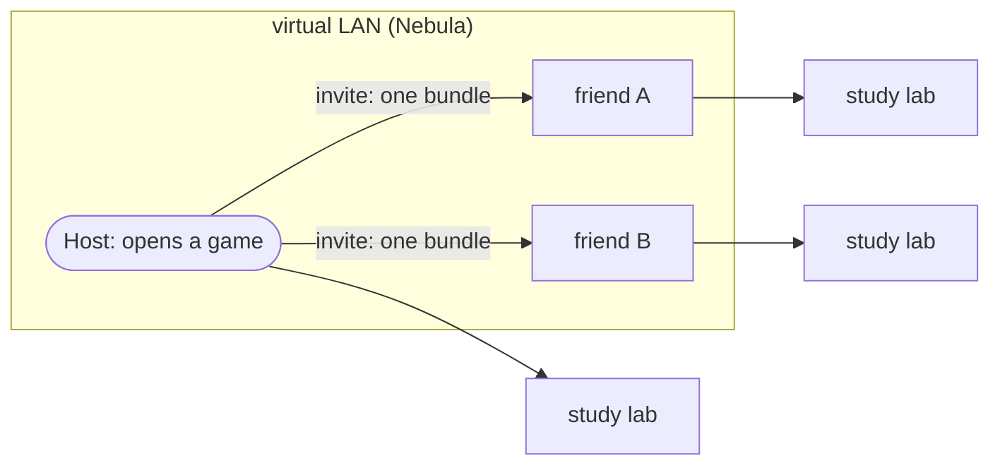

# k8s-lan-party

**Collaborative Kubernetes labs, like a LAN party: host a game, invite your friends, and everyone runs their study labs on the same virtual network.**

`MVP · phase 1: join` &nbsp;·&nbsp; public but early and not announced yet: no support promised &nbsp;·&nbsp; Apache-2.0 (placeholder, see [DESIGN](docs/DESIGN.md#11-open-decisions))

This is a way to **learn together**, not a compute marketplace and not a token. One person (the **host**) opens a lab cluster,
friends **join with one bundle and one command**, and everyone runs the labs from
[study.cybercirujas.club](https://study.cybercirujas.club) on the same network, even when they are in different houses.
Self-hosted end to end: our own CA, no SaaS.



| In a LAN game | Here |
| :--- | :--- |
| a game on a server | a lab cluster the host opens |
| server address and password | one bundle and one command |
| Hamachi / ZeroTier | Nebula, self-hosted |
| a public server with limited slots | admission: 2 places, 1 h each, a waiting list, approved by hand or by an automatic tick the host's timer runs ([ADMISSION.md](docs/ADMISSION.md)); the public request page later |

**The golden rule, in game terms:** *the game runs on your own PC, so you can see what runs on your own PC; keep private things
on your own machine.* Precisely: **what runs on someone else's machine can be seen by its owner**, so placement is by trust.
See [GOLDEN-RULES.md](docs/GOLDEN-RULES.md).

## Documentation, in reading order

1. This README: what it is and the quickest try.
2. [docs/DESIGN.md](docs/DESIGN.md): the design, the layers and the threat model ([GOLDEN-RULES.md](docs/GOLDEN-RULES.md) has the ten rules on one page).
3. [docs/HOST-YOUR-OWN.md](docs/HOST-YOUR-OWN.md): run your own lighthouse and control plane, create the CAs, invite friends or open a pool, place workloads by trust, revoke.
   Needs [docs/REQUIREMENTS.md](docs/REQUIREMENTS.md): hosts, sizes, kernels, pinned versions, ports.
4. [docs/JOIN.md](docs/JOIN.md): join with one bundle and one command, then verify.
5. [docs/TROUBLESHOOTING.md](docs/TROUBLESHOOTING.md): every problem the PoC hit, with symptom, cause, fix and the command that diagnoses it.
6. [docs/POC-STATUS.md](docs/POC-STATUS.md): what is proven and in which environment, the phase-1 gap table, what is still relaxed.
7. [docs/DEMO.md](docs/DEMO.md): the public demo: what is applied today (a lighthouse on a public server, a persistent control plane) and what is not (the automatic pool, the page, the opening).
8. [docs/ADMISSION.md](docs/ADMISSION.md): how other people get a place: manual approval with a waiting list and limits, and the automatic tick with its panic switch, events and metrics (built); the public request page and the opening (design).

## Three ways in

**Start here to try it on your own machine: [docs/TRY-IT.md](docs/TRY-IT.md)**, a tested recipe per platform (Incus VMs, Docker, kind, WSL2, a cloud VM, and mixes of them).

### 1. Try it locally (a simulation, about 4 minutes)

You need **Docker and `make`** (Linux, macOS with Docker Desktop, or WSL2). One command brings up a local CA, a lighthouse, a
control plane and two "outside" nodes, joins them, and runs a real study lab (CKA 1.1) on them:

```bash
git clone https://github.com/villadalmine/k8s-lan-party.git && cd k8s-lan-party
make poc-join       # PASS or FAIL per step; about 4 minutes
make poc-down       # remove everything
```

Expected output (the same every run):

```
PASS J01    Nebula: CA, lighthouse and control plane handshake
PASS J02    n1 joined with one bundle and one command, node Ready
PASS J03    n2 joined with one bundle and one command, node Ready
PASS J04    node InternalIP is the Nebula IP
PASS J05    n1 reaches n2 over Nebula
PASS J06    a pod on n2 reaches a pod on n1 across nodes
PASS J07    DNS inside a pod resolves cluster services
PASS J08    MTU: Nebula 1300, pod network 1250, a 1200-byte packet crosses the tunnel
PASS J09    study lab cka/1.1: break leaves the lab broken
PASS J10    study lab cka/1.1: verify says NOT solved yet, as it must
PASS J11    study lab cka/1.1: after the reference fix, verify says solved
PASS J12    the lab pod ran on a joined outside node, not on the control plane
PASS J13    narrowed Nebula firewall: ICMP and 6443 pass, an unlisted TCP port between hosts is refused
PASS J14    the host lists the players, which burns the used join token: a second machine presenting it is refused
PASS J15    an expired Nebula certificate is rejected
PASS J16    lighthouse unreachable (UDP blocked): the join fails clearly and names the port
PASS J17    revoke in one command: node deleted, cannot reach the lighthouse, does not come back
----
RESULT PASS
```

### 2. Join a game (the real mesh)

You need a **privileged Linux** (a VM, privileged Docker or WSL2), **outbound UDP** to the lighthouse, and the `nebula`
binary (at `/opt/nebula/nebula`) and `k3s` installed. Today the join command is the script [`poc/edge-mesh`](poc/edge-mesh).

1. **Get a bundle.** For now from the host of the game, privately (it holds your key and a join token of 8 minutes at most): ask for a place, the host puts you on the
   waiting list and approves you for one hour, by hand or with the automatic tick ([ADMISSION.md](docs/ADMISSION.md)). Later: a public page to ask for a
   place, or a signed pull request for regulars
   (*coming soon*, see [DESIGN](docs/DESIGN.md#51-who-may-join-and-how)).
2. **One command:**
   ```bash
   sudo ./poc/edge-mesh join ./bundle --accept-golden-rule
   ```
3. **Check you are in:** `ping 10.77.0.2` (the control plane) works from your machine, and the host sees your node Ready (`mesh host players`).
   Step by step, with the commands to install the tools: [docs/JOIN.md](docs/JOIN.md).
   **Your own namespace:** the bundle also carries a kubeconfig for `play-<you>`, valid for your lease: `sudo ./poc/edge-mesh kubectl get pods`
   ([JOIN.md](docs/JOIN.md#use-the-cluster-your-namespace-dell) lists its messages and exit codes).
4. **Run your study lab on it:** pick one in [study.cybercirujas.club](https://study.cybercirujas.club) (for example
   `cka/1.1`) and run its `break_fix.sh break`, fix it, then `verify`.
5. **Leave:** stop the agent and Nebula; the host can kick you with `mesh host kick <you>`: your certificate and your kubeconfig stop working and your namespace is deleted.

### 3. Host your own game

You need a Linux machine with privileges, a disk with room for the control plane (a healthy SSD), and **either** a UDP port the
lighthouse can be reached on **or** (recommended) a cheap VPS for the lighthouse, which also hides your home IP.

```bash
./poc/mesh host init                        # your CA, the lighthouse, the control plane (API only on the Nebula IP)
./poc/mesh host invite alice --ttl 2h           # a bundle: cert + config + an 8 min join token. Send it privately.
./poc/mesh host players                     # who is in: node, Ready, when the certificate expires
./poc/mesh host kick alice                  # cordon, drain, delete the node, blocklist the certificate
./poc/mesh host refresh cp                  # re-apply the Nebula config of a running machine (same certificate)
./poc/mesh host down                        # end the game: remove everything
```

Letting strangers in one hour at a time, with a waiting list and limits per person (`mesh host request / approve / reap`), or automatically from a
timer (`mesh host auto on`, then `mesh host auto --once` every minute; `mesh host panic` to stop it all): [docs/ADMISSION.md](docs/ADMISSION.md).

Today `mesh host` runs the host side in Docker or in Incus VMs on your machine (`export RUNTIME=incus` for VMs); a lighthouse on a public
server is `poc/lighthouse-vps.sh` ([HOST-YOUR-OWN: a public lighthouse](docs/HOST-YOUR-OWN.md#a-public-lighthouse-on-a-separate-server), tested by
`make poc-lighthouse` and applied on the maintainer's own server). Phase 1 is not complete: nobody can join a public pool yet. The full, tested walk-through (CAs, invite, join, placement,
revoke) is [docs/HOST-YOUR-OWN.md](docs/HOST-YOUR-OWN.md); the one-command revocation is `./poc/mesh host revoke <name>`.

The **CA key** is a file in your state directory (`.state/ca/ca.key` in the PoC). **Back it up**: if you lose it you must
re-issue every player. Try the whole host flow locally first: `make poc-host`.

## When it fails

| Symptom | Cause | Fix |
| :--- | :--- | :--- |
| `edge-mesh join` exits 5: "cannot reach the lighthouse ... UDP 4242" | UDP to the lighthouse is blocked (corporate firewall, hotel) | allow outbound UDP 4242 (the host's relay is reached over the same port, so it does not help here) |
| The handshake is refused: "certificate is in the block list" | the host kicked or revoked you | ask for a new invite |
| Nebula refuses your certificate as expired or not yet valid | the invite ran out, or your clock is wrong | check the time (NTP); ask for a new invite |
| The agent log says `unauthorized` | the join token expired, or a node already registered with it and the host burned it | ask for a new invite |
| `edge-mesh join` says no `/dev/net/tun` | the machine is not privileged | use a VM, `docker run --privileged`, or WSL2 |
| Big transfers hang but small ones work | MTU: the pod network is 1250 (Nebula 1300 minus 50) | do not override the MTU |
| Pods cannot resolve names | CoreDNS is not Ready yet | wait a minute, then `kubectl -n kube-system get pods` |
| `kubectl` cannot connect | the control plane is down or you are not on Nebula | check `nebula1` is up; ask the host |

More rows (and which ones each step tests) are in the [error matrix](docs/DESIGN.md#141-error-matrix).

## Roadmap

1. **It joins**, 2. **Cilium and WireGuard**, 4. **trust levels and placement by Kyverno**, 6. **mutual auth by policy**: proven in the PoC.
7. **Signed-PR regulars**: built and tested as a PoC ([participants/README.md](participants/README.md)); a first real participant is still to come.
Still to do: 3. per-namespace access, 5. the free 1 h pool (admission with manual approval and the automatic tick are built, [ADMISSION.md](docs/ADMISSION.md);
the public request page and the opening are design only).
8. **Public servers** (*coming soon*), after the private game works. Details: [DESIGN.md](docs/DESIGN.md#12-build-order-steps-one-layer-at-a-time).

## How it differs from other projects

WireGuard overlays for Kubernetes ([Kilo](https://github.com/squat/kilo), [WireKube](https://github.com/inerplat/wirekube)),
k3s's Tailscale integration, Liqo and compute marketplaces solve neighbouring problems; this one is for learning together, in
one command, self-hosted, with a trust rule. See [REFERENCES.md](docs/REFERENCES.md).

## Contributing

[CONTRIBUTING.md](CONTRIBUTING.md): sign your commits (DCO), declare AI help (welcome if declared), one concern per PR.
Questions and ideas: Issues and Discussions. Security: [SECURITY.md](SECURITY.md). The labs come from
[study.cybercirujas.club](https://study.cybercirujas.club).
