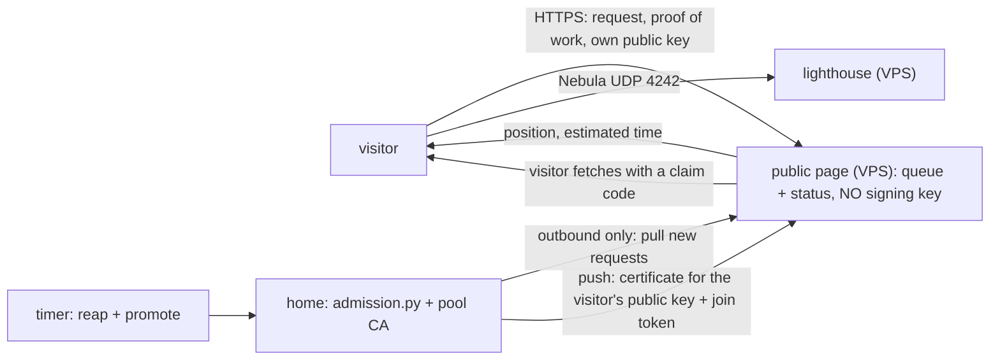

# Admission: how other people get a place in the mesh

**Status (2026-10-27).** **Option A (manual approval) is built and tested**: unit tests with a simulated clock and `make poc-admission` on Incus VMs.
**Option B (automatic, public) is design only**: nothing of section B exists. Phase 1 is still not complete (the gap table in
[POC-STATUS.md](POC-STATUS.md)); the cluster side of the pool (quotas, idle kick, the page) is issue #11, which stays open until B exists.

The maintainer decided on 2026-10-27: **start with A** (a human approves every place) and keep a written path to **B** (a public, automatic pool).
The numbers are parameters in [`poc/pool.yaml`](../poc/pool.yaml), not code: changing a limit is a one-line change there.

## The maintainer's rules, as we read them

> Two places at a time, one hour each. Whoever comes next waits in a first-come, first-served list. When an hour ends the place is freed and the
> next one in the list may enter. At most two hours a day per person, so it is not always the same one, and a pause between two hours of the same
> person. Some way to detect people "by IP or something" so everybody gets a chance.

How that became parameters (**the maintainer corrects this table, not the code**):

| Rule | Our reading | Parameter |
| :--- | :--- | :--- |
| two places at a time | at most 2 participant nodes with an active lease | `slots: 2` |
| one hour each | the lease, the certificate lifetime and the moment `reap` expels are the same hour, starting at the approval | `lease_seconds: 3600` |
| a list, in order | FIFO by the time of the request; `approve` without a name takes the first one that is **eligible now** (someone in cooldown keeps their place but is skipped) | none (the order is the rule) |
| at most two a day per person | at most 2 leases per identity in **any 24 hours** (rolling window, see below) | `daily_leases_per_identity: 2` |
| a pause between two | one hour after a lease ends before the same identity may get the next one | `cooldown_seconds: 3600` |
| "by IP or something" | an identity is the visitor's IP, normalized (below); with no IP, the name | `identity_ipv4_prefix: 32`, `identity_ipv6_prefix: 64` |

**Why a rolling 24 h window and not the calendar day.** With a calendar day (UTC) someone can take two hours just before midnight and two more just
after it: four hours in a row, exactly what the rule wants to avoid. A rolling window has no reset to game, needs no time zone, and "when can I come
back" has one exact answer: when the oldest of the last two leases is 24 hours old. A test fixes it (`test_rolling_not_calendar_day`).

**What an identity is.** One opaque string per person, computed by `pool.identity()`:

| Visitor address | Identity | Why |
| :--- | :--- | :--- |
| IPv4 `203.0.113.7` | `203.0.113.7` (`identity_ipv4_prefix: 32`) or `203.0.113.0/24` (`24`) | 32 for option A (a human looks anyway); 24 when the pool opens, because one person can easily get several addresses of one /24 |
| IPv6 `2001:db8:1:2::77` | `2001:db8:1:2::/64` | a home usually gets at least a /64: counting single IPv6 addresses would be free to dodge |
| IPv4-mapped IPv6 `::ffff:203.0.113.7` | `203.0.113.7` | the same client seen through a dual-stack socket |
| none (the request was typed by hand) | `name:<name>` | option A only: the maintainer is the identity check |
| behind the reverse proxy | the client from `X-Forwarded-For`, **only when the socket peer is in `trusted_proxies`**; from anyone else the header is ignored | anyone can send the header |

Names are checked in full against `[a-z][a-z0-9-]{1,19}` (they become the node name, the certificate name and a directory), `lh`, `cp`, `n1`, `n2` are
reserved, and a name is used once (as with `mesh host invite`).

## A. Manual approval (built)

```mermaid
sequenceDiagram
  autonumber
  participant V as visitor
  participant H as host (mesh host ...)
  participant L as ledger (admission/state.json)
  participant C as cluster (CA, k3s, Nebula)
  V->>H: "can I join?" (any channel: chat, mail, a form)
  H->>L: request alice --ip 198.51.100.10
  L-->>H: waiting, position 1 of 3 (or: deferred until 15:00 UTC, cooldown)
  H->>L: approve
  L->>L: a place free? alice eligible? (pool.py)
  L->>C: mesh host invite alice --ttl 3600s --trust public (join token 8 min at most)
  L-->>H: approved alice until 16:02 UTC; bundle: .state/bundles/alice
  H->>V: the bundle, privately
  V->>C: edge-mesh join ./bundle --accept-golden-rule
  Note over H,C: one hour later
  H->>L: reap (by hand, or a timer)
  L->>C: mesh host kick alice (cordon, drain, blocklist, delete node)
  L-->>H: reaped 1; the place is free for the next one
```

### The commands

Every command runs from the repository's `poc/` directory (`./mesh host --help` lists them). The state is
`poc/.state/admission/state.json`; `POOL_CONFIG=<file>` points at another `pool.yaml`.

```bash
./mesh host request alice --ip 198.51.100.10 --note "from the study chat"   # waiting, position 1 of 1 [added]
./mesh host request bob                                                      # no IP known: the identity is the name
./mesh host waitlist                       # POS NAME STATE ELIGIBLE IDENTITY NOTE (waiting = eligible now, deferred = not yet)
./mesh host approve                        # the first eligible one; or: ./mesh host approve bob --trust friends
./mesh host leases                         # NAME TRUST ENDS LEFT IDENTITY
./mesh host reject bob --reason "asked twice"
./mesh host reap                           # expel every lease that ended; again: "reaped 0"
./mesh host admission-status               # admission: slots 1/2 used | 1 in the list (1 eligible now) | next to end: alice in 41m10s
```

| Command | What it does | Exit codes |
| :--- | :--- | :--- |
| `request <name> [--ip IP] [--note TEXT]` | adds the person to the list; prints the position, or when they become eligible and why (`cooldown`, `daily-cap`, `active-lease`). The same name and identity again: the same position. Another name from an identity already in the list: not added | 2 bad name or IP, 3 name already used |
| `waitlist` | the list in order | |
| `approve [<name>] [--trust public\|friends]` | checks a place is free and the identity is eligible (pool.py), runs `mesh host invite <name> --ttl <lease>s` (join token: `TOKEN_TTL`, 8 min at most; over that `approve` refuses, exit 2), records the lease; prints the bundle path and the end time. If the invite fails nothing is recorded | 3 not in the list, 4 nobody eligible (prints who is next and when), 5 no free place (prints which lease ends next), 6 that person is not eligible yet |
| `reject <name> [--reason]` | takes a request off the list (idempotent) | 3 |
| `leases` | active leases with the time left | |
| `reap [--all \| --name N]` | first `mesh host burn` (the join token of every registered node); then for every lease that ended (or all, or one, now): `mesh host kick`, which takes the name off the node guard and sweeps every Node not named after a live bundle, then cooldown, place freed, request `expired`, history kept. A kick that fails, or anything left to sweep, keeps the lease (and its place) for the next run | 1 a kick failed or a Node is left (the others are recorded), 3 `--name` has no active lease |
| `admission-status` | one line for a bot or a status page | |

`--trust public` (the default) signs with the **pool CA**, which can only mint `public` certificates; `--trust friends` signs with the persistent CA.

### Who sees what

| Actor | Sees | Does not see |
| :--- | :--- | :--- |
| visitor | their position or the time they become eligible (told by the host), then their bundle and their node | the list, other people's identities |
| host | the list with identities and notes, the leases, the history | |
| the cluster | a node with the trust label and taint of its level; the golden rule places only shareable workloads on it | who was in the list |

### Where the state is, and what it promises

- `poc/.state/admission/state.json`: the requests (`id`, `name`, `identity`, `note`, `ts`, `state` = `waiting|deferred|approved|rejected|expired`), the
  active leases (`name`, `trust`, `start`, `end`, `ip` = the identity, `bundle`) and the history of ended leases, which feeds the daily cap.
- Every command takes an **exclusive lock** (`poc/.state/admission/lock`: `fcntl.flock` on Linux and macOS, `msvcrt.locking` on Windows) and writes
  the file **atomically** (temporary file, `fsync`, rename): two commands at the same moment never lose a request (a unit test runs 12 at once).
  A command that fails writes nothing, except `reap`, which records the kicks that succeeded and keeps a lease whose kick failed for the next run.
  A corrupt `state.json` is reported (exit 1) and left untouched: restore it from the backup.
- **Retention.** It holds visitors' IP addresses, which are personal data: kept only on the host, never published, and forgotten on a schedule.
  Before every write the ledger drops what no rule needs any more: daily-cap times older than 24 h, cooldowns that ended, request-rate times
  older than the rate window. A lease or request that closed more than `identity_retention_seconds` ago (25 h: the 24 h window plus the cooldown;
  the code never goes below either) keeps its name and times (a name is used once) but loses the identity, the note and the reason. Open requests
  and active leases keep theirs. A unit test with the simulated clock checks that no expired identity is left (`RetentionTest`).

### How someone is expelled

`reap` is the one way, by hand or from a timer (`* * * * * cd <repo>/poc && RUNTIME=incus ./mesh host reap`). **Every minute is a security
requirement, not a convenience:** `reap` also burns join tokens and rewrites the node guard (see "the life of a name" below). First it runs `mesh host burn`; then for each ended lease
it runs `mesh host kick <name>`: cordon, drain, the certificate fingerprint on the Nebula blocklist of every host (and the external lighthouse when it
is reachable), delete the node, take its name off the **node guard**, and **sweep every Node that is not named after a live bundle** (below), and
wait until nothing is left to sweep: if something is still there after 30 s, the API does not answer or the bundle has no `NODE_IP`, `kick` fails
(exit 4), `reap` keeps the lease and its place and tries again on its next run.

**Copies of a bundle.** A copy of a bundle started on a second machine (before its join token was burned) chooses its own node name and addresses: a
plain `k3s agent` reports its LAN address, or two addresses. Neither is evidence, so nothing keys on them alone. The keys are what the visitor cannot
choose, the bundles the host issued:
- **the node guard** (`poc/node-guard.yaml`, a ValidatingAdmissionPolicy on `nodes` and `nodes/status` for kubelets only): a Node may be registered or
  updated only under the name of a bundle that is issued and not revoked, and only with that bundle's Nebula IP as its InternalIP (every InternalIP is
  checked). Its list is the ConfigMap `kube-system/edge-mesh-nodes`, rewritten under a lock by `mesh host invite`, `revoke` and every `reap` (`mesh
  host burn`): it holds the live bundles that have a Node, or whose join token still works. A copy under its own name, or under an issued name with
  another address, is refused at registration (`poc-admission` A15, a copy with a LAN and an IPv6 address);
- **the node password** (`poc/node_password.py`): when it issues a bundle the host makes a random password for that name, stores its hash where k3s
  keeps node passwords (`kube-system/<name>.node-password.k3s`, k3s's own scrypt format) and puts the password in the bundle (`NODE_PASSWORD`, which
  `edge-mesh join` writes to `/etc/rancher/node/password`). k3s registers a name only with its password, so another visitor, with a valid token of his
  own and the other bundle's Nebula IP on a dummy interface, cannot take an issued name that has no Node yet (A16), and its owner still joins (A18);
- **the life of a name with no Node yet**, so that the node password always outlives the name's place on the guard: k3s garbage-collects a node
  password that no Node took once it is 10 minutes old (checked every minute), and from then on anybody with a working token of his own could take
  the name with his own password. So the guard admits such a name only while its join token works **and** its node password secret exists, a join
  token lives **at most 8 minutes** (`TOKEN_TTL` over 8 minutes is refused by `issue.sh` and by `approve`, before anything is made), and every
  `reap` (the timer, every minute), `players`, `invite` and `revoke` rewrite the guard. An unused name leaves the guard at most one `reap` after its
  token dies, before k3s may drop its password; a name whose password is gone leaves at the next `reap` whatever its token says (A17). **This needs
  the `reap` timer** (option A needs it anyway for the leases): without any `reap`, `players`, `invite` or `revoke` for over 10 minutes after an invite,
  an issued name that nobody took would stay on the guard after k3s dropped its password. That residual is known and of low risk (it needs a name
  issued but not joined for over 10 minutes, another visitor with a working token at that moment, and no `mesh host` command in between), and
  `invite` prints a note when nothing rewrote the guard in the last 90 seconds;
- **the sweep** (`poc/nodes_sweep.py`, run by `revoke`, so by `kick` and `reap`): every Node not named after a live bundle goes, and so does a
  live-named one that reports the revoked bundle's address, or not its own. It covers what the guard did not see (a Node registered before the guard
  existed).

So a Node name belongs to the one bundle that carries its password; a copy of a bundle can at most register again under that bundle's own name,
which is the same visitor. The blocklist cuts the copy's tunnel with the lease (`poc-admission` A30: started again after the kick, the copy cannot
reach the API). The certificate expires at the same hour anyway (`disconnect_invalid: true` closes the tunnel), so a host that forgets
`reap` still loses the node; `reap` is what frees the place and starts the cooldown. **Early end:** `reap --name <name>`. **Abuse switch:** set
`slots: 0` (no new approvals) and run `reap --all`.

### Limits of option A

- The host is the anti-bot: one human looks at every request. It does not scale, and that is the point.
- An identity typed by hand is whatever the host types: two people behind one carrier NAT share one IPv4 identity, and the host decides.
- The lease starts at the approval, not at the join: a bundle that takes 40 minutes to reach the visitor leaves them 20.
- **The join token is not one-time by itself.** A k3s bootstrap token authenticates any machine until it expires or is deleted. The host burns it once
  the node registered (`mesh host burn`, run by `reap`, `players` and `revoke`), so it is valid until **the first `reap` after the node registered, or
  8 minutes (`TOKEN_TTL`, at most 8m), whichever comes first**; with `reap` every minute that is about a minute. In that window a second machine with a copy of the bundle
  can talk to the API, but the node guard refuses a Node under any name that is not an issued bundle's, and k3s refuses an issued name without that
  bundle's node password (see "Copies of a bundle" above; A15-A18). The next `reap` burns the token, so after it no copy gets that far (A11-A12); the kick at the end of the lease sweeps
  whatever is left and the blocklist cuts the copy's tunnel (A29-A30). **Why 8 minutes at most:** the token is the only part of the bundle a second machine can
  reuse, so it lives as little as a hand delivery allows: the visitor installs the tools first ([JOIN.md](JOIN.md)) and asks for approval when
  ready (`TOKEN_TTL` may be shorter, `5m`, never longer: see "the life of a name" above).
- Not built (issue #11): per-namespace quotas and LimitRange for visitors, the idle kick, the page.

### Proof

| Check | Where |
| :--- | :--- |
| the sweep keyed on bundle names (dual-stack, LAN-address and impostor Nodes), `revoke` exit 4 when a Node stays, the API does not answer or `NODE_IP` is missing (stubbed `kubectl`); FIFO, slots, daily cap (rolling), cooldown, retention (no expired identity left), a taken name skipped, notes without control characters, a corrupt ledger left untouched, identity normalization, `X-Forwarded-For` only from a trusted proxy, invalid names, `reap` idempotent, `approve` with nobody eligible, a failed invite records nothing, 12 concurrent writers | `make test` (`poc/test_pool.py`, `poc/test_admission.py`), no Docker |
| request, approve, join, Ready, `reap` burns the join token and a second machine presenting it is refused, a non-cooperative copy of a bundle (plain `k3s agent`, LAN and IPv6 addresses) is refused by the node guard, a guest who takes another guest's issued name at its Nebula IP is refused by the node password and the owner still joins, a name whose node password k3s dropped leaves the guard, the copy's tunnel is cut with the lease, places full, the lease ends, `reap` expels (node gone, fingerprint on the blocklist), the next one in line enters, `reap --all` | `make poc-admission` (A01-A31), Incus VMs; the lease is shortened by `ADM_LEASE` (default 1800 s) |

## B. Evolution to a public, automatic pool (design only)

> **Nothing in this section is built.** Each step is a separate change that keeps A working, has its own test, and is applied only with the
> maintainer's OK. The order matters: never automate approval (B3) before the anti-bot layers (B2) exist.



### B1. A public page: the list, the position and an estimate

- **What changes:** a small page on the public server shows the free places, the length of the list and, after a request, the position and an
  estimated time (`position / slots * lease`, corrected by the leases' real end times). `admission-status` already prints the line it needs.
- **Credentials: the page holds none.** Two designs were weighed:

  | | the home pulls from a queue (**chosen**) | the public server signs with a request key of minimal scope |
  | :--- | :--- | :--- |
  | what lives on the internet-facing machine | requests and status only | a signing key (even a pool CA limited to `public`) |
  | if that machine is taken over | an attacker can spam or empty the queue (a denial of service) | an attacker can mint `public` certificates for as many machines as they like, bypassing every limit, until the pool CA is dropped |
  | home network | outbound connections only, nothing new is opened | nothing at home, but the key is on the VPS |

  The pull model also fixes the bundle's secrecy: the visitor makes their own Nebula key (`nebula-cert keygen`, or the page does it in the browser)
  and sends only the **public** key. The home signs it with `IN_PUB` (already in `issue.sh`, used for the lighthouse), so the bundle that travels back
  through the public server has **no private key**. The join token does travel; it lives 8 minutes at most, is burned once the node registers, and is useless
  without the private key (the API only answers on the Nebula IP). The visitor fetches the result with a random claim code shown only to them; the server
  stores its hash.
- **Test:** the page answers with the same numbers as `admission-status`; the server's disk holds no `*.key`.

### B2. Anti-bot and fairness, in layers (each with its honest limit)

| Layer | What it does | What it does not stop |
| :--- | :--- | :--- |
| identity caps | `identity_ipv4_prefix: 24`, IPv6 /64, behind a trusted proxy only; the per-identity request rate limit (`rate_window_seconds`, `rate_max_requests`, already in pool.py) | many honest people behind one carrier NAT share one identity; a VPN or residential proxies give many identities |
| self-hosted proof of work | before a request is taken the browser solves a small puzzle (ALTCHA/hashcash style: the server hands out a random challenge signed with an HMAC and a difficulty; the client finds `n` so that `sha256(challenge + n)` starts with enough zero bits; the server checks it with Python's `hashlib` and `hmac`). No third-party service, no tracking | it costs a bot CPU seconds, not a wall: a patient bot pays and gets in |
| optional GitHub lane | sign in with GitHub (OAuth), accounts older than a minimum age (for example 90 days), the cap counted **per account**; DESIGN.md section 8 already sketches it | someone with several old accounts; it needs an OAuth app (the maintainer's step) |
| cooldown and daily cap | `cooldown_seconds`, `daily_leases_per_identity` (built) | identities that rotate |
| "fresh first" queue | a request from an identity that had a lease in the last 24 h goes **behind** everybody who has not had one; only then FIFO | nothing on its own; it shares out what the other layers let through |

**What none of this solves, and what we would do then.** Carrier-grade NAT (honest people blocked by a neighbour's use), VPNs and residential proxies
(one person, many identities), and patient bots (they pay the proof of work and wait their turn). The answers are blunt on purpose: **a global daily
cap** (at most N leases a day in total, so abuse has a ceiling), **manual approval for part of the places** (for example one of the two places stays A),
a higher proof-of-work difficulty, or the GitHub lane only. The pool's isolation still holds whatever gets through: a `public` node gets only
shareable workloads, its certificate dies in an hour, and the pool CA can sign nothing but `public`.

### B3. Automatic approval within the limits

- **What changes:** `admission.py approve` runs without a human for requests that passed B2: same checks, same exit codes. The home's puller calls it
  for the first eligible request whenever `slots_free > 0`.
- **Test:** with fake requests, every rule of the unit tests still holds; a request that fails B2 never reaches `approve`.

### B4. A timer that reaps and promotes: "the hour ends and the next one enters"

- **What changes:** a systemd timer (every minute) runs `mesh host reap`, then `approve` while there is a free place and an eligible request; the
  page shows the new position of everybody. That is the rule "when an hour ends the place is freed and the next one enters", without a human.
- **Test:** `make poc-admission` with the timer instead of the manual calls; the next one in line gets a bundle within a minute of the end.

### B5. The abuse switch, practised

- `slots: 0` plus `mesh host reap --all` (built in A); in B also: the page says "closed", the puller stops, and as the last resort the pool CA is
  dropped from the trust bundle (`poc-ca.sh` proves only the pool goes down). Practise it before announcing.

### B6. Prerequisites for opening it to the public

All of these, each the maintainer's explicit decision:

- [ ] the repository is public (the maintainer's "open it");
- [ ] issue #9: per-namespace RBAC and a kubeconfig per visitor (today a visitor has a node, not a namespace);
- [ ] issue #12: signed-PR participants, so the regulars are not in the free pool;
- [ ] issue #13: the gateway and BGP only on own nodes;
- [ ] issue #15: the relay for symmetric NAT (otherwise part of the visitors cannot join at all);
- [ ] issue #16: the go-public checklist in [DEMO.md](DEMO.md);
- [ ] issue #11: quotas, LimitRange and the idle kick for the pool (this document's B1-B5 close the rest of it).

## Parameters

All in [`poc/pool.yaml`](../poc/pool.yaml) except the token lifetime (an environment variable).

| Parameter | Value now | Meaning | Who decides |
| :--- | :--- | :--- | :--- |
| `slots` | 2 | places at the same time; 0 closes admission | maintainer |
| `lease_seconds` | 3600 | one lease, the certificate lifetime, when `reap` expels | maintainer |
| `cooldown_seconds` | 3600 | pause after a lease before the same identity's next one | maintainer (our reading of "a pause") |
| `daily_leases_per_identity` | 2 | leases per identity in any 24 h (rolling) | maintainer |
| `identity_ipv4_prefix` | 32 | 32 = one address; 24 = the whole /24 (planned for B) | maintainer |
| `identity_ipv6_prefix` | 64 | an IPv6 /64 is one identity | maintainer |
| `rate_window_seconds`, `rate_max_requests` | 600, 5 | request rate per identity (used by the automatic pool, B) | maintainer |
| `trusted_proxies` | the reverse proxy's addresses | who may set `X-Forwarded-For` | whoever runs the border |
| `idle_kick_seconds` | 900 | early eviction of an idle node (not built, #11) | maintainer |
| `TOKEN_TTL` (environment) | 8m (1 to 8 minutes; more is refused) | lifetime of the k3s join token (burned earlier, once the node registers); it must die before k3s may drop the node password of an unused name | code (the cap) and host (shorter) |
| `identity_retention_seconds` | 90000 (25 h) | how long an identity is kept after its lease or request closed; never below 24 h or the cooldown | maintainer |
| `ADM_LEASE` (environment, test only) | 1800 | the shortened lease of `make poc-admission` | test |
