# The host console: one local API, the CLI and a web console as its clients

Status: **RFC of [#85](https://github.com/villadalmine/k8s-lan-party/issues/85)** (milestone v0.4.0): proposed in PR #94, decided when it
merges and the decision is recorded in #85. **Built so far: #86**, the daemon on the unix socket (role `local`) and every read
(`mesh host console`, `poc/console/server.py`, `poc/console/actions.py`, the unit in `poc/console/deploy/`); `POST /api/v1/actions/{verb}`
answers 501 until #87. The pieces are [#86](https://github.com/villadalmine/k8s-lan-party/issues/86) (the daemon and its reads),
[#87](https://github.com/villadalmine/k8s-lan-party/issues/87) (mutations, confirmation, jobs, audit),
[#88](https://github.com/villadalmine/k8s-lan-party/issues/88) (the CLI as a client),
[#89](https://github.com/villadalmine/k8s-lan-party/issues/89) (the web console) and
[#90](https://github.com/villadalmine/k8s-lan-party/issues/90) (docs, learn mode, What's new). The draft of the API is
[`poc/console/openapi.json`](../poc/console/openapi.json); `tests/test_console_spec.py` keeps it and the tables below in step.

## Why

Every operator action on the control plane is a `mesh host` verb today: shell in `poc/mesh`, Python in `poc/admission.py` and `poc/party.py`.
That works for one person at a terminal. A web console, and later the chat bot of [#50](https://github.com/villadalmine/k8s-lan-party/issues/50),
need **one door with the same rules, the same authentication and the same audit**, instead of each wrapping the shell its own way.

So: one small local API in front of the engine. The CLI stays, with the same commands and exit codes, and becomes one client of that API;
the web console is the second; the bot will be the third. The API adds no behaviour of its own: it runs the engine, and only from a fixed list.

## What it is, and what it is not

- **One daemon, `poc/console/server.py`, Python standard library only**, like `poc/page/page.py` (no new core dependency, CONTRIBUTING.md). It
  imports page.py's security headers and strict body rules instead of writing them again.
- **It runs the engine, never reimplements it.** Each mutation is `poc/mesh host ...` started as an argument list (no shell), with
  `EMESH_DIRECT=1`, from a fixed **action registry** (`poc/console/actions.py`, mirrored in `x-actions` of `openapi.json`). The CLI stays the
  single source of behaviour: a fix in the engine is a fix for every client.
- **Local only.** A unix socket for the host's own user, and an optional web listener on the **loopback** and nowhere else. The control plane
  shares the Nebula network with strangers (the pool's players), so the server refuses any other address, the Nebula IP included. From another
  machine the way in is an SSH tunnel to the host. It is **never public, and never on the page server** (docs/PUBLIC-PAGE.md): the public page
  stays the only thing on the internet, and it still holds no credential.
- **Not a Kubernetes dashboard.** It shows the game (queue, leases, players, parties, events), not cluster objects, and it holds no kubeconfig
  of its own: only the engine calls `kubectl`, as it does today.
- **Not in the safety path.** The tick timer keeps calling the engine directly, so lease expiry never depends on the daemon; `mesh host
  panic` from the CLI **always** runs the engine directly, never through the API; and through the API `panic` never waits behind another
  job (below, "Jobs, locks and timeouts").
- **One environment.** Once the CLI forwards to the daemon (#88), the engine runs with the daemon's environment (its systemd unit:
  `POOL_CONFIG`, `TOKEN_TTL`, `REVOKE_WAIT`, `ADMISSION_NOTIFY_*`; and what `poc/lib.sh` reads from `$STATE`, such as `LH_RSH` in
  `$STATE/lighthouse.env`), not the operator's shell's: the client sends argv only. A
  variable set in the shell for one command then needs `EMESH_DIRECT=1` on that command; #88 lists the variables in the unit.
- **The CA never moves.** The persistent CA key stays in `.state/ca/`, and no request from the web (role `console`) can make it sign.



*Diagram ([source](diagrams/console.mmd)): the CLI talks to the socket, the browser to the loopback through an SSH tunnel; the API runs
registry verbs through the engine and reads the state directly; the timer never goes through the API.*

## Roles and transport

| Role | How a client gets it | Can run | Never |
| :--- | :--- | :--- | :--- |
| `local` | the unix socket `$STATE/console/api.sock` (or `EMESH_CONSOLE_SOCK`), in a 0700 directory, and the peer's uid (`SO_PEERCRED`) equal to the daemon's | the whole registry | what is not in the registry (below) |
| `console` | `127.0.0.1:8090` (or `[::1]`), `Authorization: Bearer <token>` | the registry minus the verbs marked local only | `approve --trust friends`, `invite`, `bundle`, `refresh` (the persistent CA, a private key, a running machine's config); init, down, lighthouse, page server, participants |

The chat bot of #50 will be a `console` client with a token of its own; whether it gets a narrower role is decided there.

**The socket.** A unix socket path has at most 107 bytes. With `EMESH_STATE` deep in a home directory `$STATE/console/api.sock` can be
longer: the daemon then refuses to start (exit 2) and says to set `EMESH_CONSOLE_SOCK` (for example under `$XDG_RUNTIME_DIR`, which is 0700
and the user's own); the CLI reads the same variable.

**The web listener.** `mesh host console --web 127.0.0.1:8090`. The address must be a loopback address (`127.0.0.0/8` or `::1`); `0.0.0.0`,
`::`, the Nebula IP, a LAN address or a name that resolves to one of them are refused at start (exit 2). The bearer token is 32 random bytes
(base64url); the daemon keeps only its SHA-256 in `$STATE/console/web.token.sha256` (0600) and compares with `hmac.compare_digest`.

The token's life: `mesh host console url` makes a new token (the old one dies at once) and prints it **once**, in a link
`http://127.0.0.1:8090/#t=<token>`. "One-time" means the link: the token itself is a bearer token, valid until the next `url`,
`rotate-token` or a restart of the daemon (a restart forgets nothing on disk but the daemon can no longer print it, so a new `url` is needed
anyway). The fragment never reaches a server log or a `Referer`; the page moves the token into `sessionStorage` (a reload of the tab keeps
working, closing the tab forgets it) and removes it from the address bar. `mesh host console rotate-token` kills it without a new link. The
token never reaches the engine: not in its argv, not in its environment.

Bad tokens: only a **wrong** token counts (a request with no `Authorization` header is a plain 401 and counts nothing, so a page that merely
points at the loopback cannot lock the operator out). 10 wrong tokens in 10 minutes give 429 on the web listener for 10 minutes, the right
token too; the socket is not affected, so `mesh host console rotate-token` always works.

**From another machine** (the recipe, with a screenshot, lands with #89):

```sh
ssh -N -L 8090:127.0.0.1:8090 you@your-host          # the tunnel: nothing new is opened on the host
ssh you@your-host 'cd <the clone>/poc && ./mesh host console url'    # then open the printed link on your machine
```

## The verbs: what each one does to the state, and how the API treats it

Every `mesh` verb is in this table, also the ones that never go through the API. **Reads** are GETs; **mutations** are
`POST /api/v1/actions/{verb}`; *confirm* is how a mutation is confirmed (below). `mesh party ... --as` and `mesh play` are the local
simulation of a player's machine, not host actions.

| `mesh` verb | Today | Danger | API | Confirm | Roles |
| :--- | :--- | :--- | :--- | :--- | :--- |
| `host admission-status` | read | | `GET /status` (`status --json`, exists) | | local, console |
| `host waitlist` | read | | `GET /requests` (`--json`: #86) | | local, console |
| `host leases` | read | | `GET /leases` (`--json`: #86) | | local, console |
| `host players` | **mutates**: burns the join token of every registered node and rewrites the node guard (`poc/mesh`, `host players`) | | `GET /players` from a pure-read `players --json --read-only` (#86); the burn stays in `burn` and the tick | | local, console |
| `host activity <name>` | read | | `GET /players/{name}/activity` | | local, console |
| `host party list` | **mutates**: reconciles first (`poc/party.py`, `list` runs `reconcile`) | | `GET /parties` from a pure-read `party list --json --read-only` (#86) | | local, console |
| `host admission-metrics` | read | | `GET /metrics` (text) | | local, console |
| (events.jsonl) | read | | `GET /events` | | local, console |
| (audit.jsonl) | read | | `GET /audit` | | local, console |
| `host request <name>` | mutates | low | `request` | none | local, console |
| `host reject <name>` | mutates | low | `reject` | none | local, console |
| `host approve [<name>] --trust public` | mutates, signs with the pool CA | high: a stranger joins | `approve` | click | local, console |
| `host approve ... --trust friends` | mutates, signs with the **persistent CA** | high | `approve` with `trust: friends` (`x-actions`: `arg_roles`) | click | local |
| `host auto --once` | mutates (the tick) | low: what the timer does every minute | `tick` | none | local, console |
| `host auto on` | mutates | high: approvals without a human | `auto-on` | click | local, console |
| `host auto off` | mutates | none: closing is always safe | `auto-off` | none | local, console |
| `host auto status` | read | | in `GET /status` | | local, console |
| `host panic` | mutates | high, but its point is speed | `panic` | click | local, console |
| `host panic --clear` | mutates | high: reopens admission | `panic-clear` | click | local, console |
| `host burn` | mutates | low | `burn` | none | local, console |
| `host reap` | mutates: only leases that ended | low: what the tick does | `reap` | none | local, console |
| `host reap --all` | mutates | high: everyone out now | `reap-all` | type `all` | local, console |
| `host reap --name N` | mutates | high | `reap-one` | type the name | local, console |
| `host kick <name>` | mutates | high | `kick` | type the name | local, console |
| `host revoke <name>` | mutates | high | `revoke` | type the name | local, console |
| `host party reconcile` | mutates | low: what the tick does | `party-reconcile` | none | local, console |
| `host party end <a> <b>` | mutates | medium | `party-end` | click | local, console |
| `host invite <name>` | mutates, signs (persistent CA for `friends`), writes a private key | high | `invite` | none (local only) | local |
| `host bundle <name>` | writes a tarball with the player's key | high | `bundle` | none (local only) | local |
| `host refresh <name>` | rewrites and applies a running machine's Nebula config (`lh`, `cp` too) | high | `refresh` | none (local only) | local |
| `host init` | creates the CA, the lighthouse, the control plane | | **never**: the daemon lives in the state it creates | | |
| `host down` | removes everything, the state too | | **never**: it would delete the daemon's own socket and audit | | |
| `play`, `party ... --as` | local simulation | | **never** | | |
| `host console [--web ADDR]` (new, #86) | runs the daemon | | **never**: it is the daemon | | |
| `host console url`, `host console rotate-token` (new, #89) | write the web token's hash | | **never**: only on the host, direct, so a stolen token cannot mint the next one | | |

Also never through the API: `poc/lighthouse-vps.sh` and `poc/page/page-server.sh` (they hold ssh commands to other servers),
`poc/participants.py sync` (the persistent CA and the signed participant files), `poc/issue.sh`, `poc/up.sh` and `poc/down.sh`.

## The API

REST and JSON under `/api/v1`, described by [`poc/console/openapi.json`](../poc/console/openapi.json) (OpenAPI 3.1). The same routes answer on
the socket and on the loopback; only the role differs.

| Route | What |
| :--- | :--- |
| `GET /api/v1/health` | the daemon answers, its version and the caller's role; calls no engine |
| `GET /api/v1/status` | places used and total, waiting, eligible now, next to end, auto, panic, last tick |
| `GET /api/v1/requests`, `/leases`, `/players`, `/players/{name}/activity`, `/parties` | the lists, from pure reads |
| `GET /api/v1/events?since=&limit=`, `GET /api/v1/audit?limit=` | the last lines of each log (at most 500) |
| `GET /api/v1/metrics` | the admission metrics, Prometheus text, no identities |
| `GET /api/v1/actions` | the registry entries the caller's role may run: verb, params, confirmation, timeout |
| `POST /api/v1/actions/{verb}` | `{"args": {...}}`: starts a job (202), or answers with a plan to confirm (200) |
| `GET /api/v1/jobs/{id}` | a job: running, done, failed or timeout; the engine's exit code; its output, redacted |

**Strict requests.** page.py's rules: `Content-Length` required (411), at most 4 KB (413), `application/json` only (415), no duplicate keys,
no NaN, no deep nesting. `args` must have exactly the verb's parameters, of the right type; names match `[a-z][a-z0-9-]{1,19}` (the rule of
`admission.py` and `mesh host invite`); free text (`note`, `reason`) is capped and has no control characters. Anything else is 400, and the
engine is not called. The engine then checks everything again, as it does for the CLI.

**Reads never write.** A GET reads `admission/state.json`, `auto.json` and the logs itself, or runs an engine read that is pure. Two verbs are
not pure today (`host players` and `host party list`, in the table): #86 adds `--read-only` modes, and a test with a recording fake engine
fails if a GET changes a file or runs a mutating `kubectl`.

**Errors** are `{"error": "<code>", "message": "<sentence>"}`. 401 no or wrong credential, 403 the role may not, 404 not a registry verb,
405 any other method (also `OPTIONS`: there is no CORS), 409 busy or the plan changed, 410 a confirm token wrong, expired or used, 429 rate limit.

## Confirmation: a plan, then a single-use token

A verb whose *confirm* is not `none` runs in two calls:

1. `POST /api/v1/actions/panic` with `{"args": {}}` runs nothing. It answers 200 with a **plan**: what will happen, in sentences, computed
   from pure reads (`panic`: "auto off; slots 0; expel 2 leases: alice (ends 14:05), bob (ends 14:40); empty the outbox"), and a `confirm`
   token: 32 random bytes, valid **60 seconds, once**, bound to the verb, the args, the caller's credential (the socket's uid, or the hash of
   the web token in use: behind the SSH tunnel every web peer is 127.0.0.1, so the address would prove nothing) and a hash of the plan.
2. The same call with `"confirm": "<token>"` (and for `type:*` also `"typed": "<the name>"` or `"typed": "all"`) starts the job. If the state
   changed since the plan (another lease, a lease gone) the plan's hash no longer matches: 409, and a new plan is needed.

The web console shows the plan in a dialog: one click for `click` (panic is one click on purpose: it has to be fast), the name typed for
`kick`, `revoke` and `reap-one`, the word `all` for `reap-all`. The CLI (#88) runs both calls itself, so `mesh host kick alice` behaves
exactly as today: the person who typed the command already confirmed it.

## Jobs, locks and timeouts

- A mutation is a **job**: the engine started with `start_new_session` (its own process group), stdout and stderr captured (64 KiB at most),
  an id of 16 hex characters, kept for one hour in memory.
- **One lock, in the engine, for everybody.** Today only part of the engine is locked: admission.py holds a lock on its ledger
  (`state.json`, tested with 12 concurrent writers and 8 concurrent ticks) and the node guard has its own, but `revoke.sh` (the blocklist,
  each machine's `config.yml`) and `party.py reconcile` run unlocked, so a kick from the API could race a tick. #88 adds a file lock that
  `poc/mesh` itself takes (`flock` on `$STATE/mesh.lock`) around every mutating verb, whoever calls it: the timer, the CLI direct, or a job of
  the daemon. The daemon has no lock of its own besides that one.
  The lock is taken by the **outermost** `mesh` only. The engine calls `mesh` from inside `mesh` (a `reap`, a tick, `panic` and `approve` run
  `mesh host burn`, `kick` and `invite` through admission.py), and a `flock` is not re-entrant: a nested call that tried to take it again would
  wait for its own parent forever. So the outermost `mesh` takes it, exports `EMESH_LOCK_HELD=1`, and every nested `mesh` sees the marker and
  runs without locking. The marker alone is not trusted (anyone can set a variable): a `mesh` that sees it checks that the lock really is
  held (a non-blocking `flock -n` on `$STATE/mesh.lock` must fail; in the fallback, the link's pid must be a live ancestor) and otherwise
  takes the lock as usual. The lock's file descriptor is inherited by the whole process tree and released when the outermost process ends. On
  a system without `flock(1)` (macOS) the same rule applies to the fallback `with_guard_lock` already uses in `poc/lib.sh` (a symbolic link
  holding the owner's pid, taken over only when stale). The node guard's own lock stays, nested inside this one.
- **Jobs wait their turn, like the CLI does.** The daemon runs one job at a time, in order; while one runs, up to 4 more wait in a queue
  (a fifth gets 409 `busy`). A job that waits behaves like a direct command waiting for the lock, so the CLI through the API keeps the same
  output and exit code (#88); the client shows `waiting for <verb> (job ...)` on stderr while it waits. The one difference: the fifth
  caller's 409 makes the CLI exit 75 (`EX_TEMPFAIL`, "busy: 4 jobs waiting, try again"), where a direct command would just have waited.
  A confirmed job's plan is checked again **when the job starts**, not only when it is queued: if the state changed while it waited, the job
  does not run and ends `plan-changed` (exit 75 too); the web console shows the new plan, and the CLI, whose person already confirmed by
  typing the command, asks for a new plan and confirms it itself, at most 3 times, then exits 75.
- **`panic` never waits in the daemon's queue**, and its switch does not wait for anybody. Today admission.py writes the ledger and the
  switch only at the end of its locked pass, so a `panic` killed half way would have expelled people and still left panic off, and a `panic`
  started during a long `reap-all` would only close admission when that pass ended. #87 splits it: `panic` first writes the switch (auto
  off, panic on) to `auto.json` with an atomic rename (`write_atomic`), outside the engine's lock; every pass that starts after that sees it,
  and a pass already running does not overwrite it (admission.py writes `auto.json` only when the pass itself changed the switch; it may
  still finish the approvals of the pass it began with the old switch). #87 also makes the commit write only the keys the pass changed, so a
  `panic --clear` that read the switch before a new `panic` cannot put `panic: false` back. The `panic` event is not written there: it goes
  to `events.jsonl` with the expulsions, under the ledger's lock (a line appended outside it could be lost to `flush_events`' rewrite), and
  #87 changes the test that emits it (today only when panic was off at the start of the pass, which a switch written first would make
  false). Then `panic` takes the engine's lock to expel: **that part still waits** for the pass that holds it, as long as that pass lasts
  (900 s at most, a `reap-all`). The switch is immediate; the expulsions are not.
- Each verb has a **timeout** (`timeout_seconds` in the registry, counted from the moment the job starts, not while it waits: 120 s for a
  switch, up to 900 s for `reap-all`). When it passes the process group gets SIGTERM, then SIGKILL 30 s later, and the job ends with exit
  124, like `timeout(1)`. The engine's lock is a `flock` and dies with the process. `panic` has no timeout.
- Rate limit on mutations: 30 a minute per role.

## Audit

Every mutation writes one JSON line to `$STATE/console/audit.jsonl` (0600): time, source (`socket`, `web` or `direct`), role, peer uid,
verb, args (free text cut to 200 characters), whether it was confirmed, exit code, duration, job id. **Through the API or direct**: with #88,
`poc/mesh` writes the line itself for every registry verb it runs directly (source `direct`), and the daemon writes it for its jobs (source
`socket` or `web`). One line per action, not per process: whoever writes the line exports `EMESH_AUDITED=1` (a marker of its own,
because `EMESH_DIRECT=1` is also set by people), and a `mesh` that sees it writes nothing; so the engine the daemon starts, and the nested
`kick` and `burn` inside a `reap`, add no line of their own. One verb is left out by its name, not by who ran it: `auto --once`, the
tick, whose facts are already in `admission/events.jsonl` (a line a minute would drown the rest); a tick run from the console is the
registry verb `tick` and is audited. Every writer appends one line with a single `O_APPEND` write, under `$STATE/mesh.lock`, which is also
where the file is rotated (1 MiB, one old copy kept), so two writers never interleave or lose a line.

A mutation by the `console` role also fires the admission notify hook (`ADMISSION_NOTIFY_CMD`, docs/ADMISSION.md) with the event
`console_action` and a summary (`kick alice: exit 0`), so the host learns about a click from the web on the same channel as the pool's
events.

## Redaction: what never reaches a client

Job output, audit lines, notify summaries and every response pass through one redaction step before they leave the daemon:

| What | Why it could appear | Replaced by |
| :--- | :--- | :--- |
| the value of `LH_RSH` (the ssh command to the external lighthouse) | `poc/revoke.sh` prints it in its warning when the sync fails | `<LH_RSH>` |
| a PEM block (`-----BEGIN ...-----` to `-----END ...-----`) | a key or certificate printed by a tool | `<pem>` |
| a k3s join token (`K10...::...`), a ServiceAccount token (`eyJ...`) | a kubeconfig or an error | `<token>` |
| the page puller's token (the daemon reads the file `$STATE/page/puller.token` at start and redacts its value) | environment, error messages | `<token>` |
| a claim code of the page | puller output | `<code>` |
| the state directory and any home directory | paths in messages | `<state>`, `~` (the same rule as `poc/page/whatsnew/showcase.py`) |

Identities (a visitor's IP) are not redacted: the host sees them in `mesh host waitlist` today, and the console is the host. The notify hook
keeps its own rule (no identity unless `ADMISSION_NOTIFY_IP=1`). #87 has a leak test that plants each of these in a fake engine's output.
The console's own web token is not in this list because it never reaches the engine (above); the daemon keeps only its hash.

## Threats and their tests

In the style of docs/ADMISSION.md ("B2: threats and their tests"): each threat, what stops it, and the test that will fail if it does not.
`C..` will be classes of `poc/test_console.py` (`make test`, no network); `K..` steps of a new suite `make poc-console` (Incus VMs, #88). The
issue that builds each test is in brackets.

| # | Threat | What stops it | Test |
| :--- | :--- | :--- | :--- |
| 1 | a player, a stranger on the Nebula network or someone on the LAN reaches the console | the web listener binds the loopback only and refuses any other address at start; the socket is in a 0700 directory | C01 [#89], K01: a player node cannot connect [#89] |
| 2 | another local user on the host uses the socket | 0700 directory, and the peer's uid (`SO_PEERCRED`) must be the daemon's, else the connection is closed | C02 [#86] |
| 3 | DNS rebinding from the operator's browser (a site that resolves to 127.0.0.1) | `Host` must be `127.0.0.1:<port>`, `[::1]:<port>` or `localhost:<port>`; an `Origin`, when sent, must be the same; else 403 | C03 [#89] |
| 4 | CSRF from another site in the same browser | a bearer header, never a cookie; JSON bodies only (a form cannot send them); no CORS headers, `OPTIONS` 405 | C04 [#89] |
| 5 | the web token guessed, stolen or replayed | 256 bits; only its SHA-256 on disk; compared in constant time; in the link's fragment (no log, no `Referer`), then out of the address bar; `rotate-token` (on the host only); 10 wrong tokens: 429 for 10 minutes, a missing one counts nothing | C05 [#89] |
| 6 | XSS in the console through a player's name, a note, an event or job output | names are `[a-z][a-z0-9-]`, notes have no control characters; the page uses `textContent` only, one script of its own, page.py's CSP (`default-src 'none'`, no inline script, `frame-ancestors 'none'`) | C06 [#89] |
| 7 | command injection through a verb's arguments | the registry has typed parameters; names match the engine's rule; the engine is an argument list, never a shell; hostile values (`;`, `$()`, backticks, newlines, `../`, `--flag`) refused before the engine and checked again by it; a mutation test (the call made with `shell=True`) fails the suite | C07 [#87] |
| 8 | the web reaches the persistent CA or a private key | the role is checked on the server for every call: `console` cannot run `approve --trust friends`, `invite`, `bundle` or `refresh`, nor anything outside the registry | C08 [#87] |
| 9 | an accidental or forced destructive click | two phases: a plan first, then a token bound to verb, args, caller and plan; 60 s, single use; the name typed for kick, revoke and reap | C09 [#87] |
| 10 | a confirm token replayed, or used for something else | single use; bound to verb, args and caller; a different plan is 409 | C10 [#87] |
| 11 | two mutations race (the API, the CLI direct and the timer) | one `flock` taken by `poc/mesh` around every mutating verb, whoever calls it; the daemon runs one job at a time | C11 [#87, #88] |
| 12 | a hung engine call holds the lock forever | a timeout per verb from the job's start; SIGTERM then SIGKILL to the process group, exit 124; the `flock` dies with the process | C12 [#87] |
| 12b | panic is slowed or lost: queued behind a long job, or killed half way | `panic` skips the daemon's queue and has no timeout; the CLI's `panic` is always direct; the switch is written first, outside the engine's lock (immediate); the expulsions then wait for the pass holding the lock (honest: up to 900 s behind a `reap-all`) | C12b [#87, #88] |
| 12c | a nested `mesh` deadlocks on the engine's lock | only the outermost `mesh` locks; `EMESH_LOCK_HELD=1` for every nested call; the same with the no-`flock` fallback | C12c [#88]: a tick that reaps and kicks finishes |
| 13 | a secret leaks through output, audit, notify or a response | the redaction step (above) on every path out; a leak test plants each secret | C13 [#86, #87] |
| 14 | a read changes the game (a token burned, a party reconciled) | pure-read engine modes; a recording fake engine fails the test if a GET writes a file or runs a mutating `kubectl` | C14 [#86] |
| 15 | the daemon is down or busy when it matters | the timer calls the engine directly (expiry never needs the daemon); `mesh host panic` is always direct; the CLI works without the daemon (no socket: direct) | C15 [#88], K02: the timer expires a lease with the daemon stopped [#88] |
| 16 | denial of service of the daemon | page.py's limits (body size, connections, read timeouts); 30 mutations a minute; the socket keeps working when the web listener is rate limited | C16 [#86] |
| 17 | odd inputs | random bodies, values and paths against every route: no 5xx, the daemon keeps answering | C17 [#86, #87] |

**What stays open (honest gaps).** Whoever has the operator's laptop with an open tunnel and the token has the `console` role until the token
is rotated: it can kick, reap and panic, not sign. Anyone who is the host's user can edit `audit.jsonl`: it records, it does not prove. The
console is as safe as the host's SSH; it adds no second factor. The daemon runs as the host's user, the one that can read the CA key in
`.state/ca/`: a bug in the daemon that let a request read a file would expose it. That is why the daemon is small, standard library only,
reads only the files named here, and runs nothing outside the registry; the CA key is not one of the files it reads.

## Decisions (recorded in #85)

| Question | Decided | Why, and what was not chosen |
| :--- | :--- | :--- |
| a framework (FastAPI, Flask) or the standard library | the standard library, like page.py | no new dependency on the control plane; page.py already has the hardened HTTP parts to import |
| REST/JSON, gRPC or a websocket | REST/JSON with an OpenAPI file; the web console polls (every 5 s, and a job every second while it runs) | readable with `curl`, testable without a client library; a websocket adds a protocol for a page that changes once a minute |
| an existing dashboard (Kubernetes Dashboard, Headlamp, Cockpit) | no | they show cluster objects, not the queue, the leases or the CA verbs, and would need cluster credentials behind a web login |
| where it listens | a unix socket and the loopback; remote only through SSH | the control plane shares the Nebula network with strangers; SSH is already how the host is reached |
| authentication | the socket's peer uid; a bearer token for the web | no password store, no OIDC to run; OIDC can come with #50 if a bot needs it |
| the CLI | stays, as a client (`EMESH_DIRECT=1` keeps the direct path) | the same commands and exit codes; the engine stays the single source of behaviour |
| the timer | stays direct | expiry must never depend on the daemon |

## Relations

- [#50](https://github.com/villadalmine/k8s-lan-party/issues/50): the chat bot becomes the third client of this API, as a `console` client
  with its own token.
- [#48](https://github.com/villadalmine/k8s-lan-party/issues/48): its operator view (the queue, the leases, the events) is this console; its
  public numbers stay on the public page.
- [#41](https://github.com/villadalmine/k8s-lan-party/issues/41): the API is the seam a future operator or CRD model would sit behind. The CA
  never moves.
