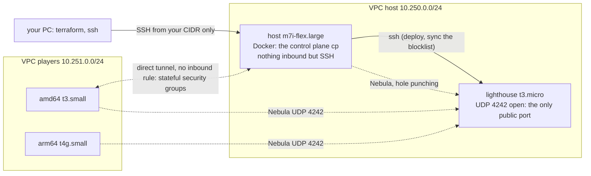

# Run a game on AWS (accessible, not the most sovereign)

Most people have a cloud account with a free tier; few have a spare machine with a public address. This recipe brings up a whole game on AWS with
Terraform: a **lighthouse**, a **host** for your control plane, and two **players** (one amd64, one arm64) in another network. Everything has a hard
lifetime and one command tears it down.

**Not the most sovereign, but accessible to many.** Say it plainly before you start:

| | Who owns it here |
| :--- | :--- |
| the hardware, the hypervisor, the disks | **AWS.** Golden rule 1 applies to AWS: *what runs on someone else's machine can be seen by its owner*, and these machines are AWS's. That includes the CA key on the host's disk |
| the CA, the certificates, the control plane, the lighthouse | **you.** They are created by the repository's scripts on your VMs; no third-party service sits in the trust path (no SaaS VPN, no hosted control plane) |
| the sovereign path | **your own machine** ([HOST-YOUR-OWN.md](HOST-YOUR-OWN.md)): the same commands on a box you own, with only the lighthouse on a cheap public server |

**Tested by following this page literally, 2026-10-28,** account in `eu-west-1`, Terraform 1.16, provider `hashicorp/aws` 6.70.0: the host ran
`mesh host init` with Cilium and the trust taint, an amd64 (`t3.small`) and an arm64 (`t4g.small`) player in **another VPC, with nothing open
inbound**, joined with [JOIN.md](JOIN.md) and went Ready in about 30 s; placement rejected a private pod aimed at a friend's node; the admission cycle
(request, approve, join, reap, kick, blocklist) ran with a third player; the golden suite ran against this control plane; and the hard lifetime
fired by itself at the deadline (below).



**Why the lighthouse has its own machine.** The control plane runs in a container behind the host's NAT. A lighthouse on that same machine would see
the control plane from the inside (its Docker address) and could never tell the players its public mapping; worse, the control plane's packets to
the machine's own public address would come back to itself. On its own small VM the lighthouse sees every member from outside, exactly like the
public lighthouse of [HOST-YOUR-OWN.md](HOST-YOUR-OWN.md) "A public lighthouse on a separate server". **Why two VPCs of our own:** the players reach
the game over the internet, as strangers do; and the default VPC (`172.31.0.0/16`) overlaps the PoC's Docker network (`172.31.0.0/24`).

## Cost

Prices of `eu-west-1`, on demand, looked up 2026-10-28 with `aws pricing get-products`: `m7i-flex.large` 0.1067 USD/h, `t3.micro` 0.0114,
`t3.small` 0.0228, `t4g.small` 0.0184, each public IPv4 address 0.005, gp3 disk 0.088 per GB-month. **The default example costs about 0.19 USD
per hour, 0.37 USD for its default 2-hour lifetime.** Every type it uses is free-tier eligible on accounts that have the free tier (check yours:
`aws ec2 describe-instance-types --filters Name=free-tier-eligible,Values=true --query 'InstanceTypes[].InstanceType'`). The run of 2026-10-28
used 4 h of `m7i-flex.large`, 4 h of `t3.micro`, 8 h of `t3.small` and 4 h of `t4g.small`: under 1 USD.

**The hard lifetime, twice** (`lifetime_minutes`, 120 by default): every machine powers itself off at the deadline (a systemd timer written at first
boot; `Persistent=true` survives a reboot) and powering off **terminates** it (shutdown behaviour = terminate, so nothing is left stopped with a
disk billing); and an EventBridge Scheduler schedule terminates all of them **from the AWS side** at the same moment, whatever happens inside the
machines. Seen on 2026-10-28: at the deadline the schedule terminated four machines (`User initiated` with the deadline's timestamp) and the
fifth had already powered itself off (`Instance initiated shutdown`). What survives the deadline costs nothing (VPCs, security groups, the key
pair, the role, the schedule) and goes with `terraform destroy`.

## 0. What you need on your PC

- Terraform 1.6 or newer, the AWS CLI with a profile that can create EC2, VPC, IAM roles and EventBridge schedules, `ssh`, `scp`.
- An SSH key pair (`ssh-keygen -t ed25519`), and your public address: `curl -s https://checkip.amazonaws.com`.

## 1. Bring the machines up

```bash
git clone https://github.com/villadalmine/k8s-lan-party.git && cd k8s-lan-party/examples/aws
cat > terraform.tfvars <<EOF          # git ignores *.tfvars and the state: they name your account and your address
region              = "eu-west-1"
aws_profile         = "<your profile>"           # or leave it out and use AWS_PROFILE
ssh_cidr            = "$(curl -s https://checkip.amazonaws.com)/32"
ssh_public_key_file = "~/.ssh/id_ed25519.pub"   # on Windows a path like C:/Users/<you>/.ssh/id_ed25519.pub
EOF
terraform init
terraform apply                      # 20 resources, about a minute
terraform plan                       # a second look: "No changes"
terraform output                     # the addresses this page calls LH_PUBLIC, LH_PRIVATE, HOST, AMD64, ARM64
```

Variables worth knowing: `joiners` (name => instance type; the architecture follows the type), `host_type` (`c7i-flex.large` has 4 GiB: tight with
Cilium and Kyverno), `lifetime_minutes`, `name` (two demos in one account need two names). `terraform output deadline_utc` says when it all ends.

## 2. Prepare the host

```bash
ssh ubuntu@HOST
sudo apt-get update && sudo apt-get install -y docker.io git make python3 python3-yaml curl
sudo usermod -aG docker ubuntu && exit           # log in again so the docker group applies
ssh ubuntu@HOST
git clone https://github.com/villadalmine/k8s-lan-party.git && cd k8s-lan-party/poc
export RUNTIME=docker
./poc-host.sh                                    # the smoke test of HOST-YOUR-OWN.md: 11 PASS in under a minute, cleans up after itself
```

## 3. The lighthouse on its own machine

The host deploys and later updates the lighthouse over SSH (`lighthouse-vps.sh`; `revoke` pushes the blocklist by itself). Give the host a key of
its own and authorize it on the lighthouse, from your PC:

```bash
ssh ubuntu@HOST 'test -f ~/.ssh/id_ed25519 || ssh-keygen -q -t ed25519 -N "" -f ~/.ssh/id_ed25519; cat ~/.ssh/id_ed25519.pub' | ssh ubuntu@LH_PUBLIC 'cat >> ~/.ssh/authorized_keys'
```

Then on the host (`ubuntu` is the cloud image's user; `sudo` makes it root there):

```bash
cd ~/k8s-lan-party && export RUNTIME=docker
ssh -o StrictHostKeyChecking=accept-new ubuntu@LH_PRIVATE true
poc/lighthouse-vps.sh install LH_PUBLIC --ssh "ssh ubuntu@LH_PRIVATE sudo"     # "changed:" lines; a second run prints none
poc/lighthouse-vps.sh verify --ssh "ssh ubuntu@LH_PRIVATE sudo"                # six "ok:" lines
```

## 4. Open the game the golden way

```bash
cd ~/k8s-lan-party/poc
CNI=cilium TAINT=yes ./mesh host init            # "host up": the control plane reached the public lighthouse from behind the host's NAT
./cilium.sh                                      # Cilium 1.20 with WireGuard; cp turns Ready
# optional, adds mutual authentication (SPIRE) so that golden check G3.4 runs instead of SKIPping: MUTUAL=yes ./cilium.sh
./install-placement.sh                           # Kyverno and the two placement policies
./kc taint node cp node-role.kubernetes.io/control-plane:NoSchedule-
```

`init` records `RUNTIME`, `CNI` and `TAINT` in `.state/game.env`: every later command (an invite, an approval, the timer) uses them. The control plane
certificate lasts 24 h with Docker (`PERSIST=1` is for Incus only, [HOST-YOUR-OWN.md](HOST-YOUR-OWN.md)), more than the example's lifetime.

## 5. Invite the two players and deliver their bundles

```bash
./mesh host invite alice --ttl 2h --trust friends        # on the host
./mesh host invite pat --ttl 1h --trust public
```

The bundle travels privately, through your PC (the players accept SSH only from you):

```bash
scp -r ubuntu@HOST:k8s-lan-party/poc/.state/bundles/alice . && scp -r alice ubuntu@AMD64: && rm -rf alice
scp -r ubuntu@HOST:k8s-lan-party/poc/.state/bundles/pat . && scp -r pat ubuntu@ARM64: && rm -rf pat
```

On each player, the tool installation of [JOIN.md](JOIN.md) (it picks amd64 or arm64 by itself), then the one command, **within 8 minutes of the
invite** (the join token's life):

```bash
ssh ubuntu@AMD64            # and the same on ARM64 with ~/pat
sudo edge-mesh join ~/alice --accept-golden-rule            # "joined: alice (trust=friends)"
```

Back on the host:

```bash
./mesh host players                                           # alice True, pat True (the join token burns here)
./kc label node alice node-restriction.kubernetes.io/trust=friends
./kc label node pat node-restriction.kubernetes.io/trust=public
./kc get nodes -o wide                                        # an amd64 and an arm64 node, InternalIP = their Nebula IP
```

Set the timer of HOST-YOUR-OWN.md section 2 now (`crontab -e`, `* * * * * cd /home/ubuntu/k8s-lan-party/poc && ./mesh host reap >/dev/null 2>&1`):
it refreshes the node guard while invites are open and expels leases at their end.

## 6. Try it

- Placement: the three pods of [HOST-YOUR-OWN.md](HOST-YOUR-OWN.md) section 5 (`private-app` on `cp`, `shared-app` on alice, `bad-app` rejected).
- The admission cycle, with one more machine (add `guest = "t3.small"` to a `joiners` map in `terraform.tfvars` and `terraform apply`):
  `./mesh host request guest --ip <its public IP>`, `./mesh host approve`, deliver and join as above, `./mesh host leases`, then
  `./mesh host reap --name guest` (or wait for the hour): the node goes, its fingerprint lands on the blocklist of the control plane **and of the
  lighthouse**, and `ping 10.77.0.1` from the guest stops answering.
- The golden rules, one check each: `./poc-golden.sh` (G8.1 needs `python3-yaml`, installed above; without it G8.1 SKIPs with a message) (section "Golden path conformance" of [POC-STATUS.md](POC-STATUS.md)).

## 7. Tear it down, and check nothing is left billing

```bash
terraform destroy                                   # from examples/aws on your PC
AWS_PROFILE=<your profile> ./leftovers.sh eu-west-1  # "OK: nothing left of 'k8slp-demo' in eu-west-1", or the list of what is left (exit 1)
```

`leftovers.sh` looks for everything the example creates, by its tag or its name: instances not terminated, volumes, elastic IPs, network interfaces,
security groups, key pairs, VPCs, subnets, internet gateways, the IAM role and the schedule. Past the deadline the example cannot be applied again: the schedule asks for a time that has gone, and `time_static` keeps the old one. Run `terraform destroy`, then `apply` for a new game (a new deadline). If you are past the deadline, the machines are already
gone: `destroy` removes the rest.

## What this recipe found in the guides (2026-10-28)

Fixed in the same change: JOIN.md downloaded the amd64 binaries only and did not say where `edge-mesh` comes from; the lighthouse commands assumed
`root@` (cloud images log in as a user with `sudo`); a game forgot its `CNI` and `TAINT` after `init`, so a timer-driven approval of a Cilium game
would have issued a flannel bundle without the trust taint (now `.state/game.env`); the pinned downloads were amd64 only on the host side too.
Measured: a burned join token keeps authenticating for up to about 10 s (the API server caches tokens); the golden suite waits for it.
