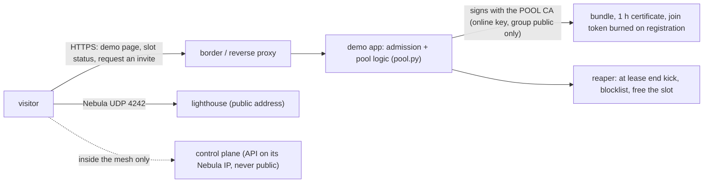

# The public demo (lighthouse and control plane applied; admission and the automatic tick built, not applied; the request page and the opening not built)

**Status (2026-10-27): the lighthouse and the control plane are up; admission with manual approval and the automatic tick
(phase B1) and the pool's cluster side (a namespace and a kubeconfig per player, quotas, the idle kick) are built and tested ([ADMISSION.md](ADMISSION.md)); the public request page (B2) and the public opening (B3) are not.**
Applied on the maintainer's own machines: steps 1 and 2 below (a lighthouse on a small public server with its public name) and a persistent control plane
at home, reachable from the internet through that lighthouse. A visitor on a network that is not the maintainer's reached the control plane's API over
Nebula (a test run from outside on 2026-10-27; the home router keeps the UDP source port, so hole punching works
without a relay). **Built in the repository, not applied to the demo yet:** admission with manual approval (`mesh host request / approve / reap`: 2 places,
1 h leases, a FIFO waiting list, a daily cap and a cooldown per identity, the reaper that expels at lease end) and the automatic tick of phase B1
(`mesh host auto --once` from the host's timer: approves inside the same limits, expels at the end and promotes the next one, `mesh host panic`, events,
a notify hook and metrics), and the pool's cluster side (`make poc-pool`: a namespace `play-<name>` with quota and limits and a kubeconfig of the
lease's length per player, the idle kick, the rate limit), tested on Incus VMs, [ADMISSION.md](ADMISSION.md). **Not built:** the public request page (B2) and the relay for symmetric NAT
(issue #15). So a stranger can join only through a request the host (or the host's own bot) enters. The repository is public since 2026-10-27 but not announced: announcing it and
opening the demo need the maintainer's explicit "open it". The PoC itself runs locally and on the maintainer's lab VMs.

The idea in one picture: a small public server with a few slots that rotate. Anyone can try the mesh for one hour, with a fixed number of
slots, no persistence, and no way to reach anything of the host's.

## What is public and what never is

| Public | Never public |
| :--- | :--- |
| the demo page (HTTPS), the slot status | the Kubernetes API (reachable only over Nebula) |
| the lighthouse, **UDP 4242** | the persistent CA key (offline); SSH and any management port |
| | anything of the maintainer's home network |

The demo uses the **pool CA** only. Its key sits with the automatic issuer and can mint `public` certificates and nothing else (the CA is
created with `-groups public`, proved in `poc-ca.sh`). If it leaks, you drop the pool CA from the trust bundle and only the pool goes down
(`B10`-`B13`); persistent friends are untouched.

The lighthouse server is public, and today it is also a full member of the mesh (a `nebula1` address, outbound `any`): whoever takes it over can reach the
Kubernetes API over Nebula, where a credential is still required. Running it as an introducer only (`tun: {disabled: true}`) is a hardening step not done yet
(DESIGN.md section 6, issue #20).

## Configuration (the numbers live in `poc/pool.yaml`)

| Setting | PoC value | Meaning |
| :--- | :--- | :--- |
| `slots` | 2 | at most N participant nodes; a join over capacity goes to a FIFO waiting list |
| `namespaces` | 1 | at most M demo namespaces |
| `lease_seconds` | 3600 | the 1 h lease; the Nebula certificate has the same expiry |
| `cooldown_seconds` | 3600 | an identity waits this long after its lease |
| `daily_leases_per_identity` | 2 | at most this many leases per identity in any 24 h (rolling window) |
| `identity_ipv4_prefix` / `identity_ipv6_prefix` | 32 / 64 | what counts as one person: an IPv4 address (or its /24) and an IPv6 /64 |
| `rate_window_seconds` / `rate_max_requests` | 600 / 5 | per-identity request rate limit (built) |
| `idle_kick_seconds` | 900 | no node, NotReady or no workload for this long: evicted early (built) |
| `quota_*`, `limit_*` | 10 pods, 1 CPU, 1 GiB, 2 GiB of disk | the ResourceQuota and LimitRange of each player's namespace (built) |
| `trusted_proxies` | the reverse proxy | only this address may set `X-Forwarded-For` |

Also built: ResourceQuota and LimitRange per player namespace (no LoadBalancer, no NodePort), one node per invite, at most one active lease
per source IP. IP limits are weak (carrier NAT hurts honest users, a VPN bypasses them): they stop casual abuse. An optional GitHub-OAuth lane
would limit per account.

**What exists today:** the decision logic (`pool.py`, unit tests: the 1 h lease, per-identity rules, the daily cap, the FIFO list), the CA split, and
admission with manual approval with its reaper (`admission.py`, `make poc-admission`) and the automatic tick with its switch, panic, events and metrics
(`make poc-admission-auto`, [ADMISSION.md](ADMISSION.md) B1), and the pool's cluster side: a namespace and a kubeconfig per player, quotas, the idle
kick (`make poc-pool`, issues #9 and #11). **What does not:** the public request page and its anti-bot layers (ADMISSION.md B2), and the relay for
symmetric NAT (issue #15). The demo needs these built and
tested before the checklist below can pass.

## The runbook (do not run without the OK)

Each step is a separate change with its own rollback; the maintainer approves each one.

**Prerequisite: the go-public checklist (issue #16).**
- [ ] `make poc-join`, `poc-ca`, `poc-placement` and the Cilium suite green and identical on two runs
- [ ] the README commands verified from a clean clone
- [ ] `SECURITY.md` present; branch ruleset ready; git history scanned for secrets
- [ ] the pool's cluster side built and tested; the persistent CA key offline; the pool CA online key stored as a protected secret

**1. A small public server for the lighthouse.** A VPS with a stable address, `nebula` 1.11.2, the `lh` bundle, **UDP 4242** open and nothing else except SSH from known addresses.
Rollback: destroy the VPS; no bundle is valid without a lighthouse. **Automated and tested on a VM: `poc/lighthouse-vps.sh` (`make poc-lighthouse`, 23 checks); applied on the maintainer's server 2026-10-27.**

**2. A public name for the lighthouse and the demo page** (a subdomain). *Needs the maintainer's OK: DNS.* Rollback: remove the record. **Done 2026-10-27** (one `A` record, TTL 300).

**3. The demo page behind the border** (HTTPS reverse proxy to the admission app; the app trusts `X-Forwarded-For` only from the proxy's address). *Needs the
maintainer's OK: the home border.* Rollback: remove the route; the page disappears, the mesh keeps working for current leases.

**4. If the control plane stays at home:** a NAT/port-forward is **not** required for the control plane, because nodes reach it over Nebula via the
lighthouse. Only the lighthouse (UDP 4242) is public. If the lighthouse is at home instead of a VPS, forwarding UDP 4242 through NAT is the single
change to the edge and needs the OK. Rollback: remove the forward.

**5. Switch on admission** (`slots: 2`, lease 1 h). By hand: `mesh host request / approve` and a timer running `mesh host reap`. Automatic (B1): a timer
running `mesh host auto --once` every minute (the unit and the cron line are in [HOST-YOUR-OWN.md](HOST-YOUR-OWN.md)), `ADMISSION_NOTIFY_CMD` pointed at the
host's bot, the metrics published, then `mesh host auto on`; requests are still entered by the host or its bot and the bundle in `outbox/` is still
delivered by the host until B2. Watch `mesh host auto status`, `mesh host players` and `emesh_admission_last_tick_timestamp_seconds`. Rollback:
`mesh host panic` (auto off, slots 0, every lease expelled), then stop the timer.

**6. Abuse switch.** `mesh host panic`: auto off, effective slots 0, every active lease expelled, the outbox emptied; idempotent; `mesh host panic --clear`
reopens with auto still off (by hand: `slots: 0` and `mesh host reap --all`). Practise it before announcing (`poc-admission-auto` AA32-AA35 do).

## Limits and honest warnings

- A visitor's machine is `public`: private workloads never land on it, and the visitor can see whatever runs on it (golden rule). Demo workloads must be shareable only.
- 1 hour is a hard lease. Nothing persists. No Secrets, no hostPath, no privileged pods on shared nodes (Kyverno, section 5 of DESIGN.md).
- The demo shows the mesh and the placement rule; it is not a compute marketplace.
