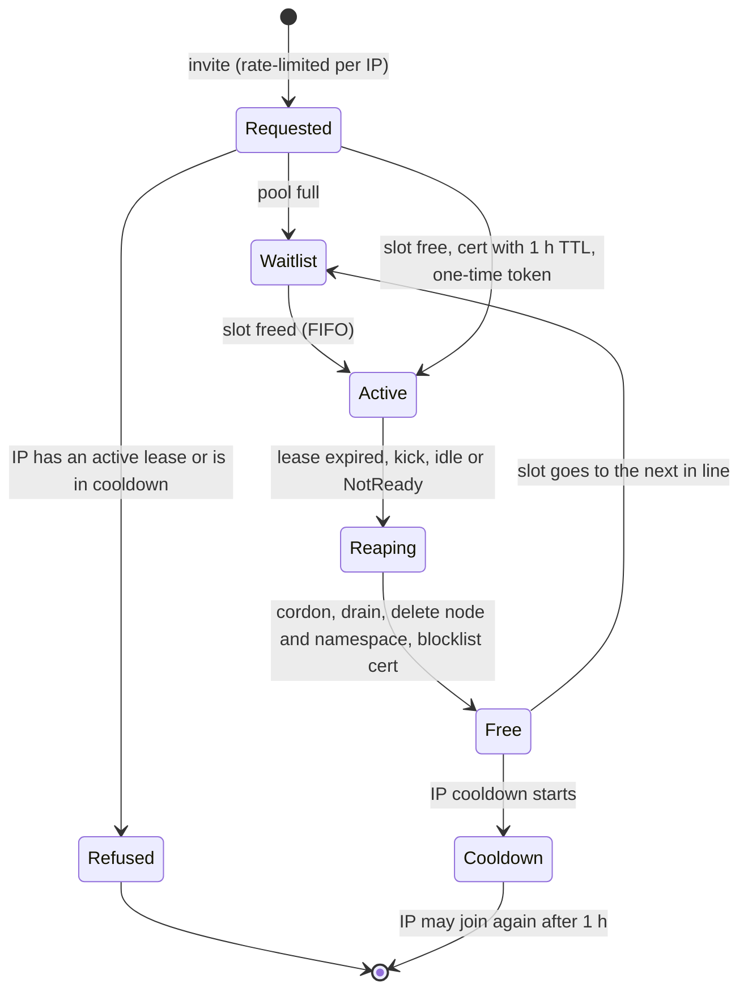

# Design: MVP phase 1

Status: **MVP phase 1, 2026-10-16, private repository.** This is a product, not a study lab. The architecture below
was decided by the maintainer on 2026-10-16; what is still open is listed in section 11. Versions are not pinned
here: they are looked up live and pinned in the PoC's `stack.env`. Claims marked **(prove in the PoC)** are the
ones the proof of concept must confirm or kill. The non-negotiables are in [GOLDEN-RULES.md](GOLDEN-RULES.md).

## 1. Golden rule (MVP)

> **What runs on someone else's machine can be seen by its owner.**

No encryption protects a pod from the owner of the node it runs on, not even TLS terminated inside the pod: the
keys and the plaintext sit in memory on that host, and the owner is root. Kubernetes does not defend a pod from its
own node. Therefore the architecture does not try to hide workloads from node owners; it decides **where
workloads may run**:

- Each **node** declares a trust level: `own`, `friends` or `public`. **Trust is relative to the workload's owner**: a node is `own` for
  the person who owns that machine (label `node-restriction.kubernetes.io/owner=<github-user>`, set by the issuing side, never by the
  kubelet) and `friends` or `public` (the level its owner offers) for everybody else. The maintainer's nodes are `own` for the
  maintainer only. A participant's `private` pods run only on nodes whose `owner` is that participant; a participant with no node of
  their own can run `shareable` workloads only. Later: `confidential` (AMD SEV-SNP or Intel
  TDX with Kata Confidential Containers and attestation; optional, never required).
- Each **workload** declares a sensitivity: `shareable` or `private`. A missing label means `private`.
- By default a user's pods run **only on their own nodes**.
- **Kyverno plus labels and taints enforce the placement**; it does not depend on goodwill.
- **Cilium protects transit and tenant isolation** (deny by default, plus mutual auth by policy). It never claims
  to protect a pod from its host.
- The rule is stated plainly at join time: *"what runs on someone else's machine can be seen by its owner"*.

**Worked example.** A runs a frontend, a backend and a db. The frontend is `shareable` and may run on B's node.
The backend and the db are `private` and stay on A's nodes. B's owner sees the frontend's memory, keys and
traffic, and holds the frontend's identity, so B can act as the frontend toward the backend: the backend must authorize
each request (the network identity alone is not a credential). See diagram 1.

*Diagram 1 ([source](diagrams/who-sees-what.mmd)): the three-pod example.*

## 2. What this is

A collaborative, "torrent-like" Kubernetes mesh. People run k3s at home (in a VM, privileged Docker or WSL2) and
join the maintainer's control plane to share compute. It must be:

- **self-sovereign**: no third-party SaaS in the trust path (Nebula, our CA, our control plane);
- **secure**: a participant's machine is not trusted by default, and neither is anybody else's;
- **simple to join**: **one bundle and one command**.

Out of scope for phase 1: marketplaces, billing, storage, GPUs, scheduling fairness.

## 3. Layers, one job each

| Layer | Its one job | Always on? | Replaces |
| :--- | :--- | :--- | :--- |
| **Nebula** | join/"login" (node identity: certificate from our CA with expiry and groups) and NAT traversal/connectivity | yes; it always encrypts (Noise) and cannot be turned off, which is fine: the team does not manage it | Tailscale, Headscale, NetBird, zrok, ngrok, ClusterMesh |
| **Cilium, tunnel mode** (VXLAN/Geneve over the Nebula IPs) | the CNI; joiners configure nothing extra. MTU is set once. Native routing is **not** the default; it is an optional optimisation for the maintainer's own nodes | yes | flannel (kept only as plan B) |
| **Cilium WireGuard** (transparent encryption) | encrypt pod-to-pod across nodes, plus node-to-node | **always on** | app-level TLS for transit |
| **Cilium mutual authentication** (SPIFFE/SPIRE, "mTLS") | authenticate workload identity; WireGuard provides the encryption | per policy, `authentication.mode: required`, when a user asks (beta: prove it in the PoC) | a service mesh |
| **Kyverno + labels + taints** | placement by trust (section 4) | yes | goodwill |

Each layer does one job. Nebula does not do placement; Cilium does not do the identity of machines; Kyverno does
not encrypt. The layers do not conflict: each protects a different stretch (section 6).

### 3.1 Nebula

- Peer-to-peer UDP with hole punching (works behind home NAT); a certificate per host carrying its **Nebula IP,
  groups and expiry**; a **group-based firewall** on every host. No central service must be trusted at runtime:
  the CA signs, the lighthouse only introduces.
- **Own CA and self-hosted lighthouse** (stable public UDP). The CA key is the crown jewel (decision 5, section 11).
- **Groups as roles**: `control-plane`, `own`, `friends`, `public` (nodes), `person` (kubectl clients).
- **Expiry is the soft revocation**: short lifetimes plus renewal; `pki.disconnect_invalid: true` makes expiry also
  cut open tunnels **(prove in the PoC)**. The hard revocation is the blocklist (section 9).
- The Nebula firewall must leave the CNI data plane open between nodes (VXLAN 8472/udp or Geneve 6081/udp,
  WireGuard 51871/udp, Cilium health 4240) **(prove in the PoC)**: with Cilium in tunnel mode nodes must reach each
  other; tenant isolation is Cilium's job, not Nebula's.

### 3.2 k3s over the Nebula IP

The API server listens on, and advertises, the **Nebula IP** only (`--bind-address`, `--advertise-address`,
`--tls-san`); there is no public Kubernetes endpoint. Agents use `K3S_URL=https://<nebula-ip>:6443` and `--node-ip`
set to the Nebula IP. k3s keeps a per-node password, so a second machine cannot take over an existing node name
**(prove in the PoC)**.

### 3.3 Cilium

Tunnel mode over the Nebula interface; pod MTU derived once from the Nebula MTU (default 1300) minus the tunnel
header. WireGuard encryption with node-to-node enabled. Mutual authentication needs the SPIRE server and agents; it
is beta, so it is **opt-in per policy**. Cilium's own service account can read Secrets cluster-wide unless
`tls.readSecretsOnlyFromSecretsNamespace: true` is set; the PoC inventories what each node-side credential can do.

## 4. Trust and placement policy

| | `own` node | `friends` node | `public` node |
| :--- | :--- | :--- | :--- |
| `private` workload | yes, if the node's `owner` is the workload's owner (default) | **never** | **never** |
| `shareable` workload | yes | yes, if its owner opts in | yes, if its owner opts in |

Mechanics (all of them required):

1. **Node labels** `node-restriction.kubernetes.io/trust=own|friends|public` and `.../owner=<github-user>`. The kubelet cannot set labels
   under that prefix (NodeRestriction applies on create too), so **the issuing side labels the node right after it registers**, and a
   node cannot upgrade itself. Until it is labelled a node receives nothing: every placement below is a *positive* requirement
   (`nodeAffinity` on the labels), so an unlabelled node matches no workload.
2. **Taint** `trust=<level>:NoSchedule` on every `friends` and `public` node, applied at registration (`--node-taint` in the join
   command; a kubelet may set its own taints). The taint is relative too: it keeps *other people's* private pods off, while the
   owner's own `private` pods tolerate it (rule 3). A Node that registers without the expected taint is deleted by the issuing side within
   seconds, and the positive affinity above covers the window.
3. **Workload label** `edge-mesh/sensitivity=shareable|private`. **Kyverno** validates and mutates: `private` (or no
   label) gets a required `nodeAffinity` on `owner=<the workload's owner>` (so a node its owner shares as `friends` still runs
   the owner's own `private` pods) and a toleration only for the taints of those nodes; `shareable` gets the toleration for
   the levels its owner allowed. A pod that tolerates a taint of a node it does not own, without being `shareable`, is rejected.
4. **System pods** (Kyverno, CoreDNS, the CNI control components, SPIRE server) are pinned to `own`.
5. **No bypass of the scheduler**: tenants cannot create `pods/binding`, and Kyverno denies `spec.nodeName` on tenant pods
   (`nodeName` skips the scheduler, so it would skip `nodeAffinity` and `NoSchedule`); policies run with `failurePolicy: Fail`.
6. **Kyverno on shareable workloads**: no `hostPath`, `privileged`, host namespaces or added capabilities; **no
   Secret volumes or `secretKeyRef`**; `automountServiceAccountToken: false`; resource limits; image allow-list.
7. **Cilium**: deny by default per namespace, plus mutual auth where a policy asks for it.

*Diagram 2 ([source](diagrams/placement-kyverno.mmd)): the correct pattern.*

**Node-side credentials.** Whoever owns a node also holds what lives on it outside NodeRestriction: the k3s controller and kube-proxy
identities (the controller can read pod specs cluster-wide and patch node status) and the CNI's service account. That is accepted,
unfixable risk on a node you do not own, so **the automatic public demo runs on its own disposable control plane** that holds
nothing of the maintainer's (no secrets, no real workloads), never on the cluster that has the maintainer's own nodes.

What this does **not** do: it does not make a `friends` node safe for a `private` workload. That is the golden rule;
the answers are `confidential` nodes (later, optional) or keeping the workload on `own`.

## 5. Credentials at join

Credentials travel encrypted at every step: the Nebula handshake first, then the k3s token over TLS with the CA
pinned in the token (`K10<hash>`). Tokens are **one-time, per node and expiring**: the **issuing side** (server-side, where `k3s token delete`
lives) deletes the token as soon as the node is Ready; the join command, running on the participant's machine, cannot. The shared `K3S_TOKEN` is a master key and is **never** handed to participants.

**Joining = one bundle + one command.** The bundle holds the Nebula certificate, `config.yml` and a one-time k3s
token; the command is `edge-mesh join <bundle>`. It requires **privileged Linux**: a VM, privileged Docker or WSL2.
The PoC measures all three. The command shows the golden rule and refuses to continue until it is accepted.

*Diagram 3 ([source](diagrams/layers-endpoints-join.mmd)): layers, endpoints and the join flow.*

### 5.1 Who may join, and how

| Kind of participant | Trust level | Admission |
| :--- | :--- | :--- |
| **Public demo** | `public` | automatic while a slot is free, no cosign and no PR (section 8): 1 h lease, per-IP rules, FIFO waitlist, automatic kick |
| **Persistent participant** | `friends` or above | **only by pull request**, signed with cosign (below) |

**Join by PR** (decided 2026-10-16: "apruebo por PR, sé quién es; validan el PR con cosign").

1. The participant adds `participants/<github-user>.yaml`: node name, resources, requested trust level, and their
   **Nebula public key** (a certificate *request*; they keep the private key).
2. They sign the file with **cosign keyless** (GitHub Actions OIDC through Fulcio, with the Rekor transparency log):
   `cosign sign-blob --bundle participants/<user>.sigstore.json participants/<user>.yaml` run by that workflow. Commits carry the DCO
   sign-off.
3. **CI verifies, deterministically**: `cosign verify-blob` with `--certificate-identity-regexp` bound to the PR author's repository
   and `--certificate-oidc-issuer https://token.actions.githubusercontent.com`. The participant signs from **a GitHub Actions workflow in
   their own fork** (`.github/workflows/sign.yml`), so the certificate identity is that workflow's URL, which contains their GitHub
   login: `^https://github.com/<pr-author>/edge-mesh-lab/.github/workflows/sign.yml@refs/heads/.*$`. (Signing interactively with
   the GitHub OAuth issuer would put the signer's *email* in the certificate, which CI cannot map to the PR author, so a file signed
   by anybody for somebody else's name would pass.); the YAML schema; the
   node name is unique; the requested trust level is allowed. Anything above `public` happens only when the
   maintainer merges, and CODEOWNERS for `participants/` is the maintainer.
4. **The maintainer approves by merging.** The issuing workflow then signs the Nebula certificate with the CA (the
   CA key is an offline step or a protected secret: decision 5), creates a one-time k3s token, **signs the bundle
   with cosign** so the participant can verify it came from the maintainer, and delivers it **privately, never in
   the public repo** (mechanism: decision 9).
5. **Removal** is a PR that deletes their file; merging triggers the cleanup and the Nebula blocklist (section 9).

## 6. Endpoints the maintainer owns

The **AI gateway** and the **Cilium LoadBalancer with BGP to the MikroTik** run **only on the maintainer's own nodes**: the BGP
peering policy has a `nodeSelector` for `own` nodes, and the IP pools select Services by label (a `CiliumLoadBalancerIPPool` has a
`serviceSelector`, not a node selector); Services that need the pool run only on the maintainer's own nodes. **Remote nodes never announce.** TLS comes from cert-manager,
issued automatically. The encryption layers do not conflict because each protects a different stretch: client to
gateway (TLS), gateway to pods (WireGuard, plus mutual auth where asked), and Nebula underneath everything.

## 7. Risks to prove in the PoC

| Risk | What the PoC must show |
| :--- | :--- |
| **Double encapsulation and MTU** (Nebula under the Cilium tunnel, plus WireGuard) | the pod MTU that works; large TLS responses do not hang; throughput cost measured |
| **Mutual auth is beta** | a policy with `authentication.mode: required` denies an unauthenticated peer and allows an authenticated one; failure modes noted |
| **Cilium on Docker and WSL2** | does it start, which kernel options are missing, which of VM, privileged Docker and WSL2 pass |
| **Privileges** | the minimal capabilities and devices a joiner needs; a joiner without them gets a clear refusal |
| **A node owner is root over its pods** | the malicious-node tests (section 10) show the placement holds and transit is unreadable |

## 8. Public demo: capacity pool

The free demo must not fill up: a fixed pool that empties itself every hour. Settings live in one file
(`poc/pool.yaml`).

- **Fixed size.** At most `N` participant nodes and `M` demo namespaces. When the pool is full a join does **not**
  get in: the person joins a **FIFO waitlist** and sees their position ("full, try later").
- **Lease: 1 hour, hard.** The Nebula certificate is issued with the same expiry; the k3s token is one-time. At
  expiry the **reaper** (CronJob or controller) kicks the node, in the order of section 9: certificate fingerprint on the Nebula
  blocklist first, then cordon, drain and `kubectl delete node`; deletes the participant's namespace and workloads; frees the slot,
  which goes to the head of the waitlist. `kick <node>` is the manual one-command version with the same effect.
- **Idle kick.** A node that is NotReady, or has had no workload for `X` minutes, is evicted early.
- **Quotas.** ResourceQuota and LimitRange per namespace (CPU, RAM, pods; no LoadBalancer, no NodePort); at most
  one node per invite.
- **Per-IP rules**: at most **1 active lease per source IP**; a **cooldown** after a lease ends (default 1 h) before
  the same IP can join again; a **per-IP invite rate limit**.
- **Which IP.** The client IP at the edge. Behind an L4 proxy (HAProxy with `send-proxy-v2`) Caddy must read the PROXY protocol
  (`listener_wrappers { proxy_protocol }`, allowing only the proxy's address) to see the real client; otherwise every visitor looks
  like the proxy and the first lease blocks everybody. Caddy then sets `X-Forwarded-For`, and the pool service trusts that header
  **only when the socket peer is Caddy** (`trusted_proxies` of the pool service, a different list from Caddy's own); from anywhere
  else it is ignored and the socket address is used.
- **Visibility.** The demo page shows slots used and free, each lease's time left, and the waitlist length.

**IP limits are weak, and we say so.** Carrier-grade NAT or a shared office makes several legitimate users look like
one IP and blocks them; a VPN bypasses the limits. They stop casual abuse, not a determined one. For that there is an
optional lane: **sign in with GitHub (OAuth)**, with a slightly longer lease (default 2 h) and a limit **per
account** instead of per IP. Cosign and PRs stay **only for persistent participants** (section 5.1).

## 9. Revocation: one command

`edge-mesh revoke <node>` does, in this order, and prints what it did:

1. add the certificate fingerprint to the **Nebula blocklist** and distribute it. **This is the only hard
   revocation**: Kubernetes has no certificate revocation list, and a kubelet that can still reach the API
   re-creates its Node object after a delete;
2. `kubectl delete node <node>`; a ValidatingAdmissionPolicy denies `CREATE nodes` for revoked names;
3. delete the node's token if it still exists. **Keep** the node-password secret: deleting it would let anybody take
   over that node name.

**Limit, stated plainly:** the Nebula blocklist is per host, so it reaches the hosts that run our agent (the lighthouse, the control
plane, our relays and every node that pulls the signed blocklist from the lighthouse every minute); a peer that has not pulled it keeps
an open tunnel to the revoked node **until the certificate expires**. That is why certificates for `friends` and `public` nodes are
short for the demo (1 h, from the online CA) and, for persistent participants whose certificates come from the offline,
hand-signed CA (decision 5), as short as hand-signing allows (weeks, renewed with each approved PR). For them the signed blocklist
pull and removal by PR are the real revocation, and the pool, Cilium and placement isolate tenants even when a tunnel is open.

Success: after `revoke`, the node cannot reach the API, cannot rejoin with the old token, cannot re-register under
its old name, and the time to loss of access is measured. A negative test runs `kubectl delete node` without the
blocklist and records that the node comes back. Expiry of a lease (section 8) runs the same steps in the same order (blocklist first).

## 10. Proof of concept

The WSL test is a **proof of concept**, not a product claim. The PoC's Nebula firewall is open (inbound any) on purpose: group-based
firewalling and the isolation between tenants are later steps. `make poc` brings up kind or k3d (WSL or a CI
runner): a control plane and two "outside" nodes over Nebula, with an own CA and a lighthouse in a container.
Versions are pinned; each step prints `PASS` or `FAIL`; the output is byte-identical across runs except timestamps.

Asserted steps:

- join with the bundle and one command; Cilium tunnel with WireGuard on; mutual auth by policy;
- Kyverno placement: a private pod never lands on `friends` or `public`, a shareable one may;
- revocation in one command; malicious-node checks (a node cannot read another tenant's traffic in transit, and
  placement holds);
- capacity pool: over capacity goes to the waitlist; after the 1 h lease (simulated time) node, namespace and
  certificate are gone and the slot goes to the waitlist; idle kick; quotas enforced; a second join from the same IP
  is refused while the first is active; the cooldown is enforced; the rate limit is enforced;
- join by PR: a valid signed PR passes; a PR signed by an identity different from the author fails; an unsigned or
  tampered file fails; a trust level above the allowed one fails without the maintainer; removal revokes.

The PoC cannot use the real Fulcio offline: a local test CA, or `--insecure-ignore-tlog`, is used **only in the PoC
fixture, marked as such**; the real flow runs in CI on the PR.

## 11. Open decisions

| # | Decision | Notes |
| :--- | :--- | :--- |
| 1 | **Name** | `edge-mesh-lab` is a working name; a product name is needed before going public |
| 2 | **Licence** | Apache-2.0 is a placeholder; alternatives AGPL-3.0, MPL-2.0 |
| 3 | **When it goes public** | private until the maintainer says so (it holds a security design) |
| 4 | **Lighthouse location** | small VPS (stable public UDP) vs the home edge (NAT/CGNAT dependent) |
| 5 | **CA custody** | the automatic demo needs an **online** CA key, so one offline CA cannot do both jobs. Proposal: **two CAs** in `pki.ca`: an offline one for persistent participants (hand-signed after a merge) and an online one for the `public` demo only, whose certificates carry the `public` group and nothing else |
| 6 | **Keycloak or Dex** | login for people (OIDC); Keycloak heavier and complete, Dex lighter |
| 7 | **Pool numbers** | `N` nodes, `M` namespaces, idle minutes, cooldown for the public demo |
| 8 | **GitHub OAuth lane** | build it in phase 1 or leave it for later |
| 9 | **Bundle delivery** | encrypted to the participant's key vs fetched over an authenticated endpoint |
