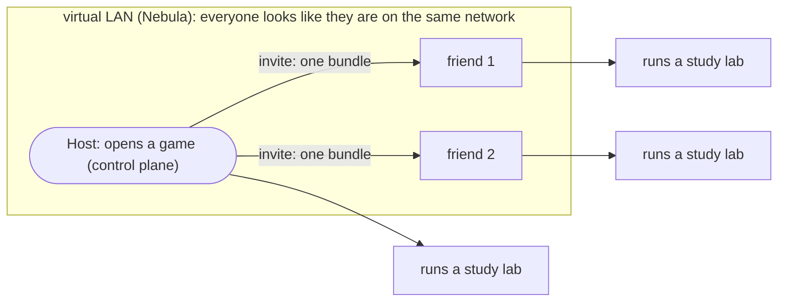
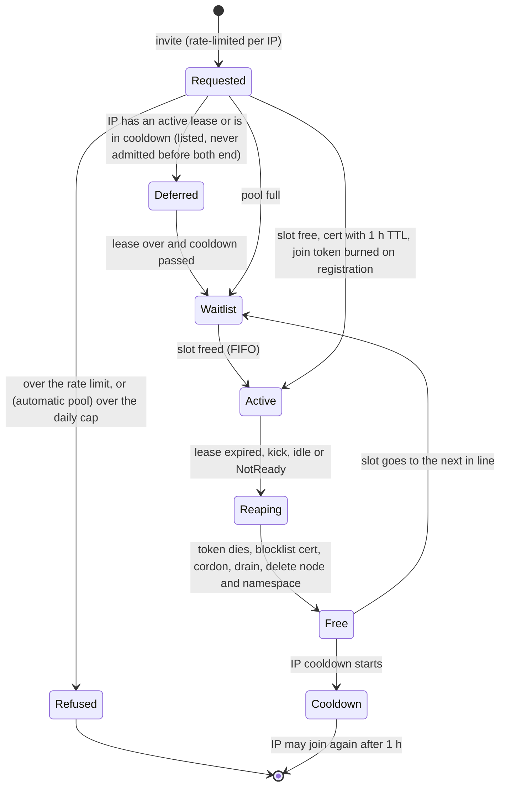

# Design: MVP phase 1 (collaborative labs for learning)

Status: **MVP phase 1, 2026-10-16; public repository since 2026-10-27, early stage, not announced yet.** This is a product, not a study lab. The architecture below
was decided by the maintainer on 2026-10-16; what is still open is listed in section 11. Versions are not pinned
here: they are looked up live and pinned in the PoC's `stack.env`. Claims marked **(prove in the PoC)** are the
ones the proof of concept must confirm or kill. The non-negotiables are in [GOLDEN-RULES.md](GOLDEN-RULES.md).

## 0. Purpose, in one picture: a LAN party for Kubernetes labs

This project is **collaborative labs for learning**. It is not a production compute marketplace and it has no tokens.
The model is a **LAN party**: someone opens a game, friends join over a virtual LAN, and everybody plays (runs their
study labs) on the same network.

| In a LAN game | Here |
| :--- | :--- |
| A **game** (session) | a lab cluster a **host** opens; the host runs the control plane (the "server") and invites a group of friends |
| Entering the server address and password | **joining**: one bundle and one command |
| Hamachi or ZeroTier, "everyone is on the same network" | **Nebula**, the virtual LAN, self-hosted with our own CA |
| A public server with limited slots that rotate | the **free pool**: a fixed number of slots, a 1 h lease, a FIFO waitlist |
| The regulars on a friends list | **persistent participants**, admitted by a signed pull request |
| The game client runs on the player's own PC | **the trust rule**: what runs on someone else's machine can be seen by its owner, so keep private things on your own machine |
| Several game servers, one per region | **phase 2**: several control planes |
| Listing your server so others can find it | **publishing** the public lighthouse and demo, after the private game works |



Security stays honest, in game terms: the host decides who gets an invite; an invite expires; a player can be kicked in one
command; and the machine's **owner** can see what runs on it: a player sees what runs on their own PC, and a friend who lends a PC sees what runs on that PC (the golden rule below).

## 1. Golden rule (MVP)

> **What runs on someone else's machine can be seen by its owner.**

No encryption protects a pod from the owner of the node it runs on, not even TLS terminated inside the pod: the
keys and the plaintext sit in memory on that host, and the owner is root. Kubernetes does not defend a pod from its
own node. Therefore the architecture does not try to hide workloads from node owners; it decides **where
workloads may run**:

- Each **node** declares a trust level: `own`, `friends` or `public`. **Trust is relative to the workload's owner**: a node is `own` for
  the person who owns that machine (label `node-restriction.kubernetes.io/owner=<github-user>`, set by the issuing side, never by the
  kubelet) and `friends` or `public` (the level its owner offers) for everybody else. The maintainer's nodes are `own` for the
  maintainer only. A participant's `private` pods run only on nodes whose `owner` is that participant; a participant with no node of
  their own can run `shareable` workloads only. Later: `confidential` (AMD SEV-SNP or Intel
  TDX with Kata Confidential Containers and attestation; optional, never required).
- Each **workload** declares a sensitivity: `shareable` or `private`. A missing label means `private`.
- By default a user's pods run **only on their own nodes**.
- **Kyverno plus labels and taints enforce the placement**; it does not depend on goodwill.
- **Cilium protects transit and tenant isolation** (deny by default, plus mutual auth by policy). It never claims
  to protect a pod from its host.
- The rule is stated plainly at join time: *"what runs on someone else's machine can be seen by its owner"*.

**Worked example.** A runs a frontend, a backend and a db. The frontend is `shareable` and may run on B's node.
The backend and the db are `private` and stay on A's nodes. B's owner sees the frontend's memory, keys and
traffic, and holds the frontend's identity, so B can act as the frontend toward the backend: the backend must authorize
each request (the network identity alone is not a credential). See diagram 1.



*Diagram 1 ([source](diagrams/who-sees-what.mmd)): the three-pod example.*

## 2. What this is

A collaborative, "torrent-like" Kubernetes mesh. People run k3s at home (in a VM, privileged Docker or WSL2) and
join the maintainer's control plane to share compute. It must be:

- **self-sovereign**: no third-party SaaS in the trust path (Nebula, our CA, our control plane);
- **secure**: a participant's machine is not trusted by default, and neither is anybody else's;
- **simple to join**: **one bundle and one command**.

Out of scope for phase 1: marketplaces, billing, storage, GPUs, scheduling fairness.

## 3. Layers, one job each

| Layer | Its one job | Always on? | Replaces |
| :--- | :--- | :--- | :--- |
| **Nebula** | join/"login" (node identity: certificate from our CA with expiry and groups) and NAT traversal/connectivity | yes; it always encrypts (Noise) and cannot be turned off, which is fine: the team does not manage it | Tailscale, Headscale, NetBird, zrok, ngrok, ClusterMesh |
| **Cilium, tunnel mode** (VXLAN/Geneve over the Nebula IPs) | the CNI; joiners configure nothing extra. MTU is set once. Native routing is **not** the default; it is an optional optimisation for the maintainer's own nodes | yes | flannel (kept only as plan B) |
| **Cilium WireGuard** (transparent encryption) | encrypt pod-to-pod across nodes, plus node-to-node | **always on** | app-level TLS for transit |
| **Cilium mutual authentication** (SPIFFE/SPIRE, "mTLS") | authenticate workload identity between nodes that are honest; not evidence against a joined node's owner (section 3.3, issue #29); WireGuard provides the encryption | per policy, `authentication.mode: required`, when a user asks (beta: prove it in the PoC) | a service mesh |
| **Kyverno + labels + taints** | placement by trust (section 4) | yes | goodwill |

Each layer does one job. Nebula does not do placement; Cilium does not do the identity of machines; Kyverno does
not encrypt. The layers do not conflict: each protects a different stretch (section 6).

### 3.1 Nebula

- Peer-to-peer UDP with hole punching (works behind home NAT); a certificate per host carrying its **Nebula IP,
  groups and expiry**; a **group-based firewall** on every host. No central service must be trusted at runtime:
  the CA signs, the lighthouse only introduces.
- **Own CA and self-hosted lighthouse** (stable public UDP). The CA key is the crown jewel (decision 5, section 11).
- **Groups as roles**: `control-plane`, `own`, `friends`, `public` (nodes), `person` (kubectl clients).
- **Expiry is the soft revocation**: short lifetimes plus renewal; `pki.disconnect_invalid: true` makes expiry also
  cut open tunnels **(prove in the PoC)**. The hard revocation is the blocklist (section 9).
- The Nebula firewall must leave the CNI data plane open between nodes (VXLAN 8472/udp or Geneve 6081/udp,
  WireGuard 51871/udp, Cilium health 4240) **(prove in the PoC)**: with Cilium in tunnel mode nodes must reach each
  other; tenant isolation is Cilium's job, not Nebula's.

### 3.2 k3s over the Nebula IP

The API server listens on, and advertises, the **Nebula IP** only (`--bind-address`, `--advertise-address`,
`--tls-san`); there is no public Kubernetes endpoint. Agents use `K3S_URL=https://<nebula-ip>:6443` and `--node-ip`
set to the Nebula IP. k3s keeps a per-node password, so a second machine cannot take over an existing node name
**(prove in the PoC)**.

### 3.3 Cilium

Tunnel mode over the Nebula interface; pod MTU derived once from the Nebula MTU (default 1300) minus the tunnel
header and the WireGuard overhead (`poc/stack.env`: `NEBULA_MTU` is the only number, `pod_mtu_from` the only formula). WireGuard encryption
with node-to-node enabled. Mutual authentication needs the SPIRE server and agents; it is beta, so it is **opt-in per policy**. The SPIRE
agent tolerates the `trust` taint: it must run on every node a workload may land on. Cilium's own service account can read Secrets
cluster-wide unless `tls.readSecretsOnlyFromSecretsNamespace: true` is set; the PoC inventories what each node-side credential can do.

**What the node-side Cilium credential can do (measured 2026-10-28).** Every Cilium agent runs under one service account, and its token sits on
the node's disk, where the node's owner is root. That account may `update` every `CiliumNode`, and a `CiliumNode` carries the node's WireGuard
public key: the owner of a remote node could replace another node's key (seen live with the agent token of a joined node). **Guard:**
`poc/cilium-node-guard.yaml`, a `ValidatingAdmissionPolicy` that admits a write by that account only to the `CiliumNode` of the node its
pod-bound token was issued on (`cilium.sh` applies it; `poc-vm` V06c). The same account may also create `CiliumEndpoints` and
`CiliumIdentities`, which no per-node rule scopes, and the SPIRE registration entries are not tied to a node (selector `cilium:mutual-auth`,
parented to the operator). So **mutual authentication proves that the peer node holds a certificate from the cluster's SPIRE for that
identity; it is not evidence against the owner of a joined node** claiming another workload's identity (section 1: authorize each request in
the application). That attack is not tested yet: a follow-up (issue #29).

**The k3s controller credential (found in the review of PR #28, 2026-10-28).** Every joined machine also holds
`/var/lib/rancher/k3s/agent/k3scontroller.kubeconfig` (user `system:k3s-controller`). Its ClusterRole in k3s v1.37.1 reads nodes, pods, endpoints,
endpointslices, namespaces and network policies cluster-wide and has exactly one write: `patch nodes/status`, on every Node. The API server resets only
`spec` on a status update, so a status patch may change `metadata.labels`, and NodeRestriction and the node guard match `system:node:*` only. So a joined
node could have labelled itself `own` or taken `own` away from the maintainer's nodes. **Guard:** `poc/node-trust-freeze.yaml`, a
`ValidatingAdmissionPolicy` (fail closed) on `nodes` and `nodes/status`: the `node-restriction.kubernetes.io/` labels and the `trust` taint change only
for `system:masters` (the host), everything else (other labels, annotations, the status) stays writable so kubelets, k3s and the lifecycle controller keep
working. Applied by `up.sh` before any node joins; `poc-bgp` G09b and `poc-placement` L52b test it. Still open on that credential, by design of k3s:
the rest of `status` (conditions, capacity, addresses of any Node) is writable by it, and the reads above include every pod spec. Accepted for a node
you do not own, as the paragraph above says.

**The SPIRE agent (found in the same review).** Running it on joined nodes (a toleration, so their pods get an identity) puts its service account token
there. The chart's ClusterRole is `get` on `pods`, `nodes` and `nodes/proxy` cluster-wide (measured by `poc-vm` V103 as an RBAC inventory). `nodes/proxy`
lets the API server relay a GET to any node's kubelet (`/pods`, container logs), so the owner of a joined node can read the pod specs and logs of the
maintainer's own nodes with it. The chart offers no way to narrow that role, and the SPIRE Kubernetes workload attestor needs that permission to ask the
local kubelet about its pods (not re-measured by removing it), so mutual authentication toward joined nodes and this exposure come together. The
decision is the maintainer's: accept it as golden-rule exposure (nothing private belongs where such a node can be reached through the API), a kubelet-side
authorizer, or no SPIRE agent on joined nodes (then no mutual auth for their pods). Open: see the issue linked in POC-STATUS.

## 4. Trust and placement policy

| | `own` node | `friends` node | `public` node |
| :--- | :--- | :--- | :--- |
| `private` workload | yes, if the node's `owner` is the workload's owner (default) | **never** | **never** |
| `shareable` workload | yes | yes, if its owner opts in | yes, if its owner opts in |

Mechanics (all of them required):

1. **Node labels** `node-restriction.kubernetes.io/trust=own|friends|public` and `.../owner=<github-user>`. The kubelet cannot set labels
   under that prefix (NodeRestriction applies on create too), so **the issuing side labels the node right after it registers**, and a
   node cannot upgrade itself. Until it is labelled a node receives nothing: every placement below is a *positive* requirement
   (`nodeAffinity` on the labels), so an unlabelled node matches no workload.
2. **Taint** `trust=<level>:NoSchedule` on every `friends` and `public` node, applied at registration (`--node-taint` in the join
   command; a kubelet may set its own taints). The taint is relative too: it keeps *other people's* private pods off, while the
   owner's own `private` pods tolerate it (rule 3). A Node that registers without the expected taint is deleted by the issuing side within
   seconds, and the positive affinity above covers the window.
3. **Workload label** `edge-mesh/sensitivity=shareable|private`. **Kyverno** validates and mutates: `private` (or no
   label) gets a required `nodeAffinity` on `owner=<the workload's owner>` (so a node its owner shares as `friends` still runs
   the owner's own `private` pods) and a toleration only for the taints of those nodes; `shareable` gets the toleration for
   the levels its owner allowed. A pod that tolerates a taint of a node it does not own, without being `shareable`, is rejected.
4. **System pods** (Kyverno, CoreDNS, the CNI control components, SPIRE server) are pinned to `own`.
5. **No bypass of the scheduler**: tenants cannot create `pods/binding`, and Kyverno denies `spec.nodeName` on tenant pods
   (`nodeName` skips the scheduler, so it would skip `nodeAffinity` and `NoSchedule`); policies run with `failurePolicy: Fail`.
6. **Kyverno on shareable workloads**: no `hostPath`, `privileged`, host namespaces or added capabilities; **no
   Secret volumes or `secretKeyRef`**; `automountServiceAccountToken: false`; resource limits; image allow-list.
7. **Cilium**: deny by default per namespace, plus mutual auth where a policy asks for it (it does not stand against a joined node's owner: section 3.3).



*Diagram 2 ([source](diagrams/placement-kyverno.mmd)): the correct pattern. What the PoC implements of it today (one owner, a ValidatingAdmissionPolicy on Nodes) is in section 10.*

**Node-side credentials.** Whoever owns a node also holds what lives on it outside NodeRestriction: the k3s controller and kube-proxy
identities (the controller can read pod specs cluster-wide and patch the status of any Node, which can carry label changes) and the CNI's service account. The
trust of a node is frozen against all of them: `poc/node-trust-freeze.yaml` lets only `system:masters` (the host) change the `node-restriction.kubernetes.io/`
labels or the `trust` taint, on a Node or its status (`poc-bgp` G09b, `poc-placement` L52b). That is accepted,
unfixable risk on a node you do not own, so **the automatic public demo runs on its own disposable control plane** that holds
nothing of the maintainer's (no secrets, no real workloads), never on the cluster that has the maintainer's own nodes.

What this does **not** do: it does not make a `friends` node safe for a `private` workload. That is the golden rule;
the answers are `confidential` nodes (later, optional) or keeping the workload on `own`.

## 5. Credentials at join

Credentials travel encrypted at every step: the Nebula handshake first, then the k3s token over TLS with the CA
pinned in the token (`K10<hash>`). Tokens are **per node and expiring, and burned after use**: a k3s bootstrap token is not one-time by itself (it authenticates
any number of machines until it expires or is deleted), so the **issuing side** (server-side, where `k3s token delete` lives) deletes it once the
node registered: `mesh host burn`, run by `reap` (the admission timer, every minute: a security requirement, ADMISSION.md), `players` and `revoke`. Until then, and at most for its TTL (8 minutes at most, so that it dies before k3s may drop the node password of an unused name), a
second machine with the same bundle could register too; the join command, running on the participant's machine, cannot burn it. The shared `K3S_TOKEN` is a master key and is **never** handed to participants.

**Joining = one bundle + one command.** The bundle holds the Nebula certificate, `config.yml` and a short-lived k3s
join token (burned once the node registers); the command is `edge-mesh join <bundle>`. It requires **privileged Linux**: a VM, privileged Docker or WSL2.
The PoC measures all three. The command shows the golden rule and refuses to continue until it is accepted.



*Diagram 3 ([source](diagrams/layers-endpoints-join.mmd)): layers, endpoints and the join flow.*

### 5.1 Who may join, and how

| Kind of participant | Trust level | Admission |
| :--- | :--- | :--- |
| **Public demo** | `public` | automatic while a slot is free, no cosign and no PR (section 8): 1 h lease, per-IP rules, FIFO waitlist, automatic kick |
| **Persistent participant** | `friends` or above | **only by pull request**, signed with cosign (below) |

**Join by PR** (decided 2026-10-16: "apruebo por PR, sé quién es; validan el PR con cosign").

1. The participant adds `participants/<github-user>.yaml`: node name, resources, requested trust level, their numeric GitHub account id,
   their **Nebula public key** (a certificate *request*; they keep the private key) and the **public key the bundle is encrypted to** (age or
   ssh-ed25519). The schema and the steps are in [participants/README.md](../participants/README.md).
2. They sign the file with **cosign keyless** (GitHub Actions OIDC through Fulcio, with the Rekor transparency log):
   `cosign sign-blob --bundle participants/<user>.sigstore.json participants/<user>.yaml` run by that workflow. Commits carry the DCO
   sign-off.
3. **CI verifies, deterministically**: `cosign verify-blob` with `--certificate-identity-regexp` bound to the PR author's repository
   and `--certificate-oidc-issuer https://token.actions.githubusercontent.com`. The participant signs from **a GitHub Actions workflow in
   their own fork** (`.github/workflows/sign.yml`), so the certificate identity is that workflow's URL, which contains their GitHub
   login: `^https://github.com/<pr-author>/k8s-lan-party/.github/workflows/sign.yml@refs/heads/.*$`. (Signing interactively with
   the GitHub OAuth issuer would put the signer's *email* in the certificate, which CI cannot map to the PR author, so a file signed
   by anybody for somebody else's name would pass.) The login part of the identity is matched case-insensitively and the ref must be a
   branch; the certificate's **owner account id** (Fulcio extension `1.3.6.1.4.1.57264.1.17`) must equal the file's `github_id` and the PR
   author's id, so a renamed login re-registered by somebody else inherits nothing. Then: the YAML schema (strict: unknown or duplicated keys
   are refused); the node name, the Nebula key and the recipient are unique; the requested trust level is at most the ceiling of
   `participants/policy.yaml` **read from the base branch** (`friends`, the only trust a pull request ever issues: `own` is the maintainer's own machines, `mesh host init`, never a remote one; review finding of 2026-10-28); the PR author is the
   file's login; a join PR touches nothing else. The checker itself is taken from the base branch, so a PR cannot loosen it. Anything
   above `public` happens only when the maintainer merges, and CODEOWNERS for `participants/` is the maintainer.
4. **The maintainer approves by merging.** The **issuing side runs on the maintainer's host, never on GitHub** (`participants.py sync`
   from a timer): **the Nebula CA and the issuer's signing key are never a GitHub secret and never in an Actions step**. It reads main,
   **verifies every new or changed file again** (it does not trust the CI result), signs the participant's own public key with the
   persistent CA (no private key is made for them), creates a short-lived k3s join token, **signs the bundle with the issuer's cosign key**
   (its public half published as `participants/issuer.pub`) so the participant can verify it came from the maintainer, and **encrypts it to
   the recipient declared in the signed file**, so it can travel by any private channel (e-mail, a direct message) and is useless to anybody
   else; never a PR or issue comment, never an Actions artifact (decision 9, proposed).
5. **Removal** is a PR that deletes their file; the next sync after the merge revokes the certificate (`mesh host revoke`: the Nebula
   blocklist on every host, the node deleted; section 9). A file that stops passing (a policy change, a signature that no longer verifies)
   is revoked the same way, and a node name is never issued twice.

Built as a proof of concept (issue #12): `make poc-participants` (offline, the real cosign against a local TEST CA in place of Fulcio) and
`make poc-participants-e2e` (a real join and its revocation on Incus VMs); the check against the public Sigstore runs on every pull request
(`.github/workflows/participants.yml`; its `participants-live` job runs the same verification code on a blob it signs keyless itself, since no real participant has signed yet). Not built yet: a fresh join token on request (the 8-minute token is usually stale by the time an
e-mailed bundle is used) and renewal under the same node name ([participants/README.md](../participants/README.md), known gaps).

## 6. Endpoints the maintainer owns

A longer, plainer guide to the network layers, optional BGP, the options without it and the AI gateway: [NETWORKING.md](NETWORKING.md).

The **AI gateway** and the **Cilium LoadBalancer with BGP to the MikroTik** run **only on the maintainer's own nodes**: the BGP
peering policy has a `nodeSelector` for `own` nodes, and the IP pools select Services by label (a `CiliumLoadBalancerIPPool` has a
`serviceSelector`, not a node selector); Services that need the pool run only on the maintainer's own nodes. **Remote nodes never announce.** TLS comes from cert-manager,
issued automatically. The encryption layers do not conflict because each protects a different stretch: client to
gateway (TLS), gateway to pods (WireGuard, plus mutual auth where asked), and Nebula underneath everything.

**How the PoC builds it (`make poc-bgp`, issue #13).** The gateway is Envoy Gateway: its controller and its Envoy proxies (an `EnvoyProxy`
with `nodeSelector` on the trust label) run only on `own` nodes, and so do cert-manager and the backend. The listener's certificate comes from
the `Gateway` itself (`cert-manager.io/cluster-issuer` annotation; a local CA in the test, ACME in real life): nobody writes a `Certificate`.
Cilium's BGP control plane is on, with a `CiliumBGPClusterConfig` whose `nodeSelector` is `trust=own`: a remote node gets no BGP instance at
all. Four things keep it that way, each tested: a kubelet cannot set the `node-restriction.kubernetes.io/` label on its own Node (NodeRestriction),
and no other credential on a joined machine can either (`poc/node-trust-freeze.yaml`, below; G09, G09b); the Cilium
agent's token (which a remote owner can read from his disk) may not write any BGP object, the pool, a Node or a Service; and the edge router
peers only with the addresses of `own` nodes, so root on a remote machine that speaks BGP to it gets no session. The test router is an FRR
container in the test's own network; the real router is configured by the maintainer, never by a test. The AI part (model routes, token
limits) sits on top of this gateway later (Envoy AI Gateway extends Envoy Gateway); placement, BGP and TLS do not change with it.

**The public lighthouse** is today a full member of the mesh: it has a `nebula1` address, outbound `any`, and every host accepts `tcp/6443` from any
member, so a compromised lighthouse server can reach the Kubernetes API over Nebula (authentication still applies). A lighthouse only has to introduce
hosts; running it with `tun: {disabled: true}` (and checking its liveness with `lighthouse-vps.sh verify` instead of a ping over the mesh) removes that
reach. Not done yet: tracked as a hardening follow-up (issue #20).

## 7. Risks to prove in the PoC

| Risk | What the PoC must show |
| :--- | :--- |
| **Double encapsulation and MTU** (Nebula under the Cilium tunnel, plus WireGuard) | the pod MTU that works; large TLS responses do not hang; throughput cost measured |
| **Mutual auth is beta** | a policy with `authentication.mode: required` denies an unauthenticated peer and allows an authenticated one; failure modes noted |
| **Cilium on Docker and WSL2** | does it start, which kernel options are missing, which of VM, privileged Docker and WSL2 pass |
| **Privileges** | the minimal capabilities and devices a joiner needs; a joiner without them gets a clear refusal |
| **A node owner is root over its pods** | the malicious-node tests (section 10) show the placement holds and transit is unreadable |

## 8. Public demo: capacity pool

The free demo must not fill up: a fixed pool that empties itself every hour. Settings live in one file
(`poc/pool.yaml`).

- **Fixed size.** At most `N` participant nodes and one namespace per participant, `play-<name>`. When the pool is full a join does **not**
  get in: the person joins a **FIFO waitlist** and sees their position ("full, try later").
- **Lease: 1 hour, hard.** The Nebula certificate is issued with the same expiry; the k3s join token is burned once the node registers. At
  expiry the **reaper** (CronJob or controller) kicks the node, in the order of section 9: certificate fingerprint on the Nebula
  blocklist first, then cordon, drain and `kubectl delete node`; deletes the participant's namespace and workloads; frees the slot,
  which goes to the head of the waitlist. `kick <node>` is the manual one-command version with the same effect. **Built (PoC):** the reaper
  is the host's timer running `mesh host auto --once`; `kick` deletes the participant's ServiceAccount first (their API token dies at once), then
  revokes, removes the machine and deletes `play-<name>` (it fails, and the next tick retries, while the namespace is still there).
- **Idle kick.** A node that is NotReady, or has had no workload for `X` minutes, is evicted early. **Built:** `idle_kick_seconds` (900); a lease
  is idle from its start until its node is first seen Ready with a workload (a pod in its namespace, or a non-system pod on its node), and
  again from the first tick that sees it idle; the tick expels it like an expiry (`how: idle`). An API that does not answer never expels.
- **Quotas.** ResourceQuota and LimitRange per namespace (CPU, RAM, pods; no LoadBalancer, no NodePort); at most
  one node per invite. **Built** (`poc/participant.py`, numbers in pool.yaml), with Pod Security `restricted` on the namespace and a
  `ValidatingAdmissionPolicy` (`poc/participant-policy.yaml`): Services are ClusterIP without externalIPs, and a pod may not set `nodeName` or
  tolerate the control plane's taint; with it a mutating policy keeps a player's private (unlabelled) pods on the player's own node, and a
  NetworkPolicy per namespace keeps players' pods apart (section 14).
- **Per-IP rules**: at most **1 active lease per source IP**; a **cooldown** after a lease ends (default 1 h) before
  the same IP can join again; a **per-IP invite rate limit**; at most `daily_leases_per_identity` (2) leases per identity in any 24 h. The "IP" is an
  identity: the address normalized (IPv4 or its /24, IPv6 /64). A human approves each lease (option A) or the automatic tick does, inside the same limits
  (phase B1: `mesh host auto --once` from the host's timer, with a panic switch); the public request page and its anti-bot layers are B2
  ([ADMISSION.md](ADMISSION.md)).
- **Which IP.** The client IP at the edge. Behind an L4 proxy (HAProxy with `send-proxy-v2`) Caddy must read the PROXY protocol
  (`listener_wrappers { proxy_protocol }`, allowing only the proxy's address) to see the real client; otherwise every visitor looks
  like the proxy and the first lease blocks everybody. Caddy then sets `X-Forwarded-For`, and the pool service trusts that header
  **only when the socket peer is Caddy** (`trusted_proxies` of the pool service, a different list from Caddy's own); from anywhere
  else it is ignored and the socket address is used.
- **Visibility.** The demo page shows slots used and free, each lease's time left, and the waitlist length.

**IP limits are weak, and we say so.** Carrier-grade NAT or a shared office makes several legitimate users look like
one IP and blocks them; a VPN bypasses the limits. They stop casual abuse, not a determined one. For that there is an
optional lane: **sign in with GitHub (OAuth)**, with a slightly longer lease (default 2 h) and a limit **per
account** instead of per IP. Cosign and PRs stay **only for persistent participants** (section 5.1).



## 9. Revocation: one command

`edge-mesh revoke <node>` does, in this order, and prints what it did:

1. add the certificate fingerprint to the **Nebula blocklist** and distribute it. **This is the only hard
   revocation**: Kubernetes has no certificate revocation list, and a kubelet that can still reach the API
   re-creates its Node object after a delete;
2. `kubectl delete node <node>`; a ValidatingAdmissionPolicy denies `CREATE nodes` for revoked names;
3. delete the node's token if it still exists. **Keep** the node-password secret: deleting it would let anybody take
   over that node name.

**Limit, stated plainly:** the Nebula blocklist is per host, so it reaches the hosts that run our agent (the lighthouse, the control
plane, our relays and every node that pulls the signed blocklist from the lighthouse every minute); a peer that has not pulled it keeps
an open tunnel to the revoked node **until the certificate expires**. That is why certificates for `friends` and `public` nodes are
short for the demo (1 h, from the online CA) and, for persistent participants whose certificates come from the offline,
hand-signed CA (decision 5), as short as hand-signing allows (weeks, renewed with each approved PR). For them the signed blocklist
pull and removal by PR are the real revocation, and the pool, Cilium and placement isolate tenants even when a tunnel is open.

Success: after `revoke`, the node cannot reach the API, cannot rejoin with the old token, cannot re-register under
its old name, and the time to loss of access is measured. A negative test runs `kubectl delete node` without the
blocklist and records that the node comes back. Expiry of a lease (section 8) runs the same steps in the same order (blocklist first).

## 10. Proof of concept

The PoC is a **proof of concept**, not a product claim. It runs k3s in Docker containers, on Incus VMs and (for step 2) on kind, with
pinned versions (`poc/stack.env`); every step prints `PASS` or `FAIL`, and the output is byte-identical across runs except for the numbers
it records separately. The Nebula firewall is narrowed by default (`FW=narrow` in `poc/issue.sh`; `FW=open` gives the old any/any).
Where each suite passed, how often, and what is still relaxed is in [POC-STATUS.md](POC-STATUS.md); this table is the map.

| Command | What it asserts today |
| :--- | :--- |
| `make poc-join` | step 1: join with a bundle and one command, nodes Ready, pod-to-pod and DNS across nodes, MTU, a study lab running on a joined node, narrowed firewall, token reuse refused, expired certificate refused, blocked UDP gives a clear message, revocation in one command (17 checks) |
| `make poc-host` | `mesh host init / invite / players / kick / down` (11) |
| `make poc-weakness` | flapping, tolerance, a lossy link, control plane down, the supervised k3s agent (8) |
| `make poc-ca` | two CAs (persistent and pool); pulling the pool CA cuts only the pool (13) |
| `make poc-revoke` | `mesh host revoke` is idempotent, the negative test (`kubectl delete node` alone does not revoke), time to loss of access (10) |
| `make poc-placement` | trust levels and Kyverno placement, the golden rule (31, 15 of them negative; L52b: no identity but the host can change a node's trust labels) |
| `make poc-cilium` / `poc-vm` / `poc-kind` | step 2: Cilium tunnel + WireGuard over Nebula (`cilium-dbg encrypt status` with every other node a peer, the kernel's peers are the published keys), the MTU set once, encryption on the wire, a remote node's Cilium token cannot rewrite another node's WireGuard key, mutual auth with SPIRE non-root and persistent: an authenticated peer passes and an unauthenticated one (its node has no SPIRE identity) is dropped by the same policy (34 on the Incus VMs, V103 inventories the SPIRE agent's reach) |
| `make poc-bgp` | the maintainer's endpoints (section 6): Envoy Gateway and cert-manager only on `own` nodes, TLS issued from the Gateway by itself, BGP only from `own` nodes to a test router, a remote node never announces (no BGP instance, cannot select itself with the kubelet's or the k3s controller's credential, its Cilium token writes no BGP object, the router refuses it) (20, 6 of them negative) |
| `make poc-lighthouse` | a lighthouse on a separate public server (a VM plays it): prepare, sign and deploy are idempotent, a player joins through it, `revoke` reaches it; `mesh host refresh` with no change, with a change that restarts Nebula (the API and the node come back) and with one read on reload (23) |
| `make poc-admission` | admission with manual approval ([ADMISSION.md](ADMISSION.md)): request, approve, join, places full, the lease ends, `reap` expels, the next one in line enters, `reap --all`, a burned join token refused to a second machine, a non-cooperative copy of a bundle refused by the node guard and cut with the lease, another guest's issued name refused by its node password, a name whose node password k3s dropped refused by the guard (31) |
| `make poc-pool` | issues #9 and #11 ([ADMISSION.md](ADMISSION.md)): a namespace and a kubeconfig per player (a TokenRequest token of exactly the lease, node and user credentials apart, RBAC to the namespace only, no secret, no node), the error matrix rows 6, 7, 8, 9 and 11 with their messages and exit codes, Pod Security and the participant guard, private pods pinned to the player's own node and a shareable one allowed on another's, the NetworkPolicy between players, the token dead at once when a lease is ended by hand, the idle kick, the second request of an address held while its lease runs and through the cooldown, the rate limit, `X-Forwarded-For`, the lease end removing node, namespace and token, the place reused (30) |
| `make test` | the pool logic (`poc/pool.py`): fixed slots, 1 h lease, per-identity rules (IP normalized), daily cap, FIFO waitlist; the admission ledger (`poc/admission.py`), the idle kick and the rate limit; the participant's objects and kubeconfig (`poc/participant.py`); `edge-mesh kubectl` and its exit codes; the scripts keep their executable bit |
| `make poc-participants` | join by signed PR (section 5.1), offline: the real cosign against a **local TEST CA** that plays Fulcio (marked TEST ONLY, never committed); a valid signed PR passes; another identity, another account id, another workflow or OIDC issuer, an untrusted CA, a key instead of keyless, an unsigned or tampered file, a replay by another author, trust `own` (never through a PR, also with the policy edited in the same PR or pushed straight to main), a taken or reserved node name, a join PR that touches code, a removal by a re-registered login: each fails; the issuing side re-verifies main, delivers the bundle encrypted and signed, refuses a forged one, a removal revokes, a failed revoke blocks the new certificate; a broken policy changes nothing (33) |
| `make poc-participants-e2e` | the same flow on Incus VMs: the participant's keys made on her machine, sync issues, she opens and joins (Ready), her file leaves main, one sync and she reaches neither the lighthouse nor the API, her Node does not come back (11) |
| `make poc-nat` | relay and NAT ([issue #15](https://github.com/villadalmine/k8s-lan-party/issues/15)): a control plane and a player behind two different routers; port-preserving NAT gives a direct tunnel; symmetric NAT on both sides gives none (the negative test) until `lighthouse-vps.sh sign --relay`; then the player reaches the control plane through the relay on the lighthouse, the relay really carries the bytes and does not bypass the far end's firewall, a real player joins (node Ready, the API reaches its kubelet) and `revoke` cuts it, relay included; latency and bandwidth of both paths recorded (26) |
| `make test` | the pool logic (`poc/pool.py`): fixed slots, 1 h lease, per-identity rules (IP normalized), daily cap, FIFO waitlist; the admission ledger (`poc/admission.py`); the participants' schema, policy, PR gate and issuing plan (`poc/participants.py`); the scripts keep their executable bit |

**What the PoC implements of section 4.** The PoC runs one owner's cluster (the maintainer's), so it implements the single-owner case:
the node label `node-restriction.kubernetes.io/trust`, set by the issuing side, the `trust=<level>:NoSchedule` taint from registration,
and a `ValidatingAdmissionPolicy` that refuses a `friends` or `public` label without its taint (and the taint's removal while labelled)
instead of deleting a Node that registered without it. Private pods are pinned to `trust=own`, and `spec.nodeName` on a node that is not
`own` is denied. The `owner=<github-user>` label and the relative trust of section 1 (several owners in one cluster) are not built yet.

**Not built yet** (the phase-1 gap table in POC-STATUS.md has the evidence): the public request page of the pool (the manual admission, the
automatic tick, the reaper, quotas and the idle kick exist, [ADMISSION.md](ADMISSION.md)), OIDC for persistent users, and
the public opening. Join by signed PR is built; the PoC cannot use the real Fulcio offline, so its fixture uses a local TEST CA with
`--insecure-ignore-tlog`, **only there and marked as such** (`participants.py --test-root` refuses a trusted root without the TEST marker),
and the real flow runs in CI on every pull request.

## 11. Open decisions

| # | Decision | Notes |
| :--- | :--- | :--- |
| 1 | **Name** | `k8s-lan-party`, the repository's name since 2026-10-27; it may still change before the project is announced |
| 2 | **Licence** | Apache-2.0 is a placeholder; alternatives AGPL-3.0, MPL-2.0 |
| 3 | **When it goes public** | **Decided 2026-10-27: the repository is public, not announced.** Why: on a free account GitHub enforces branch protection and rulesets only on a public repository (or with a paid plan), and the PR-only `main` with required checks had to be enforced, not followed by hand. Before it went public, the tree and the history passed a privacy gate. Announcing it and opening the demo (B3 in [ADMISSION.md](ADMISSION.md), issue #16) stay the maintainer's explicit decision |
| 4 | **Lighthouse location** | small VPS (stable public UDP) vs the home edge (NAT/CGNAT dependent) |
| 5 | **CA custody** | the automatic demo needs an **online** CA key, so one offline CA cannot do both jobs. Proposal: **two CAs** in `pki.ca`: an offline one for persistent participants (hand-signed after a merge) and an online one for the `public` demo only, whose certificates carry the `public` group and nothing else |
| 6 | **Keycloak or Dex** | login for people (OIDC); Keycloak heavier and complete, Dex lighter |
| 7 | **Pool numbers** | `N` nodes, `M` namespaces, idle minutes, cooldown for the public demo |
| 8 | **GitHub OAuth lane** | build it in phase 1 or leave it for later |
| 9 | **Bundle delivery** | encrypted to the participant's key vs fetched over an authenticated endpoint. **Proposed and built in the PoC (issue #12), for the maintainer to confirm:** encrypted with age to the recipient (age or ssh-ed25519 public key) declared in the participant's signed file and signed with the issuer's cosign key, handed over by any private channel; never a PR or issue comment, never an Actions artifact |

## 12. Build order: steps, one layer at a time

The simple idea first: **it joins, and a study lab runs on it.** Security layers go on one at a time, each with its own test.

| Step | What | Test | State |
| :--- | :--- | :--- | :--- |
| **1. It joins** | Nebula CA and lighthouse, a one-command bundle, k3s on the Nebula IP, flannel over the Nebula interface, a real study lab (CKA 1.1) running on a joined node | `make poc-join` (17 steps) | built, measured (#4) |
| **1b. Host your own game** | `mesh host init / invite / players / kick / revoke / refresh / down`; a lighthouse on a separate public server | `make poc-host`, `make poc-revoke`, `make poc-lighthouse` | built (#5, #7) |
| **1c. Weaknesses of one control plane** | flapping, tolerance tuning, lossy links, control plane down | `make poc-weakness` | built, numbers in section 13 (#6) |
| **2. Cilium + WireGuard** | tunnel mode, encryption always on, `cilium-dbg encrypt status`, the MTU set once | `make poc-vm`, `poc-cilium`, `poc-kind` | built (#8) |
| **3. Per-namespace RBAC and kubeconfig** | user access (section 14): `play-<name>`, a TokenRequest kubeconfig of exactly the lease, `edge-mesh kubectl` | `make poc-pool` (PL04-PL16, PL23) | built for the pool and hand invites (#9); OIDC for persistent users is step 7 |
| **4. Trust levels + Kyverno placement** | sections 4, 1 | `make poc-placement` | built for one owner (#10; section 10) |
| **5. The 1 h pool and per-IP limits** | section 8: admission, the automatic tick, quotas, the idle kick, the lease end | `make poc-admission`, `poc-admission-auto`, `poc-pool`, `make test` | cluster side built (#11); the public request page is B2 ([ADMISSION.md](ADMISSION.md)) |
| **6. Mutual auth by policy** | section 3 | `make poc-vm` (V90-V102) | built: an authenticated peer passes, an unauthenticated one is dropped (V101); beta upstream; not evidence against a joined node's owner (section 3.3) (#8) |
| **6b. Gateway and BGP on own nodes** | section 6 | `make poc-bgp` | built (#13) |
| **7. Signed-PR participants** | section 5.1 | `make poc-participants`, `make poc-participants-e2e`, CI `participants` | built as a PoC (#12) |
| 8. The public opening | the runbook with the go-public checklist ([DEMO.md](DEMO.md)) | planned | design (#16) |

Every step is a milestone epic, so nothing is lost.

## 13. Control planes: one now, several later

**Phase 1 (MVP): a single control plane, the host's.** It is the simplest thing that works and the PoC **measures its
weaknesses and publishes them as data** (`make poc-weakness`, numbers below). **Phase 2 (design only):** participants can
run their own control planes.

### 13.1 The weaknesses, measured

The PoC runs on one machine (WSL2, Docker 29.8, kernel 6.18), so latency and loss are simulated with `tc netem`.
Measured on 2026-10-19 by `make poc-weakness`; the exact numbers vary run to run, the behaviour is asserted.

| Measurement | Result |
| :--- | :--- |
| Nebula latency, same machine (baseline) | avg 0.472 ms |
| 5 MB pod to pod, baseline | 0 s |
| Simulated intercontinental link (150 ms delay, 2 % loss): Nebula latency | avg 152.310 ms |
| Same link: 5 MB pod to pod | 2 s, completes |
| A node drops (its Nebula tunnel dies): time to NotReady | 44 s (kubelet status interval 10 s; the controller's node-monitor-grace-period defaults to 50 s since Kubernetes 1.32) |
| Default eviction toleration for not-ready and unreachable | 300 s (asserted) |
| Pod with tolerationSeconds=20: time until it is evicted after the drop | 70 s |
| The tunnel comes back: time until the node is Ready again (Dell VMs, 2026-10-26, `W03b`) | 20 s, with nobody touching it, because `edge-mesh join` supervises the k3s agent |
| Same drop on the Dell VMs (2026-10-26): NotReady / eviction with tolerationSeconds=20 | 50 s / 73 s |
| Control plane down: kubectl | `The connection to the server 10.77.0.2:6443 was refused - did you specify the right host or port?` |
| Control plane down: running pods | keep answering over the pod network; nothing can be managed |

What this says: with defaults a dropped node is NotReady after about 40-50 s and its pods are evicted after about five
minutes; `tolerationSeconds` tunes the second. One weakness the numbers alone did not show (found on 2026-10-26, when `W05` failed on the
Dell VMs): when the tunnel drops, `nebula1` loses its address and the embedded flannel of k3s panics, which kills the agent; unsupervised,
the node stays NotReady for ever after the network is back. The join command now restarts the agent (docs/TROUBLESHOOTING.md). A lossy intercontinental link works but is slow. If the control plane dies,
running pods keep answering, but **nothing can be managed** until it is back: it is a single point of failure, and the
host's machine is the game server.

### 13.2 Phase 2: several control planes

Options, none built: **regional control planes federated with [Liqo](https://docs.liqo.io/)** (peering), **[Kueue
MultiKueue](https://kueue.sigs.k8s.io/docs/concepts/multikueue/)** (a manager dispatches jobs to worker clusters), or node
autonomy with **[OpenYurt](https://openyurt.io/docs/) or [KubeEdge](https://kubeedge.io/docs/)**.

**What Nebula decides and what it does not.** Nebula provides **identity and reachability**: who can reach whom (its groups and
firewall) and the best path to get there (direct, or through a relay). It does **not** decide which control plane or region
runs a workload: that belongs to the scheduling and federation layer (Liqo, MultiKueue, the scheduler). Nebula's groups can,
however, restrict which nodes may reach which control plane, and that is part of the answer: a node in group `region-eu`
can reach only the EU control plane's port.

Open questions for phase 2: **governance** of shared control planes (who may add a host, who may remove one); **trust between
them** (the same trust and placement rule applied per control plane); and the **CA hierarchy** (one Nebula CA for everybody,
or one per host with cross-signing, which changes revocation).

## 14. Using the cluster after joining (user API access)

**Access model.** The k3s API is never public. Users reach it **only over Nebula**, at the control plane's Nebula IP; the
kubeconfig's `server:` is that IP and its CA is pinned.

- **Free 1 h pool:** the bundle includes a kubeconfig built from a ServiceAccount token issued with the TokenRequest API,
  expiring with the lease. RBAC binds it to the participant's demo namespace only: create/get/list/delete pods, deployments,
  ClusterIP services and configmaps; no cluster-wide secrets, no nodes, no CRDs. **Built** (`mesh host invite`,
  so a hand invite gets one too): the namespace is `play-<name>` (the prefix keeps a player called `kube-system` out of the real one),
  Pod Security `restricted` is enforced, the Role also reads its quota, limits and events and may exec into its own pods, and nothing else (no
  secrets at all, no RBAC, no tokens). The token stops working at the lease end twice over: its expiry, and the ServiceAccount the reaper deletes.
  What applies to a player's pods is what `mesh host init` and `invite` install, Kyverno or not: Pod Security, the quota, a NetworkPolicy (the
  namespace's pods reach each other and the cluster DNS, nothing else; nothing from another namespace reaches them) and the participant guard (`poc/participant-policy.yaml`): a pod without `edge-mesh/sensitivity=shareable` is private and is pinned to the player's own node (a MutatingAdmissionPolicy binds it by node NAME with a nodeAffinity on `metadata.name`, which no kubelet can choose, unlike a label such as `kubernetes.io/hostname` that a stranger's kubelet may set on its own node; the player's own nodeAffinity is replaced, and the guard refuses a private pod bound otherwise); a shareable pod may run on any player's node (golden rule 1: that node's owner can see it), never on the control plane.
  Golden rule 2 is relative here: "own" is the player's own node, so the host's absolute `trust=own` placement (section 4, `poc/placement/`)
  skips the players' namespaces. Trust taints on players' nodes (`TAINT=yes`) are not supported with the pool yet.
- **Persistent participants (signed-PR flow):** OIDC (Keycloak or Dex, still open) through kubelogin; groups map to RBAC:
  their own namespaces plus `friends`-level permissions. No long-lived tokens.
- **Node credentials and user credentials are different things.** The k3s agent's node credential lets a *machine* be a node;
  the user's kubeconfig lets a *person* manage objects in a namespace. A user never gets the node credential and a node never
  authenticates a human.

The flow, in commands:

```bash
edge-mesh join ./bundle --accept-golden-rule     # brings up Nebula and the agent (a player machine)
sudo edge-mesh kubectl get pods                    # your kubeconfig (installed by join), your namespace play-<name>, the messages below
sudo edge-mesh kubectl apply -f my-pod.yaml        # a pod that passes Pod Security "restricted"; unlabelled = private: it runs on your node only
                                                   # label it edge-mesh/sensitivity=shareable to let it run on other players' nodes
```

### 14.1 Error matrix

One test per row, deterministic. **Step 1** means the local PoC tests it now; **later** needs a later layer or the public setup.

| # | What fails | What the user sees, and what we tell them | Tested |
| :-: | :--- | :--- | :--- |
| 1 | UDP to the lighthouse is blocked (corporate firewall) | `edge-mesh join` exits 5: "cannot reach the lighthouse; UDP 4242 must be allowed" (a relay does not help: it is reached over the same port) | step 1: J16 |
| 2 | Symmetric NAT on both sides | without a relay the two never connect; with the lighthouse as relay they connect through it; latency and bandwidth measured (section 15.1) | `make poc-nat`: N15 (no relay, no path), N19-N25 (through the relay) |
| 3 | Nebula certificate expired or not yet valid (clock skew) | Nebula refuses the certificate; check NTP | step 1: J15 (expiry) |
| 4 | Certificate revoked or blocklisted (after a kick) | handshake refused: "certificate is in the block list" | step 1: J17 |
| 5 | MTU or fragmentation: handshake works, big packets hang | pod network MTU fixed at 1250 (Nebula 1300 minus 50) | step 1: J08 |
| 6 | The kubeconfig server is unreachable because Nebula is down | a clear error, not a generic timeout: "Nebula is down; run `edge-mesh join`" | step 3: `edge-mesh kubectl` exit 10, PL16 |
| 7 | x509 CA mismatch (wrong bundle or a man in the middle) | `x509: certificate signed by unknown authority`; re-download your bundle | step 3: exit 11, PL15 |
| 8 | The token expired at the end of the lease, mid-session (401) | friendly message and how to rejoin | step 5: exit 12, PL23 |
| 9 | RBAC forbidden outside your namespace (403) | `forbidden`; use your namespace | step 3: exit 13, PL10-PL12 |
| 10 | A Kyverno denial: privileged pod, hostPath, a private pod on a shared node, LoadBalancer/NodePort | the policy's message, naming the rule | later (step 4) |
| 11 | ResourceQuota exceeded | `exceeded quota`; lower requests or delete something | step 5: exit 14, PL13 |
| 12 | Pool full (waitlist), same IP already active, cooldown, rate limit | "full, position N" or the reason | step 5: `poc/test_pool.py`, `test_admission*.py`; PL03, PL17-PL19, PL21, PL24 |
| 13 | The node joins but stays NotReady: Cilium fails on WSL2 or privileged Docker (eBPF, WireGuard module, BPF mounts) | `edge-mesh join` prints which prerequisite is missing | later (step 2); a first attempt is recorded |
| 14 | The k3s agent rejects the token: burned (a node already registered with it), or expired | the agent log says unauthorized; ask the host for a new invite | step 1: J14 |
| 15 | Duplicate node name or Nebula IP conflict | the second joiner is refused | later |
| 16 | Image pull fails or is slow (no registry access or mirror) | pods stay `ImagePullBackOff`; document a mirror | step 1 (observed: pulls worked); mirror later |
| 17 | DNS inside pods across nodes (CoreDNS over the tunnel) | resolves cluster services | step 1: J07 |
| 18 | The control plane is down | running pods continue; kubectl fails with `connection refused` on the Nebula IP (a friendlier message is planned for the kubeconfig wrapper) | step 1c: W06 |
| 19 | OIDC login fails (browser, wrong group) for persistent users | message from kubelogin; check your group | later (step 7) |
| 20 | Flapping on a lossy link | no eviction storm once the tolerances are tuned (section 16) | partial: W02 (a lossy link still transfers), W03 and W05 (a hard drop and a tuned eviction) are measured; a test that flaps the link and counts evictions is later |

## 15. What the operator needs (and where traffic goes)

| Traffic | Goes through the operator? | Size (measured in the PoC, see 15.1) |
| :--- | :--- | :--- |
| Pod to pod across nodes | **No**: peer to peer over Nebula (direct UDP) | the payload plus about 9 % overhead; the lighthouse sees none of it |
| Node to API | yes (the control plane) | light: kilobytes per second per node |
| `kubectl` | yes | negligible |
| The lighthouse | yes, for discovery only | tiny: handshakes |
| **Relays** | **yes, and they carry full traffic** | the bandwidth risk: every relayed byte lands on the relay host, in and out: about 2.35 bytes of relay traffic per byte of payload (measured, 15.1) |
| Image pulls | no (nodes pull from the registry directly) | the largest transfers, but not through the operator |
| The operator's public services (demo page, invite API) | yes | small |

Recommendations:

- **Lighthouse and relay on a VPS, not at home**: it hides the home IP and relay bandwidth lands on the VPS.
- **The control plane at home**, reachable only over Nebula; check the home IP is static or use DDNS.
- **etcd on a healthy SSD.** The Dell's current SSD is worn; the planned NVMe is where etcd belongs. (A single k3s server uses
  SQLite by default, so this matters when moving to etcd.)
- **Protection and monitoring**: the existing border protection, and alerts on relay bandwidth and on node flapping.
- **Purchases**: none now; the NVMe **before opening widely**; a bigger VPS or a second relay if the relay saturates; a second
  site in phase 2.

### 15.1 Measured bandwidth

Measured by `make poc-join` on one machine (Docker, WSL2); steady state, from the second of two runs (the first 30 s window after a node starts is higher because of the initial sync). The idle numbers are over 30 s with the cluster running and no lab; the transfer is 50 MiB pod to pod across nodes.

| What | Bytes | Per second |
| :--- | ---: | ---: |
| Idle node n1 (kubelet, flannel, Nebula keepalives), both directions | 112850 in 30 s | about 3761 B/s |
| Idle node n2, both directions | 29845 in 30 s | about 994 B/s |
| Lighthouse, whole container (eth0), idle, both directions | 2488 in 30 s | about 82 B/s |
| 50 MiB pod to pod: sender's Nebula tunnel | 57000071 sent | overhead about 9 % over the payload |
| 50 MiB pod to pod: receiver's Nebula tunnel | 56897207 received | |
| 50 MiB pod to pod: lighthouse, whole container (eth0), both directions | 696 | the transfer did not go through the lighthouse |

Relay use is not in step 1 (no relay is configured there); the lighthouse counters above show that a direct path carries the data. The control plane's own traffic is in the idle rows: the node-to-API cost per node is a few KB/s. (50 MB pod-to-pod over nebula: 1 s.)

**Direct against relayed, measured by `make poc-nat`** (issue #15; Incus VMs on the maintainer's lab host, 2026-10-28: the last two runs of the final
script passed with identical output, and earlier versions of the suite passed six times; the ranges below cover them all). The control plane sits behind one router, the player behind another; the lighthouse
(1 vCPU, 1 GiB) is the relay. Each transfer is 50 MiB with `iperf3` over Nebula, once each way; the lighthouse's interface counters are read
around the two transfers (100 MiB of payload in all).

| Path | Nebula ping (avg) | Throughput, each way | Lighthouse traffic during the 100 MiB | Lighthouse Nebula CPU |
| :--- | ---: | ---: | ---: | ---: |
| direct (port-preserving NAT on both sides, hole punching) | 1.5 to 1.9 ms | 140 to 210 Mbit/s | about 1 KB (0 %) | 0 to 40 ms |
| relayed (symmetric NAT on both sides) | 1.8 to 2.6 ms | 140 to 210 Mbit/s | about 235 MiB (233 to 235 % of the payload) | 1.1 to 1.2 s |

What it means for the operator: **a relayed byte costs the relay host about 2.35 bytes** (it comes in and goes out again, plus Nebula, UDP and
TCP acknowledgements) and about 11 ms of one core per MiB on this hardware. On one machine the relay adds under a millisecond and is not the
bottleneck (both paths land on the same two values, 140 or 210 Mbit/s, run to run: the VMs' own limit); on the internet the relayed path is player to VPS to control plane, so its
latency is the sum of the two legs and its throughput the smaller of them and of the VPS's link. An idle relayed node (about 1 to 4 KB/s,
the idle rows above) costs the VPS 2 to 9 KB/s, a few GB a month per node; a lab moving data between relayed nodes costs 2.35 times that data.


## 16. Relay and tolerance profile

**Relay (learned from WireKube and Nebula's docs):** a relay is the guaranteed path and direct is the optimisation. **Built (issue #15):**
`lighthouse-vps.sh sign --relay` makes the lighthouse a Nebula relay (`relay: {am_relay: true}`) and remembers it, so every bundle issued
after that (and `mesh host refresh` of a running machine) names it (`relay: {relays: [<lighthouse>]}`; `use_relays` stays at its default, true).
Nebula tries the direct addresses and falls back to the relay when the handshake does not get through; while a direct path exists the
lighthouse carries none of the data (N10). `make poc-nat` proves both halves and the negative (symmetric NAT on both sides and no relay: no path at all). Relays carry full traffic, so the VPS bandwidth is the budget (section 15.1).

What a participant can and cannot do with the relay: it forwards Nebula packets end to end encrypted, so the relay host reads none of it;
the far end's Nebula firewall still decides what gets in (N21: through the relay, `6443` answers and an unlisted port does not); a revoked
certificate is on the lighthouse's blocklist, so it is relayed no more (N25 checks the lighthouse's own copy and that she cannot reach it; N26: if the host cannot push the blocklist to the lighthouse, `revoke` ends with exit 5 and says so instead of reporting success). What it does allow is spending the VPS's bandwidth: any admitted
host can push traffic through it for as long as its certificate lives (the pool's 1 h lease bounds it). Alerting on the relay's bandwidth
(the lighthouse publishes Nebula's metrics on its loopback) and a rate limit on the VPS are the operator's protections; neither is built.

**Tolerance profile** (to be set from the measurements in 13.1, not before): the per-pod `tolerationSeconds` for
`node.kubernetes.io/unreachable` and `not-ready` (default 300 s, asserted by `make poc-weakness` W04); the node lifecycle
controller's grace period (default 50 s since Kubernetes 1.32) and the kubelet's status interval (default 10 s). Lab pods on shared nodes are
disposable, so a short `tolerationSeconds` (tens of seconds) is right for them and the default stays for system pods on `own`
nodes. The PoC shows a 20 s toleration working (W05).

## 17. Prior art and how we differ

The full notes, each link verified, are in [REFERENCES.md](REFERENCES.md). In short: [Kilo](https://github.com/squat/kilo),
[WireKube](https://github.com/inerplat/wirekube) and [wg-overlay](https://github.com/tyler-lloyd/wg-overlay) are WireGuard
overlays for Kubernetes nodes; k3s has an [embedded Tailscale
integration](https://docs.k3s.io/networking/distributed-multicloud) (`--vpn-auth`); a [CCC 2024
session](https://events.ccc.de/congress/2024/hub/event/home-hosted-locally-distributed-kubernetes-on_7d68) proposed friends
hosting nodes at home over WireGuard (a proposal, not a product); [Liqo](https://docs.liqo.io/) peers clusters;
[Akash](https://akash.network/) is a token-based compute marketplace; [BOINC](https://boinc.berkeley.edu/) is volunteer
computing; [Killercoda](https://killercoda.com/) and Instruqt host labs.

**Our difference:** it is for **learning together**, with LAN-party "games" that anyone can host, joined in **one command**,
**self-hosted end to end** (Nebula, our own CA, no SaaS), with the **trust-based placement golden rule** and **deterministic
tests**, and integrated with the labs of [study.cybercirujas.club](https://study.cybercirujas.club). It is not a compute
marketplace and has no tokens.
