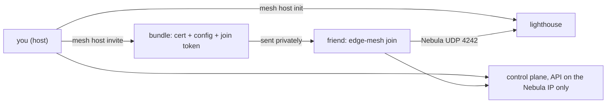

# Host your own game

The LAN-party host guide: run your own lighthouse and control plane, create the CAs, hand out join bundles, open a pool, place workloads by trust, revoke.

**Tested by following this guide literally, 2026-10-21, on Incus VMs** (an Ubuntu 26.04 host with Incus 6.0.5, Ubuntu 24.04 guests with kernel 6.8):
host init, invite, a friend's machine joining by hand with [JOIN.md](JOIN.md), the placement policy with a rejected pod, revoke, shut down. The Docker
variants were run earlier on WSL2 (Docker 29) and are marked **[docker]**. Where something is not tested it says **[not tested]**.

**What you will have at the end:** a control plane and a lighthouse of your own, a friend's machine joined to it over an encrypted mesh, a policy that keeps
your private workloads off other people's machines, and one command that throws a participant out.

**Time and cost:** about 30 minutes the first time (a few minutes for each machine to come up, most of it downloads), nothing to pay: no cloud, no account. It
needs a Linux machine with Incus (or Docker) and roughly 9 GiB of free RAM for three machines (the lighthouse 1 GiB, the control plane 3 GiB, each node 3 GiB).

Read [REQUIREMENTS.md](REQUIREMENTS.md) first. Every command below runs from the repository's `poc/` directory.



## 0. Pick how the machines run, once per shell

Every tool in `poc/` reads the environment variable `RUNTIME`:

```bash
export RUNTIME=incus        # machines are Incus VMs (Linux host with Incus, no Docker needed)
# export RUNTIME=docker     # machines are privileged containers (the default; needs Docker)
```

Forgetting it on a host without Docker gives `docker: command not found`. Use `./kc` wherever a guide says `kubectl`: it runs the right kubectl for your
runtime. At most **4 machines** run at once by default (`MAX_VMS`); kick someone before inviting a fifth.

Smoke test the toolchain first (about 6 minutes, cleans up after itself):

```bash
./poc-host.sh               # 11 checks, all PASS
```

## 1. Open your game: the CAs, the lighthouse, the control plane

```bash
./mesh host init            # prints "host up" after a few minutes
./kc get nodes              # the control plane, Ready
```

Run `TAINT=yes ./mesh host init` (and `TAINT=yes` on each `invite`) if you will use trust-based placement (section 5): every player's node then registers with the
trust taint.

This creates, in `poc/.state/`:

| Path | What | Treat it as |
| :--- | :--- | :--- |
| `ca/ca.key`, `ca/ca.crt` | the **persistent CA**: signs `own`, `control-plane`, `friends`, `lighthouse`; it **cannot** sign `public` | the crown jewel. Keep it offline in a real deployment (DESIGN.md decision 5): copy it to a password manager and delete it from the host |
| `ca-pool/ca.key`, `ca-pool/ca.crt` | the **pool CA**: created with `-groups public`, so it can only ever mint `public` certificates | online by design (an automatic issuer uses it); the group limit is what contains a leak |
| `bundles/lh`, `bundles/cp` | the lighthouse and control plane identities | |
| `blocklist` | fingerprints of everyone you revoked | new bundles start with it already applied |

Look at the CAs:

```bash
.cache/nebula-cert print -path .state/ca/ca.crt        # groups: control-plane, friends, lighthouse, own
.cache/nebula-cert print -path .state/ca-pool/ca.crt   # groups: public
```

**Back up `.state/ca/ca.key`.** If you lose it you must re-issue every player.

## 2. Invite a friend (persistent CA)

```bash
./mesh host invite alice --ttl 2h --trust friends
```

The output names the bundle directory (`.state/bundles/alice`). It holds the player's Nebula key and certificate, the CA bundle (both CAs), a `config.yml`
with the narrowed firewall, and `join.env` with a **k3s join token valid for 8 minutes** (`TOKEN_TTL=5m ./mesh host invite ...` makes it shorter; longer
than 8 minutes is refused, see ADMISSION.md "the life of a name"). A k3s
token is **not one-time** by itself: any machine holding it can register until it expires or is deleted, so once the node registered the host burns it
(`./mesh host burn`; `players`, `reap` and `revoke` do it too). `join.env` also carries the node's **node password**: the host stores its hash in
`kube-system/<name>.node-password.k3s` when it invites, so only this bundle can register this node name. Send it privately; the friend has to run the join
inside those 8 minutes (or you invite again under a **new name**: a name can be used once, even after a kick). The shared `K3S_TOKEN` is never given out.

**While an invite is open, rewrite the node guard every minute** (a security requirement, not a convenience): k3s drops the node password of a name
nobody took 10 minutes after the invite, and only a guard rewrite between the token's death (8 minutes at most) and then keeps somebody else's token
from taking the name. `reap` (and `burn`, `players`, `invite`, `revoke`) rewrite it. From a timer, on the machine that holds the state:

```bash
# crontab -e   (every minute; RUNTIME as in section 0)
* * * * * cd /path/to/k8s-lan-party/poc && RUNTIME=incus ./mesh host reap >/dev/null 2>&1
```

`invite` prints a note when nothing rewrote the guard in the last 90 seconds. Without the timer the gap is known and small: it needs a name issued but
not joined for over 10 minutes, another visitor holding a token that still works at that moment, and no `mesh host` command in between
([ADMISSION.md](ADMISSION.md), "the life of a name").

`--ttl` is the certificate lifetime (days for friends, `1h` for a demo). `--trust` accepts `friends` or `public`; `own` is for your own machines and is issued
by hand (`./issue.sh <name> <ip> own 24h`).

Your friend follows [JOIN.md](JOIN.md) on their machine. To simulate a friend on the same host:

```bash
./mesh play alice           # creates the machine (a VM or a container) and runs `edge-mesh join` in it
./mesh host players
# PLAYER   READY  CERT-EXPIRES
# alice    True   2026-10-21T14:30:42+02:00
```

Tested [dell]: a separate VM set up by hand from JOIN.md alone joined and showed Ready here.

## 3. Open a pool slot (pool CA)

A pool participant is `public`: admitted by your admission (by hand today, below), short lease, nothing persistent.

```bash
./mesh host invite pat --ttl 1h --trust public
```

`issue.sh` signs it with the **pool CA** (verified: the certificate's issuer is the pool CA's fingerprint, [docker] and [dell]). The two CAs' separation has its
own proof, which builds a cluster of its own (run it **after** `./mesh host down`, it starts by deleting whatever is running):

```bash
./poc-ca.sh                 # 13 checks: the pool CA cannot mint own/friends certs; removing the pool CA cuts only the pool
```

### Strangers, one hour at a time: admission with manual approval

To let people you do not know in, without handing out bundles one by one by feel, use the waiting list. Its limits are in `pool.yaml` (2 places, 1 h
each, a pause of 1 h and at most 2 leases a day per person); [ADMISSION.md](ADMISSION.md) explains every rule; the automatic version is below.

```bash
./mesh host request alice --ip 198.51.100.10 --note "from the chat"   # alice: waiting, position 1 of 1 [added]
./mesh host waitlist                    # the list in order; "deferred" = in cooldown or over the daily cap, with the time
./mesh host approve                     # the first eligible one: a public bundle that lives exactly the lease, an 8 min join token
# approved alice (public) until 2026-10-27T16:02:11Z; bundle: .../.state/bundles/alice
./mesh host leases                      # who has a place and how long is left
./mesh host admission-status            # one line: slots 1/2 used | 0 in the list | next to end: alice in 59m40s
./mesh host reap                        # expel every lease that ended (kick + blocklist) and free its place; again: "reaped 0"
./mesh host reject bob --reason "..."   # take a request off the list
```

Run `reap` from a timer **every minute** (the crontab line of section 2): it frees the place of an hour that ended even when you are away, and it is
the node guard's refresh, which is a security requirement while a name waits to join. `approve` refuses with exit 5 when both places
are taken (it says which lease ends next) and with exit 4 when nobody in the list is eligible yet. To close admission: `slots: 0` in `pool.yaml` and
`./mesh host reap --all`. `./poc-admission.sh` proves the whole cycle on Incus VMs (31 checks, among them a second machine refused with a burned token, a non-cooperative copy of a bundle refused by the node guard, and another guest's name refused by its node password; [dell]); it builds its own cluster, so run it after
`./mesh host down`.

### The automatic pool (B1): your timer runs it

The same list and the same limits, without you approving each place: a **tick** approves the first eligible requests while a place is free, puts each
bundle in an outbox, warns 5 minutes before the end, expels at the end and promotes the next one. Requests are still yours to enter (`mesh host request`,
by hand or from your own bot) and the bundle is still yours to deliver: the public page that does both is B2, not built ([ADMISSION.md](ADMISSION.md)).

```bash
./mesh host auto status                 # auto: off | panic: off | slots 0/2 used | 0 in the list ... (off by default)
./mesh host auto on                     # from now on the tick approves; `auto off` stops approvals, expiry always runs
./mesh host auto --once                 # one tick (your timer runs this every minute): tick: auto on | expelled 0 | approved 1 | ...
./mesh host bundle alice                # .state/admission/outbox/alice.tar.gz (0600) and the join line to send with it
./mesh host admission-metrics           # Prometheus textfile: slots, leases, the list, events per type, the last tick
./mesh host panic                       # abuse: auto off, slots 0, every lease expelled now; `panic --clear` reopens (auto stays off)
tail -f .state/admission/events.jsonl   # every fact, one JSON line: request, approved, bundle_ready, expiring, expelled, panic ...
```

**Your bot hears every event** if you point `ADMISSION_NOTIFY_CMD` at a command of yours: it is called with two arguments, the type and a short summary
(`approved "alice: approved automatically (public) until 2026-10-27T16:02:11Z"`), never through a shell, without IPs (`ADMISSION_NOTIFY_IP=1` adds
them), keys or tokens. If it fails the tick goes on; the event stays in the log. The repository knows no chat service: the command is yours.

**The timer** (the repository has no loop of its own). Every tick starts with `mesh host burn`, which rewrites the node guard, so this one timer
every minute is also the guard refresh of section 2, with auto on, off or in panic (no separate `reap` timer is needed while it runs). A tick that
cannot read its ledger or its switch exits 1 before the burn: alert on `emesh_admission_last_tick_timestamp_seconds`, or keep the `reap` line too. A systemd unit and timer, every minute, as
the user that owns the clone:

```ini
# /etc/systemd/system/emesh-admission.service
[Unit]
Description=edge-mesh admission tick (mesh host auto --once)
[Service]
Type=oneshot
User=<your user>
WorkingDirectory=<the clone>/poc
Environment=RUNTIME=incus
Environment=ADMISSION_NOTIFY_CMD=<your notify command>
ExecStart=<the clone>/poc/mesh host auto --once
ExecStopPost=/bin/sh -c './mesh host admission-metrics > /var/lib/node_exporter/textfile/emesh_admission.prom.tmp && mv /var/lib/node_exporter/textfile/emesh_admission.prom.tmp /var/lib/node_exporter/textfile/emesh_admission.prom'

# /etc/systemd/system/emesh-admission.timer
[Unit]
Description=edge-mesh admission tick, every minute
[Timer]
OnCalendar=*-*-* *:*:00
AccuracySec=5s
Persistent=true
[Install]
WantedBy=timers.target
```

`sudo systemctl daemon-reload && sudo systemctl enable --now emesh-admission.timer`; `journalctl -u emesh-admission` shows each tick's line. Or cron:
`* * * * * cd <the clone>/poc && RUNTIME=incus ADMISSION_NOTIFY_CMD=<your command> ./mesh host auto --once >>/var/log/emesh-admission.log 2>&1`.
Two ticks at the same moment are safe (one lock). Alert on `emesh_admission_last_tick_timestamp_seconds` older than a few minutes: without the tick
nothing expels at the hour (the certificate still expires). `./poc-admission-auto.sh` proves the whole automatic cycle on Incus VMs (37 checks; [dell]);
like the other suites it builds its own cluster, so run it after `./mesh host down`.

**Not built:** the pool's cluster side (quotas, LimitRange, idle kick) and the public page: issue #11 and ADMISSION.md sections B2 and B3. Without
`reap`, a "1 h slot" is still a 1 h certificate: when it expires Nebula closes the tunnel (`disconnect_invalid: true`) and the node goes NotReady.

## 4. Who is in, and the one command that revokes

```bash
./mesh host players
./mesh host revoke alice    # the one command
./mesh host kick alice      # the same, plus cordon, drain and removing the machine you simulated
```

`revoke` puts the certificate fingerprint on the Nebula **blocklist** of every host, reloads them and deletes the node object. It is idempotent (run it twice,
nothing breaks, nothing is listed twice), refuses an unknown name (exit 3), and works for pool nodes too. Players invited later start with the blocklist
already applied. Deleting the node alone (`kubectl delete node`) is **not** a revocation: the machine stays inside the mesh. `./poc-revoke.sh` proves all of
this ([docker], 10 checks, two identical runs; it measured 3 to 5 seconds from the command until the node could not reach the lighthouse). Tested [dell] from
this guide: revoke of a joined node, then `./kc get nodes` no longer lists it.

## 5. Trust levels and the golden rule (Kyverno)

Placement by trust needs the nodes to carry the trust taint (the `TAINT=yes` of section 1: the join then registers the node with `trust=<level>:NoSchedule`).
After the join **you** label the node, because a kubelet cannot set that label:

```bash
./kc label node alice node-restriction.kubernetes.io/trust=friends
```

Install Kyverno (pinned to your own node) and the two policies, then make the control plane an `own` worker for the test (it is tainted by default):

```bash
./install-placement.sh                                            # a few minutes; ends with "placement installed"
./kc taint node cp node-role.kubernetes.io/control-plane:NoSchedule-
./kc create namespace demo
```

Three pods to try. `private.yaml` has no label: **private by default**, it may only run on your own nodes. `shared.yaml` opts in to friends' nodes. `bad.yaml`
tries to bypass the scheduler with `nodeName`. Save each as its own file:

```yaml
# private.yaml
apiVersion: v1
kind: Pod
metadata: {name: private-app, namespace: demo}
spec:
  containers: [{name: c, image: busybox:1.36, command: ["sleep","3600"]}]
```

```yaml
# shared.yaml
apiVersion: v1
kind: Pod
metadata:
  name: shared-app
  namespace: demo
  labels: {edge-mesh/sensitivity: shareable, edge-mesh/share-with: friends}
spec:
  automountServiceAccountToken: false
  nodeSelector: {node-restriction.kubernetes.io/trust: friends}
  containers: [{name: c, image: busybox:1.36, command: ["sleep","3600"], resources: {limits: {cpu: 50m, memory: 32Mi}}}]
```

```yaml
# bad.yaml   (alice is a friends node)
apiVersion: v1
kind: Pod
metadata: {name: bad-app, namespace: demo}
spec:
  nodeName: alice
  containers: [{name: c, image: busybox:1.36, command: ["sleep","3600"]}]
```

```bash
./kc apply -f - < private.yaml
./kc apply -f - < shared.yaml
./kc apply -f - < bad.yaml          # REJECTED: "A private workload may only run on `own` nodes"
./kc -n demo get pods -o wide
# private-app  Running  cp       <- your own node
# shared-app   Running  alice    <- the friend's node, because it opted in
```

Tested [dell], exactly this: the first two ran where shown and the third was rejected with that message. The complete matrix (30 checks, 14 of them negative)
is `./poc-placement.sh` [dell] [docker]; it builds its own cluster, so run it after `./mesh host down`. Pods in `kube-system`, `kyverno` and `cilium-spire` are
exempt (the Cilium and SPIRE agents must run on every node).

## 6. Encrypted pod network and mutual auth (Cilium, SPIRE)

```bash
./vm/poc-vm.sh              # [dell]  Cilium tunnel + WireGuard over Nebula, SPIRE non-root with a PVC (24 checks); builds its own cluster
./kind-cilium.sh            # [kind]  the same checks without Nebula
```

To run a game with Cilium instead of flannel, set `CNI=cilium` before `init` and every `invite`, then run `./cilium.sh` and `MUTUAL=yes ./cilium.sh`. Read
[TROUBLESHOOTING.md](TROUBLESHOOTING.md) first: mutual auth is beta and has one known trap (the "sticky failure"), fixed in the PoC by a small MSS on the mesh route.

## 7. End the game

```bash
./mesh host down            # removes every machine, the network and the state (the CAs too: back them up first)
```

## A public lighthouse on a separate server

By default the lighthouse sits next to your control plane. To let people **outside your network** join, the lighthouse needs a public UDP address
(4242). It is the only thing that has to be public: the CA key and the Kubernetes API stay with you (the API listens on its Nebula IP only, `H02`).
A small VPS is enough. `poc/lighthouse-vps.sh` installs it and keeps it in step with your CA.

```bash
# on the machine that holds your CA (poc/.state/ca) and the server's ssh key; it does all three phases
poc/lighthouse-vps.sh install play.example.org --ssh "ssh -i ~/.ssh/server_key root@203.0.113.7"
# open udp/4242 on the server's firewall (that is yours; nothing else is needed besides ssh), then bring up the game with that lighthouse:
RUNTIME=incus PERSIST=1 poc/mesh host init        # the choice was recorded in .state/lighthouse.env; no lh machine is created
poc/lighthouse-vps.sh verify --ssh "ssh -i ~/.ssh/server_key root@203.0.113.7"
```

What the three phases do, and why they are separate commands:

| Phase | Runs where | What it does |
| :--- | :--- | :--- |
| `prepare <host> --ssh ...` | where the server's ssh key is | installs `nebula` (pinned version, `sha256` checked against the release), makes the lighthouse key **on the server** and writes `lh.pub` |
| `sign <host> lh.pub` | where the CA is | signs that public key (group `lighthouse`, 180 days by default; `--duration` changes it) into `.state/bundles/lh`. The private key never leaves the server |
| `deploy --ssh ... [bundle-dir]` | where the server's ssh key is | pushes `ca.crt`, the certificate and the config, installs the systemd unit, starts or reloads it, and waits until it is active |

`install` runs the three in a row when one machine has both the CA and the ssh key; otherwise run `prepare` where the key is, copy `lh.pub` to the CA machine,
`sign`, copy `.state/bundles/lh` back and `deploy`. Every phase is idempotent (a second run prints no `changed:` line, `P03`, `P06`, `P08`). After `mesh host revoke`,
`lighthouse-vps.sh sync --ssh ...` pushes the new blocklist to the server (revoke does it itself when it can reach the server, `P16`/`P17`). `remove` stops the
service and deletes its keys and config.

`PERSIST=1` is for a game people keep joining: nebula and k3s of the control plane become systemd services, the VM starts with the host (`boot.autostart`), and the
control plane certificate lasts 180 days instead of one (`CP_CERT_DURATION` changes it). **Renewing that certificate before it ends is not automated yet.**
**A second game next to the PoC tests.** Every PoC suite starts with `down.sh`, which deletes every `emesh-*` machine of its Incus project **and its state
directory** (the CA keys, the bundles, the blocklist, `lighthouse.env`). So a game people keep joining gets its own Incus project, its own subnet **and its own
state directory** (`EMESH_STATE`, default `poc/.state`; `tests/test_poc_state_dir.py` checks that two of them do not touch each other):
`incus project create mygame -c features.profiles=false -c features.images=false`, then
`EMESH_STATE=$HOME/mygame-state INCUS_PROJECT=mygame VMNET=mygamebr UNDERLAY_NET=10.79.0 RUNTIME=incus PERSIST=1 poc/mesh host init`, and the same
`EMESH_STATE` (and project) on every later `mesh` or `lighthouse-vps.sh` command of that game. Simpler still: run that game from its own clone. Keep `features.networks` off: with it on, Incus only
allows OVN networks in the project and the bridge cannot be created (the client waits for ever). The network is created in the shared set, so give it its own name and subnet.

Not covered: a player behind a symmetric NAT needs a relay (issue #15), and a control plane behind your home NAT is reached by hole punching through the
lighthouse, which depends on your router. Test it from a network that is not yours before you announce the game.

**The lighthouse is a full member of the mesh.** It gets a `nebula1` address like any host, its outbound rule is `any`, and every host allows `tcp/6443`
from any mesh member, so whoever takes over the public server can reach the Kubernetes API over Nebula (a credential is still required). A lighthouse that
only introduces hosts could run with `tun: {disabled: true}`; that is a later hardening step (issue #20), noted in [DESIGN.md](DESIGN.md) section 6.

## What this guide does not cover yet

Per-namespace RBAC and user kubeconfigs (issue #9), the public pool's cluster side and its public page (issue #11; the automatic tick is built),
the relay for symmetric NAT (issue #15), and the LoadBalancer/BGP on own nodes (issue #13). See the gap table in [POC-STATUS.md](POC-STATUS.md). Join by signed pull request (issue #12) exists as a proof of concept for the maintainer's own game: [participants/README.md](../participants/README.md) (`participants.py sync` takes the same `EMESH_STATE`).
