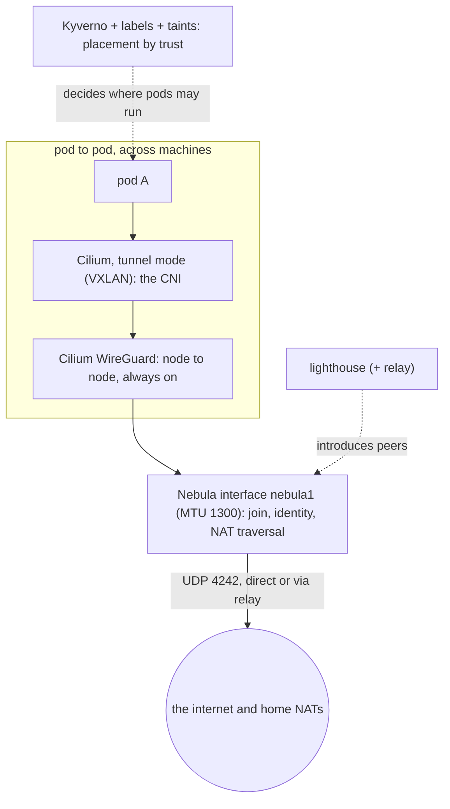
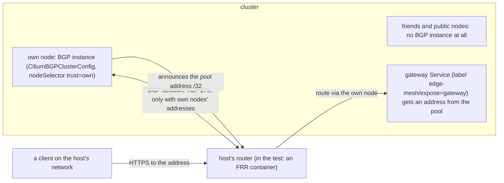

# Networking guide: layers, optional BGP, what to use without it, the AI gateway

For someone who knows Kubernetes but not networks. Everything here follows the golden rules ([GOLDEN-RULES.md](GOLDEN-RULES.md)): one job per layer
(rule 3), the Kubernetes API never public (rule 6), the host's endpoints only on the host's own nodes (rule 7).
**Tested** means a suite in this repo ran it; **not tested here** means general knowledge or upstream documentation.

## 1. The layers, one job each



| Layer | Its one job | Always on? | Numbers (`poc/stack.env`, DESIGN section 3) |
| :--- | :--- | :--- | :--- |
| **Nebula** | join (a certificate from your CA) and connectivity through NAT; a lighthouse introduces peers, a relay carries traffic when no direct path exists | yes | UDP **4242** to the lighthouse; Nebula addresses `10.77.0.x` in the PoC; `NEBULA_MTU=1300` |
| **Cilium, tunnel mode** | the CNI: pod networking, joiners configure nothing | yes | VXLAN adds 50 bytes; Cilium health 4240 |
| **Cilium WireGuard** | encrypt pod traffic between nodes | always on | adds up to 80 bytes; UDP 51871 stays open between nodes |
| **Cilium mutual auth** (SPIRE) | workload identity, per policy | only when a policy asks (beta) | not evidence against a joined node's owner (DESIGN 3.3) |
| **Kyverno, labels, taints** | placement by trust (`own`, `friends`, `public`) | yes | no network number |

**MTU is set once.** `NEBULA_MTU=1300` is the only number; the pod MTU is derived by one formula in `poc/stack.env` (`pod_mtu_from`:
(1300 - 50 - 80) rounded down to a multiple of 50 = 1150). Nothing else is configured by hand.

**What crosses the internet.** Only Nebula (UDP 4242). Pod traffic rides inside it, wrapped by the tunnel and by WireGuard. The API server
listens only on the Nebula address (DESIGN 3.2): there is no public Kubernetes endpoint.

## 2. BGP, explained for Kubernetes people

**The problem.** A `Service` of type `LoadBalancer` gets an IP, but something has to tell the *network* where that IP lives. In a cloud the
provider does it. On your own network the router does not know that `10.200.0.1` is "behind node 3". **BGP** is the protocol routers use to
say "this prefix is reachable through me". With BGP a node tells your router "send traffic for the gateway's address to me" and the router
updates its routing table; if the node dies, the route is withdrawn.

**Why it is optional.** Nothing in the game needs it: nodes talk over Nebula, pods over Cilium. BGP matters only if the **host** wants a
gateway address reachable from the host's own network through a router that speaks BGP. A game among friends needs none (section 3).

**Who uses it.** Only the host, and **only from the host's `own` nodes**. A participant never sees it and never needs it (section 5).

**How it is built and tested** (`make poc-bgp`, 20 checks, 6 negative; DESIGN section 6; `poc/vm/poc-bgp.sh`):



- `poc/gateway/bgp.yaml`: a `CiliumBGPClusterConfig` whose `nodeSelector` is the label `node-restriction.kubernetes.io/trust: own`; a
  `CiliumBGPAdvertisement` that announces only the `LoadBalancerIP` of Services carrying `edge-mesh/expose: gateway` (never pod CIDRs); a
  `CiliumLoadBalancerIPPool` that selects **Services** by that label (a pool has a `serviceSelector`, not a node selector).
- A remote node has no BGP node configuration, so no instance and no session (G08). It cannot label itself `own`: a kubelet cannot set labels
  under the `node-restriction.kubernetes.io/` prefix (G09) and no other credential on a joined machine can either (G09b,
  `poc/node-trust-freeze.yaml`). Its Cilium agent token may not write any BGP object, the pool, a Node or a Service (G10). Root on it opening
  TCP 179 to the router gets no session, "not configured" (G11). A LoadBalancer Service without the label gets no address (G18); the router
  learns no route through a remote node (G19).
- The Gateway, cert-manager and the backend run only on `own` nodes (G17).

**Try it without hardware** (needs Incus on a Linux machine; it builds 4 VMs and an FRR router container, and tears them down):

```bash
make poc-bgp          # from the repo root; same as poc/vm/poc-bgp.sh. KEEP=1 leaves it up to look around
```

It prints PASS or FAIL per step (G01 to G19) and ends with `RESULT PASS`. On your own game instead: `BGP=yes ./cilium.sh`, then
`ROUTER_IP=<router> OWN_IP=<own node> ./gateway.sh bgp` and `./gateway.sh install` ([HOST-YOUR-OWN.md](HOST-YOUR-OWN.md) section 6b).
`gateway.sh router` is the test router only: never point it, or the suite, at a real router.

**What the real router needs.** The test router accepts a session from a bare neighbour address, which can be spoofed on a shared segment.
On the real router list **only your own nodes** as neighbours, and for each also set a **session password** and **GTSM** (`ttl-security hops 1`)
(HOST-YOUR-OWN 6b). The test router does not do this (it is a throwaway). How to set the password and GTSM on the Cilium side: not verified
here; read the Cilium BGP peer configuration reference (section 7) first.

**Problems** (a session that stays down, a route through the wrong node): [TROUBLESHOOTING.md](TROUBLESHOOTING.md), "The router shows no
session with the own node". `kubectl get ciliumbgpnodeconfigs` must list only own nodes.

## 3. If you do not use BGP

| Your case | Use | What to know |
| :--- | :--- | :--- |
| A game among friends, no special router | **Nothing to publish.** Keep the gateway (or nothing) inside Nebula | Participants and `kubectl` already reach everything over Nebula. Tested: every recipe in [TRY-IT.md](TRY-IT.md) |
| Your network is one flat LAN and you want a stable gateway address on it | **Cilium L2 announcements** with LB IPAM | Beta upstream. Cilium answers ARP/NDP for the address, so it suits clients on the same layer-2 segment. One node (a leader per Service, chosen through a lease) answers for each address: no balancing before the cluster, no ECMP; failover takes seconds (upstream: 10 to 20 s by default). Needs kube-proxy replacement. Not tested here |
| You just need a port on a node | `NodePort` Service | Reachable on the node's address; nothing is announced, you manage the node address yourself. Participants' namespaces get no NodePort (DEMO.md). Not tested here |
| The gateway should not be reachable from outside at all | Gateway without publishing | The Gateway exists, its address is not announced; reach it from inside the cluster or over Nebula. Not tested here as a separate mode |
| You want it on the internet and control no router | A VPS with a public IP in front (the lighthouse host is one) forwarding to the gateway over Nebula | Keeps your home address hidden (DESIGN 15). Not tested here |

What changes for participants in each case: **nothing**. What still holds in every case: the Gateway and whatever announces it run only on
`own` nodes (rule 7), and the Kubernetes API is never published (rule 6). With L2 announcements or a NodePort apply the same discipline as for
BGP: select only the gateway's Service, on `own` nodes. The repo does not enforce that for L2 or NodePort yet.

## 4. The AI gateway and agentgateway

**"The AI gateway"** is the host's single entry point for LLM calls (later also MCP tools and agent-to-agent traffic). Like the rest of the
host's endpoints it runs **only on `own` nodes** (rule 7). It is optional: you need it only if the host wants to expose models or tools. It
changes nothing about placement, BGP or TLS (DESIGN section 6).

**What the repo runs today.** `poc/gateway/gateway.yaml` uses **Envoy Gateway** (`ENVOY_GATEWAY_VERSION` in `poc/stack.env`): a `GatewayClass`
with controller `gateway.envoyproxy.io/gatewayclass-controller`, one HTTPS `Gateway`, an `HTTPRoute` to a plain backend, TLS issued by
cert-manager from the Gateway. That is a generic Kubernetes Gateway API gateway. **There is no AI routing in the repo yet, and agentgateway is
not used anywhere in it.** DESIGN section 6 says the AI part would sit on top of this gateway (Envoy AI Gateway extends Envoy Gateway).

**Options, from upstream documentation (read 2026-10-29; not exercised in this repo):**

| Option | What it is | Relation to the Gateway API |
| :--- | :--- | :--- |
| Envoy Gateway (used today) | a Kubernetes Gateway API implementation on Envoy | is a Gateway API gateway |
| Envoy AI Gateway, now branded **Agent Router** (its site shows version 1.2) | OpenAI-compatible routing to many providers, token limits, MCP routing, inference-aware routing; "powered by Envoy", lists Envoy Gateway as a base | how it attaches to the Gateway API: not verified |
| **agentgateway** (Linux Foundation, Apache-2.0) | proxy for LLM, MCP and A2A traffic, also plain HTTP and gRPC; its docs show version 1.7.x | its docs say it is conformant to the Gateway API (HTTPRoute, GRPCRoute, TCPRoute, TLSRoute); GatewayClass name and install method: not verified |

All of them are used behind a Gateway API `Gateway`, so the choice does not touch the layers above: same `nodeSelector` on own nodes, same
labelled Service, same BGP (or none), same cert-manager TLS. Choosing one is an open decision; whichever is chosen must pass "runs only on own
nodes" (`poc-bgp` G17, `poc-golden` rule 7) before it is claimed.

## 5. What a participant sees and what not

| A participant sees | A participant does not see or need |
| :--- | :--- |
| Nebula (one bundle, one command, outbound UDP 4242) | BGP: no instance on their node, no session, no config |
| their namespace and the pods placed by trust | the gateway, the AI gateway, the LoadBalancer pool |
| everything their node's owner can see (rule 1) | a router of any kind |

## 6. My network, what do I choose

- [ ] Friends only, everyone on Nebula: choose nothing, skip sections 2 to 4.
- [ ] Same home LAN, you want an address for the gateway: L2 announcements (section 3), accepting its limits.
- [ ] A router that speaks BGP and you want a routed address: BGP from own nodes, rehearsed first with `make poc-bgp`, then password and GTSM on the router.
- [ ] Models or tools exposed: the AI gateway on own nodes only, after the plain gateway works.
- [ ] Always: the API stays on Nebula; only `own` nodes carry your endpoints.

## 7. References

Opened 2026-10-29. "Not verified" means the page fetched did not say.

- Cilium BGP Control Plane: https://docs.cilium.io/en/stable/network/bgp-control-plane/bgp-control-plane/index.html (resources `CiliumBGPClusterConfig`, `CiliumBGPPeerConfig`, `CiliumBGPNodeConfig`; enabled with `bgpControlPlane.enabled=true`; peer password and GTSM fields: not verified)
- Cilium L2 announcements: https://docs.cilium.io/en/stable/network/l2-announcements/ (beta; ARP/NDP; one leader node per Service)
- agentgateway: https://agentgateway.dev/docs/kubernetes/latest/ and https://github.com/agentgateway/agentgateway
- Envoy AI Gateway / Agent Router: https://theagentrouter.ai/ (redirect from aigateway.envoyproxy.io)
- Gateway API: https://gateway-api.sigs.k8s.io/ (version: not verified)
- Nebula: https://nebula.defined.net/docs/ (also in [REFERENCES.md](REFERENCES.md))
