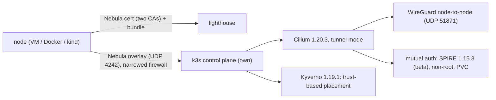

# PoC status (2026-10-28)

Where the proof of concept stands, what was proven, and what is still open.
the maintainer's rule for this phase: make it work first, write down every place where security was relaxed, then harden it. Phases A, B and C
are done; this page records what each one proved and what is still relaxed.

## Proven, with identical output across two runs

| Step (script) | Dell Incus VMs | WSL2 k3s-in-Docker | WSL2 kind |
| :--- | :--- | :--- | :--- |
| Join, 17 checks (`poc-join`), now with the narrowed firewall (J13) and the pool CA for `public` nodes | PASS x2 | earlier version PASS | n/a |
| `poc-host` 11 / `poc-weakness` 8 | PASS x2 | earlier version PASS | n/a |
| Cilium + WireGuard over Nebula, pod to pod, DNS, MTU, 30 MB md5, firewall check | PASS x2 (23 steps); 24 PASS on 2026-10-26 (1 run) | PASS (1 run, see report) | PASS (SPIRE steps too) |
| **#8 closed** (`poc-vm`, 34 checks (V103 new), remote nodes tainted as in a real join): `cilium-dbg encrypt status` with every other node a peer and its own published key (V06), the kernel's WireGuard peers are exactly the other nodes' keys (V06b), a remote node's Cilium token cannot rewrite another node's key (V06c, the CiliumNode guard), the CNI drop-in on every node (V06d), the MTU set once (V11), mutual auth: the twin on a node with an identity passes, the twin on a node without one is dropped with "Authentication required", and is let in once its node has an identity again (V98-V102) | PASS (2026-10-28, head 8d772c4: x2 identical, 33 checks). On the head of round 2 (34 checks): run 1 PASS; run 2 failed V101/V102 because the API server could not reach n1's kubelet (`502` on exec) while the Dell was loaded: a transient of the environment, not rerun, not counted as x2 | `poc-cilium` PASS x2 identical (23 steps) on 8d772c4; `poc-kind` 1 run PASS (20 steps) on 8d772c4 (the repeat was stopped for low memory) | `poc-kind`: see Docker column |
| **#13** gateway and BGP on own nodes only (`poc-bgp`, 20 checks, 6 of them negative; G09b: no identity but the host can change a node's trust labels, k3s controller credential included): BGP config selects `trust=own`, the pool selects Services; the own node Established, the remote nodes without a BGP instance; a remote node cannot select itself (kubelet credential), its Cilium token writes no BGP object, Node or Service, root on it gets no session from the router; Envoy Gateway and cert-manager on own nodes; the certificate issued from the Gateway; HTTPS from the router verifies against the local CA; an unlabelled LoadBalancer gets no address; no route through a remote node | PASS x2, identical output (2026-10-28), also on the round-2 head with the node trust freeze | n/a | n/a |
| Encryption on the wire (canary in clear only on `cilium_wg0`, none on `nebula1`) | PASS x2 | PASS | PASS |
| Mutual auth (SPIRE), non-root, PVC, survives a restart (V92-V97) | PASS 10 of 10 runs after the MSS fix of 2026-10-21 (the earlier flake, 1 of 4 runs failing V92, had a root cause: see below); PASS again on 2026-10-26 with the supervised agent | PASS (1 run, see report) | PASS (3 runs) |
| **B3** two CAs (`poc-ca`, 13 checks) | PASS x2 | not run | n/a |
| **Lighthouse on a separate public server** (`poc-lighthouse`, 23 checks): prepare / sign / deploy are idempotent, its key is made on the server, its metrics answer, a player joins through it, `revoke` reaches it; `mesh host refresh` leaves an unchanged machine alone (P12c), brings the API and the node back after a change that restarts Nebula (P12d) and reloads without a restart otherwise (P12e) | PASS (2026-10-27, one run with 21 checks and one with the 23 on the merged tree) | not run | n/a |
| **C** trust-based placement with Kyverno (`poc-placement`, 30 checks, 14 of them negative, 2 more stay Pending by design) | PASS x2 | PASS (1 run) | n/a |
| **Admission with manual approval** (`poc-admission`, 31 checks, [ADMISSION.md](ADMISSION.md)): request, approve, join, `reap` burns the join token and a second machine presenting it is refused, a non-cooperative copy of a bundle is refused by the node guard and cut with the lease, another guest's issued name is refused by its node password, a name whose node password k3s dropped leaves the guard, places full, the lease ends, `reap` expels, the next one in line enters, `reap --all` | PASS (2026-10-27: the 31-check version once, in its own Incus project; earlier versions of the suite 7 times) | not run | n/a |
| **Automatic pool, phase B1** (`poc-admission-auto`, 37 checks, [ADMISSION.md](ADMISSION.md)): `auto on`, one tick approves two and the third waits, the outbox bundle (0600, the same files), both join, a copy of a bundle refused by the node guard, the tick burns the tokens, `expiring` once, one tick expels at the end (no stray Node left) and only then promotes, the copy's tunnel cut, a burned token refused, auto off only warns and expels, the daily cap refuses a third request of one identity, `panic` (idempotent, exit 7 while on, `--clear`), the notify hook got every event in order, the metrics | PASS (2026-10-27: the 37-check version three times in its own Incus project, the last two (node passwords, 8-minute tokens) with identical output; the 36-check version once, project default, before the node guard) | not run | n/a |
| **Join by signed PR** (`poc-participants`, 33 checks, offline; `poc-participants-e2e`, 11 checks, Incus VMs; issue #12, [participants/README.md](../participants/README.md)): the real cosign against a **local TEST CA** playing Fulcio; a valid signed PR passes; another identity, another account id, another workflow or OIDC issuer, an untrusted CA, a key instead of keyless, an unsigned or tampered file, a replay by another author, trust `own` (never through a PR), a taken or reserved node name, a join PR that touches code: each fails; the issuing side re-verifies main, issues the participant's own public key, delivers the bundle age-encrypted and cosign-signed and refuses a forged one; on the VMs she joins with her own key and, once her file leaves main, one sync cuts her from the lighthouse and the API | PASS x2 (both suites, 2026-10-28) | `poc-participants` PASS (WSL, 2 runs) | n/a |

"x2" = two runs whose `diff` is empty. **Last full run, 2026-10-26, Dell Incus VMs, after the agent supervision (one run each, all PASS):** `vm/run-all.sh` = join 17, host 11,
weakness 8 (W00-W06 and W03b), CAs 13, revoke 10, placement 30 (89 PASS); `vm/poc-vm.sh` (Cilium + WireGuard + SPIRE) 24 PASS; `vm/poc-placement.sh` (Cilium) 30 PASS.
The earlier pairs of runs were identical; the 2026-10-26 runs have not been repeated, so they are single runs, not "x2".

## Phase A: it works everywhere

- **A1.** Cilium + WireGuard + SPIRE with the uid fix on the Dell VMs: PASS, two identical runs (`V01-V92`).
- **A2.** A real narrowed Nebula firewall, in `issue.sh` (`FW=narrow` is the default, `FW=open` gives the old any/any). Inbound allows only:
  ICMP, `TCP 6443`, `TCP 10250` (only from group `control-plane`), `UDP 51871`, and `UDP 8472` only when flannel is the CNI.
  Re-run: join/host/weakness (flannel, `8472` open) and the Cilium step (no `8472`, no `4240`) pass. New negative checks: `J13` / `V15` / `C14`
  show an unlisted TCP port between two hosts is refused while ICMP and `6443` pass. `tcp/4240` (Cilium health) is not needed: the node
  encryption carries it. `tcp/4250` (the mutual-auth handshake between agents) is not needed either: it rides inside WireGuard.

## Phase B: what was relaxed, now hardened

| Was relaxed | Now | Evidence |
| :--- | :--- | :--- |
| spire-server ran as root | **Done.** Runs as uid 1000. A one-shot root initContainer (`CHOWN`, `DAC_OVERRIDE`, `FOWNER` only) hands the hostPath socket dir to 1000; the pod-level `runAsUser: 1000` is what makes the chart's `cilium-init` sidecar work (see below) | `V93` |
| SPIRE had no persistent datastore | **Done.** A 1 Gi PVC (`spire-data`), `fsGroup: 1000`. Deleting the server pod keeps the same CA bundle and the same registration entries | `V95`, `V96`, `V97` |
| SPIRE server was free to land anywhere | **Done.** Pinned to a node labelled `trust=own` (DESIGN.md section 4.4) | `V94` |
| Nebula firewall any/any | **Done**, see A2 | `J13`, `V15`, `C14` |
| Single CA | **Done for the join path.** Two CAs: *persistent* (offline in real life, may sign `own`, `control-plane`, `friends`, `lighthouse`, not `public`) and *pool* (online, created with `-groups public`: even a stolen pool key can mint only `public` certificates). Every host trusts both. Removing the pool CA from the bundle cuts the public node off and leaves the others untouched | `poc-ca` `B01-B13` |

### SPIRE findings worth keeping

1. **Why non-root needed more than a chown.** The chart's `cilium-init` sidecar reaches the server through `/proc/<pid>/root`. A process with a
   different uid, root included but without `SYS_PTRACE`, gets `Permission denied`. With the server at 1000 and the sidecar at root, no
   registration entry is created and mutual auth silently never works (found on kind, `entries=0`). Same uid for the whole pod fixes it.
2. **The sticky mutual-auth failure: root cause found and fixed (2026-10-21).** Cilium's agents authenticate each other with a TLS handshake on host-to-host
   TCP 4250. That traffic goes through the node-to-node WireGuard (`cilium_wg0`, MTU about 1055), but the host computes its TCP MSS from `nebula1` (MTU 1300), so
   full-size or GSO segments are dropped silently (no ICMP is generated for them) and the SPIFFE certificates (about 1.5 KB) never get through. The auth manager
   then keeps that flow "pending" for ever, without a log line. Whether a run stalls depends on earlier packet sizes on that node pair, which is why it looked
   random (5 of 7 Dell runs with the PVC before the fix; a PVC is not the cause). **Fix:** `advmss 860` on the mesh route of every node (`edge-mesh join`, `up.sh`,
   `vm/up.sh`, only with Cilium). **Proof:** `poc-vm.sh` 10 runs in a row on the Dell VMs, 24 steps each, 0 failures (CPU at most 53 C); an extra guard waits for the
   registration entries and a quiet delegate stream before applying the policy. Not re-run in the fix: the Docker flow was run once after it (23 steps PASS).
   The evidence trail (live cluster: restarting one agent sometimes cured it; a bulk `nc` between the node addresses stalled; `tcpdump` showed the 1248-byte segment
   retransmitted while the small one was acknowledged) is in docs/TROUBLESHOOTING.md.

## Phase C: the golden rule (`poc-placement`)

Nodes: `cp` = `own` (schedulable in this test: the maintainer's machine), `n1` = `friends`, `n2` = `public`; the last two carry the taint
`trust=<level>:NoSchedule` from registration and the label `node-restriction.kubernetes.io/trust`. Policy: `poc/placement/trust-placement.yaml`
(Kyverno `ClusterPolicy`, Enforce, plus a `ClusterRole` so Kyverno can read Nodes) and `poc/placement/node-trust-vap.yaml` (a
`ValidatingAdmissionPolicy` on Nodes).

| Case | Result |
| :--- | :--- |
| Unlabelled pod (private by default), or a private Deployment of 3 | forced to `nodeSelector trust=own`, all on `cp` |
| Private pod that asks for a friends node by `nodeSelector` | silently ends on `cp` (the mutation overwrites the selector) |
| **Private pod with `nodeName` on a friends or public node** | **rejected**: "A private workload may only run on `own` nodes" (Kyverno looks the node's label up with an API call) |
| Private pod that tolerates the `trust` taint, or an `Exists` toleration for everything | rejected |
| Unknown `edge-mesh/sensitivity` value | rejected |
| Shareable + `share-with=friends` pinned to the friends node / `share-with=public` pinned to the public node | Running there |
| Shareable + `share-with=friends` aimed at the public node, or shareable without opt-in aimed at a shared node | stays Pending (Unschedulable) |
| Shareable with hostPath, privileged, `secretKeyRef`, host network, no limits, or a mounted service account token | each rejected |
| Relabel `cp` as `friends` without the taint; remove the taint from `n1` | both rejected by the node-side policy |

Choices and limits:

- `nodeName` bypasses the scheduler, and the PoC's own test pods use it with `tolerations: Exists`; that is why a taint alone is not enough and the
  admission rule exists.
- DESIGN.md says a policy "refuses a Node create without the taint and the label". A kubelet cannot set that label (NodeRestriction), so a create
  without it is normal. The policy therefore enforces the pairing at **label time and on taint removal**, and the join sets the taint at registration.
- System namespaces (`kube-system`, `kyverno`, `cilium-spire`) are excluded: the Cilium and SPIRE agents run on every node by design, so a
  `friends` owner can read the SPIRE agent socket of their own node. Kyverno itself is pinned to `own`.
- Kyverno runs 1 admission replica with `failurePolicy: Fail`; if it is down no pod is admitted. HA is not tested.
- The policy matches `Pod`, so Deployments, Jobs and DaemonSets are covered at pod creation (autogen is off).

## Phase-1 gap check (issues #4-#17, the "MVP phase 1" milestone)

**Verdict (2026-10-28): phase 1 is not complete.** Of the 13 goals (#4-#16): **7 done** (#4, #5, #6, #7, #8, #10, #13), **3 partial** (#11; #12: join by signed PR is built and tested as a proof of concept, a first signature from a real participant's fork is still missing; #14), **3 missing** (#9, #15 and #16, which is missing by design). What is done is the technical core; what is missing is what turns it into an open service (RBAC and kubeconfig per user, the pool's reaper and quotas, a first real signed-PR participant, relay/NAT tests, the public opening).

| Goal (issue) | Evidence | Status |
| :--- | :--- | :--- |
| Step 1: it joins, one bundle and one command, study lab runs, token reuse / expired cert / blocked UDP (#4) | `poc-join` J01-J17, Dell VMs x2 and WSL Docker | **done** |
| Host your own game: init / invite / players / kick / down (#5) | `poc-host` H01-H11, Dell VMs x2 and WSL Docker; `invite --trust public` run on WSL Docker | **done** |
| Weaknesses of one control plane as data (#6) | `poc-weakness` W00-W06 and W03b, 8 of 8 on the Dell VMs (W03b and the supervised agent: 2026-10-26, one run; W05 had been failing since the agent died on the flannel panic, see TROUBLESHOOTING); numbers in DESIGN.md 13.1 | **done** |
| Revocation in one command (#7) | `J17`: node deleted, cannot reach the lighthouse, does not come back | **done**: `mesh host revoke <name>` is the one command, idempotent, refuses an unknown name, covers pool nodes, and later invites inherit the blocklist; `poc-revoke` R01-R10 passes twice with identical output on WSL Docker and 10 of 10 on the Dell VMs (2026-10-26, one run); the negative test shows `kubectl delete node` alone does not revoke (the machine stays in the mesh); measured 3 to 5 s to lose access |
| A lighthouse on a separate public server (needed by the public demo, #16) | `poc-lighthouse` P01-P18 with P09b, P12b-P12e (23 checks), a Dell VM plays the server | **done on a VM**; a real public server is the maintainer's step in DEMO.md |
| A control plane that stays up, reachable from the internet (the demo's infrastructure, #16) | the maintainer's lab: persistent control plane (systemd, starts with the host) behind a lighthouse on a public server; a visitor from another network reached its API over Nebula on 2026-10-27 | **done for the maintainer's own setup**; admission, reaper and the page are not built (#11); the control plane certificate (180 days) is renewed by hand |
| Cilium tunnel + WireGuard, MTU once, mutual auth by policy (#8) | `poc-vm` V01-V102 (33) on Dell VMs, twice with identical output (2026-10-28); `tests/test_mtu_once.py`; kind and WSL Docker on the earlier checks | **done**: every node a WireGuard peer by key (V06, V06b); the pod MTU derived once from `NEBULA_MTU` (V11 on every node and pod, the unit test keeps a second number out); the deny half: a peer whose node has no SPIRE identity is dropped by the same policy that lets its twin in (V101), and let in once the identity is back (V102); the first attempt's CreateContainerError is fixed and checked on every node (V06d, TROUBLESHOOTING). Found on the way and fixed: the SPIRE agent did not tolerate the `trust` taint (pods on real joined nodes would never authenticate); the Cilium agents' shared token could rewrite any node's WireGuard key (now the CiliumNode guard, V06c). Limit, not tested: mutual auth is not evidence against the owner of a joined node (DESIGN.md 3.3) |
| Per-namespace RBAC and user kubeconfig (#9) | none | **missing** (big: issue #9) |
| Trust levels + Kyverno placement (#10) | `poc-placement` L01-L53 with L52b (31 checks, x2 identical on the Dell VMs 2026-10-28), Dell VMs and WSL Docker: private never on friends/public even with toleration or nodeSelector or `nodeName`; shareable may; a node cannot raise its own label with its kubelet credential (L52); the Kyverno denial message (matrix row 10) | **done** |
| Free 1 h pool and per-IP limits (#11) | `pool.py` and `admission.py` unit tests; the pool CA (`poc-ca`); `poc-admission` A01-A31; `test_admission_auto.py` and `poc-admission-auto` AA01-AA37 | **partial**: option A, admission with manual approval, is built and tested (2 places, 1 h leases, FIFO list, cooldown and daily cap per identity, `reap` expels at lease end, [ADMISSION.md](ADMISSION.md)); phase B1, the automatic tick (approve inside the limits, expel at the end, promote the next, panic, events, notify hook, metrics), is built and tested; B2 (the public request page, anti-bot) and B3 (the opening) are design only; quotas, LimitRange and the idle kick are missing (issue #11 stays open) |
| Signed-PR participants with cosign (#12) | `poc-participants` S00-S30, S09b, S28b (offline, local TEST CA), `poc-participants-e2e` E01-E11 (Dell VMs), `test_participants.py`; CI `participants` (the PR's files, public Sigstore) and `participants-live` (the same verification code on a blob the job signs keyless) | **partial** (2026-10-28): every acceptance criterion has a check (valid passes: S01, E03; other identity: S02, S03, S08, S09, S09b; unsigned or tampered: S05, S06; above the allowed trust: S10, S11, S12, `own` is never issued through a PR; removal revokes: S27, E08-E10, and only the participant's account or the maintainer removes: S16; the fixture's CA is a local TEST CA, refused without its marker: S00, S18). Missing: a signature from a real participant's fork through `sign.yml` (needs a second GitHub account; until then the `participants` checks are not required), a fresh join token on request, renewal under the same node name, the issuer's public key |
| Gateway and BGP on own nodes only (#13) | `poc-bgp` G01-G19 and G09b on Dell VMs with a test FRR router, twice with identical output (2026-10-28) | **done** (refs, not fixes, until the review closes): a node selector (`trust=own`) in the BGP configuration; the pool selects Services by label because its API has no node selector (DESIGN.md section 6); a remote node never announces (no BGP instance G08, cannot opt in G09-G10, the router refuses it G11, no route through it G19); TLS issued from the Gateway by cert-manager (G13, G16); every gateway, backend and cert-manager pod on an own node (G17). The real edge router is the maintainer's step |
| PoC matrix: VM, privileged Docker, WSL2 (#14) | VM (Dell), privileged Docker on WSL2, kind; `edge-mesh` refuses without `/dev/net/tun` (exit 4) | **partial**: VM (Dell, many runs), privileged Docker on WSL2 and kind are covered; native WSL2 as a node, macOS and bare metal are **not run** (a first attempt showed that a WSL2 distro cannot send UDP to the Docker bridge containers, so a native node needs a control plane on a routable address; the script was written and parked). The refusals are in `edge-mesh` (exit 3 no golden rule, 4 no `/dev/net/tun`, 5 no lighthouse, 6 not root, 7 token rejected) and are listed in JOIN.md; only exits 5 and 7 have automated checks |
| Relay and NAT tests (#15) | none | **missing** (issue #15) |
| The public opening (#16) | `docs/DEMO.md` (design and runbook only) | **missing by design**: needs the maintainer's explicit OK for each edge change and "open it" to announce the repo (public since 2026-10-27, not announced) |

Beyond the issue list, this round also closed: the narrowed Nebula firewall (A2), SPIRE non-root and persistent (B1, B2), two CAs (B3).
Small gaps found and left as follow-ups: the revocation negative test (#7), an automated check of the join refusal without `/dev/net/tun` (#14),
the suites printing `RESULT PASS` when no step ran (CRLF case).

## Stranger test of the guides (2026-10-21)

HOST-YOUR-OWN.md and JOIN.md were followed literally on fresh Incus VMs (host init, invite, a separate VM joined by hand, placement with a rejected pod, revoke,
down). It found and fixed: `RUNTIME` must be exported (otherwise `docker: command not found` and a half-created bundle: invites are now atomic); the VM flow
defaulted to Cilium so the first `poc-host.sh` on a fresh checkout failed (now flannel by default); a join with an expired token printed `joined:` (now exit 7
with a clear message); no `kubectl` and no workload examples (added `poc/kc`, `poc/install-placement.sh` and three example pods); the machine limit
(now `MAX_VMS`, with a clear message); a kicked name cannot be reused. The tool installation commands for a joiner were missing (added).

## Still relaxed, and why

| Item | Why | Next |
| :--- | :--- | :--- |
| CA keys sit in `.state/ca*` (PoC fixture) | a real deployment keeps the persistent CA offline and the pool key in a protected secret | DESIGN.md decision 5 |
| One control plane, one SPIRE server replica, no HA for Kyverno | PoC scope | phase 2 (CA hierarchy and governance, DESIGN.md section 13) |
| No cross-signing between control planes, no per-host CAs | phase 2 question, not needed for the join path | phase 2 |
| SPIRE agent and Cilium agent run on `friends` and `public` nodes | they must, for the data plane and for identity | confidential nodes (later) |
| Cilium mutual auth is beta | upstream | keep it opt-in per policy |
| The SPIRE agent token on joined nodes: `get nodes/proxy` cluster-wide reads pod specs and logs of the maintainer's nodes; the chart offers no narrower role and the attestor needs it | upstream chart; measured as RBAC inventory (V103) | maintainer's decision (DESIGN.md 3.3): accept, kubelet-side authorizer, or no agent on joined nodes |
| `system:k3s-controller` on every joined machine may patch the status (conditions, capacity, addresses) of any Node and read all pod specs | k3s design | labels and the trust taint are frozen (`node-trust-freeze.yaml`, G09b, L52b); the rest accepted for a node you do not own |
| A joined node's Cilium token can still create `CiliumEndpoints` and `CiliumIdentities`, and every SPIRE agent may fetch every identity's certificate | upstream design: one service account for all agents; the registration entries are not tied to a node | test the forged-endpoint attack, then decide (Cilium's operator-managed identities, or no mutual-auth claim toward joined nodes); DESIGN.md 3.3 |

## Still to test

- macOS Docker Desktop, bare-metal Linux, Killercoda.
- Kyverno with a failing admission controller (what a user sees), user DaemonSets, policy exceptions for the maintainer's own gateway pods.
- The signed-PR flow with a real fork: `sign.yml` in a participant's fork against the public Fulcio and Rekor, then `participants.py sync` on the maintainer's host.

## Notes

- **The join token was not one-time (found 2026-10-27 in the review of the admission change):** a k3s bootstrap token authenticates any number of
  machines until it expires or is deleted, and nothing in the flow deleted it; `J14` passed only because the check deleted the token itself. Now the
  issuing side burns it once the node registered (`mesh host burn`, run by `reap`, `players` and `revoke`), the docs say "valid until the node
  registers or it expires", `J14` only lists the players (no manual delete) and `poc-admission` A11-A12 refuse a second machine with a burned token
  (both PASS on the Dell VMs, 2026-10-27, one run each).
- **Node names belong to bundles (2026-10-27, reviews of the admission change):** the node guard (a ValidatingAdmissionPolicy keyed on the issued
  bundle names and their Nebula IPs) and a node password per bundle (pre-made by the host in k3s's own secret) stop a copy of a bundle from
  registering under its own name or another guest's. With both in place `poc-join` 17, `poc-host` 11, `poc-revoke` 10 and `poc-placement` 30 PASS
  on the Dell VMs (one run each, Incus, flannel), and `poc-admission` 30 PASS; the same `poc-admission` on the code before them fails 7 checks.
- **VM clock skew:** a VM clock about 1 s behind made a fresh Nebula cert "not yet valid". `vm/lib-vm.sh` sets the clock before pushing a bundle.
- **Repo hygiene found on the way:** scripts must stay LF (a CRLF `lib.sh` made every step print `command not found` while the suite still
  said `RESULT PASS`); the suites should refuse to print PASS when no step ran (open).
- **Fuller report** (every command and its output): kept by the maintainer outside the repo.
