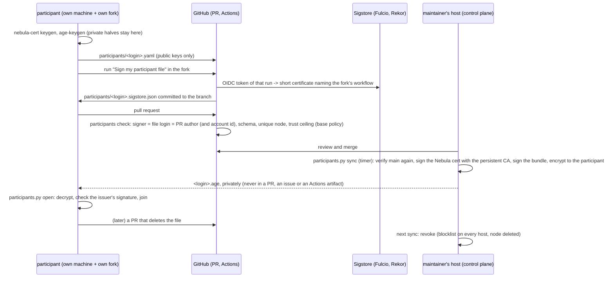

# participants/: join by signed pull request

The regulars of a game (**persistent participants**, trust `friends`) join by a pull request that adds one file, signed with
**cosign keyless** from a workflow in their own fork. The maintainer approves by merging. Nothing secret is ever in this repository or in
GitHub: the file holds only **public** keys, the Nebula CA and the issuer's signing key stay on the maintainer's host, and the bundle travels
encrypted to a key only the participant has. Design: [DESIGN.md section 5.1](../docs/DESIGN.md#51-who-may-join-and-how). Issue #12.

**State (2026-10-28): built and tested as a proof of concept** (`make poc-participants`, 33 checks, offline against a local TEST CA;
`make poc-participants-e2e`, a real join and its revocation on Incus VMs). On every pull request CI checks the participant files against the public Sigstore
(`.github/workflows/participants.yml`) and runs the same verification code on a blob it signs keyless itself (`participants-live`). **Not
done yet:** no participant has signed from a real fork (issue #12 stays open for it), and `issuer.pub` is not published (the maintainer
publishes it when the flow opens).



## The file: `participants/<login>.yaml`

`<login>` is your GitHub login in lower case. Every key below is required and nothing else is accepted (duplicated keys are refused too):

```yaml
apiVersion: k8s-lan-party/v1
kind: Participant
github: alice                 # your login, lower case: the file's own name
github_id: 1001               # your numeric account id: gh api users/<login> --jq .id
node: alice-pc                # 2-20 chars, a-z 0-9 -, unique, never issued before on this host
trust: friends                # the only trust a pull request gives (own is the maintainer's own machines, never by PR)
resources: {cpu: 2, memory_gib: 4}
nebula_public_key: |          # nebula-cert keygen -out-key host.key -out-pub host.pub; paste host.pub, keep host.key
  -----BEGIN NEBULA X25519 PUBLIC KEY-----
  ...
  -----END NEBULA X25519 PUBLIC KEY-----
recipient: age1...            # age-keygen's public key, or "ssh-ed25519 AAAA..." without a comment: your bundle is encrypted to it
```

`github_id` binds the file to your account, not only to your login: a renamed login that somebody else registers later does not inherit
your place (the certificate carries the owner's account id, and a change of `github_id` in an existing file is refused).

## How to join, step by step

On your own Linux machine (the one that will be the node), with `nebula-cert`, `age` and `cosign` installed (the versions in
`poc/stack.env`):

```bash
# 1. your keys; the private halves never leave this machine
mkdir -p ~/k8s-lan-party-keys && cd ~/k8s-lan-party-keys
nebula-cert keygen -out-key host.key -out-pub host.pub
age-keygen -o age.key            # prints "Public key: age1..."
# 2. fork the repository on GitHub (keep the name k8s-lan-party), enable Actions in the fork, then in your clone of the fork:
git checkout -b join
$EDITOR participants/<login>.yaml   # the file above
python3 poc/participants.py lint participants/<login>.yaml
git add participants/<login>.yaml && git commit -s -m "feat(participants): <login> joins" && git push -u origin join
# 3. in the fork: Actions -> "Sign my participant file" -> Run workflow on branch join, tick the DCO box.
#    It commits participants/<login>.sigstore.json to the branch.
git pull
# 4. open the pull request against villadalmine/k8s-lan-party (fill the template: Kind code, Scope small).
#    The "participants" check must be green; then the maintainer reviews and merges.
```

After the merge the maintainer's host issues your bundle and sends you `<login>.age` privately (e-mail or a direct message: the file is
useless to anybody without your `age.key`). Then:

```bash
python3 poc/participants.py open <login>.age --identity ~/k8s-lan-party-keys/age.key \
  --issuer-pub participants/issuer.pub --out ~/k8s-lan-party-bundle --key ~/k8s-lan-party-keys/host.key
sudo edge-mesh join ~/k8s-lan-party-bundle --accept-golden-rule
```

`open` refuses a file that is not signed by `participants/issuer.pub` **from the repository**: anybody can encrypt something to your
public key, only the maintainer can sign it. Manual equivalent: `age -d -i age.key <login>.age | tar x`, then
`cosign verify-blob --key participants/issuer.pub --bundle bundle.tar.sigstore.json bundle.tar`, then `tar xf bundle.tar`.

**Leaving:** a pull request that deletes both of your files (you or the maintainer may open it). The next sync after the merge revokes
your certificate: it goes on the Nebula blocklist of every host and your node is deleted. Your node name is never issued again.

## What the check refuses

| Refused | Why |
| :--- | :--- |
| a signature by another identity, another account id, another workflow or another OIDC issuer | the certificate must name `https://github.com/<login>/k8s-lan-party/.github/workflows/sign.yml@refs/heads/...`, issuer GitHub Actions, owner id = `github_id` |
| no `.sigstore.json`, or a file changed after it was signed | unsigned or tampered |
| a pull request by somebody other than `<login>` that adds or changes `<login>.yaml` | a valid signed file replayed by another account |
| `trust: own` or `public` | `own` puts a node where the maintainer's private pods run (groups `own,control-plane`, no taint): only the maintainer's own machines, joined with `mesh host init`, never through a pull request (also refused when issuing); `public` is the automatic demo |
| a removal by an account that is not the file's `github_id` | a renamed login re-registered by somebody else cannot remove you |
| a node name, Nebula key or recipient somebody else has; a reserved name | unique |
| a join pull request that changes anything else | one concern per pull request |
| deleting somebody else's file | only that participant or the maintainer |

## For the maintainer: the issuing side

`policy.yaml` is yours: who the maintainers are, the trust a pull request gives (`friends`, nothing else), reserved names, the certificate
duration and the participants' Nebula range. A pull request is always judged by the policy **on its base branch**, and only a maintainer's
pull request may change it. A broken policy on main makes `sync` do nothing (no mass revocation).

On the control plane host, from a timer (every minute or so), in a clone of the repository that only fetches:

```bash
git -C ~/k8s-lan-party fetch -q origin
COSIGN_PASSWORD=... python3 ~/k8s-lan-party/poc/participants.py sync --repo ~/k8s-lan-party --ref origin/main \
  --issuer-key ~/issuer/cosign.key
```

`sync` verifies every new or changed file on main again (it does not trust the CI result), revokes what is gone, changed in a way the
certificate depends on, or no longer passes the policy (`mesh host revoke`), issues what is new (`poc/issue.sh` with the participant's own
public key: no private key is ever made for them) and writes `participants-outbox/<login>.age` (0600, in a 0700 directory). It is
idempotent: a second run prints `sync: issued 0, revoked 0`. A file whose exact bytes were verified before is not sent to Sigstore again, so
an unreachable Sigstore never reads as "every participant left". Make the issuer key once with `cosign generate-key-pair` on that host and
publish `participants/issuer.pub` by a pull request; the private key and the Nebula CA never go to GitHub.

## Known gaps (2026-10-28)

- **The join token lives 8 minutes** (`TOKEN_TTL`, a security limit of the PoC: [DESIGN.md section 5](../docs/DESIGN.md#5-credentials-at-join)),
  so a bundle delivered by e-mail is usually stale by the time it is used: a fresh token on request is not built yet.
- **Renewal:** the certificate lasts `cert_duration` (two weeks); renewing it under the same node name is not built (a changed key or
  node name revokes and issues under a new name).
- **The live path has not run end to end with a real fork:** no participant has signed a file with `sign.yml` yet (it needs a second GitHub
  account; issue #12 stays open for it). The `participants-live` job runs the same verification code against the public Sigstore on a blob
  it signs keyless itself; the offline suites use a local TEST CA. The `participants` checks become required only after that first real run.
